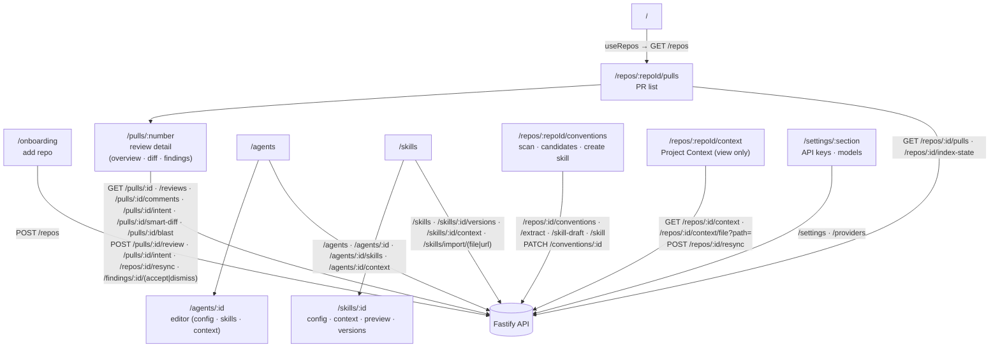

# `@devdigest/web` — the studio (Next.js 15)

The DevDigest UI: import repos, browse pull requests, run and read AI reviews,
and author agents. App Router + React Server/Client components, data via
**TanStack Query** hooks over the Fastify API. (This is the starter surface;
course lessons add the Skills, Memory, Eval, Blast/Brief, multi-agent, CI, and
dashboard screens.)

- **Stack:** Next.js 15 (App Router), React 19, TanStack Query, `next-intl`
  (messages in `messages/<locale>/*.json`), `recharts`, `mermaid`,
  `react-markdown`. UI primitives are vendored under `src/vendor/ui`
  (`@devdigest/ui`) and shared Zod contracts under `src/vendor/shared`
  (`@devdigest/shared`).
- **API base:** `NEXT_PUBLIC_API_BASE` (default `http://localhost:3001`), used by
  `src/lib/api.ts`. Every data hook lives in `src/lib/hooks/*`.
- **Run:** `pnpm dev` (`:3000`). **Test:** `pnpm test` (vitest + jsdom, fetch
  mocked — no API needed). **Typecheck:** `pnpm typecheck`.

## UI route map

Routes (`src/app/**/page.tsx`) and the API surface each leans on (via
`src/lib/hooks/*` → `src/lib/api.ts`):

The PR page (`/repos/:repoId/pulls/:number`) also shows the PR's derived intent (L03):

- **`IntentCard`** sits at the top of the **Overview** and **Agent runs** tabs, so it precedes
  the review results. It shows the summary, the in-scope and out-of-scope lists, risk areas, a
  confidence badge, the sources it was derived from (an unreadable one is marked *not read*,
  with a warning when a linked issue or document could not be read), and a re-run button. With
  no stored intent it shows **Derive intent**. Model-derived text is rendered as plain text
  nodes only.
- **`FindingCard`** shows an *Outside PR scope* badge on a finding the reviewer tagged
  `out_of_scope` (with the filter on, only a serious one survives).
- **The run trace drawer** adds a badge with the number of out-of-scope findings filtered.

The **Overview** tab also shows the **Blast radius** block (L04, `BlastRadiusCard`), above the
description, for what the PR's changes can reach. It renders one answer of `GET /pulls/:id/blast`
without regrouping or recounting it:

- **Summary row.** Four numbers — changed symbols, callers, endpoints, cron jobs — taken from the
  response's `totals`.
- **Tree view** (default). One group per changed symbol that has callers, in the server's order: its
  callers as `file:line` (a link to that line on GitHub at the indexed commit, falling back to the PR's
  head, opening in a new tab; plain text when the repository name is unknown) with the calling symbol
  beside it, then the endpoints as chips, and the cron jobs as chips in a separate list. A group at the
  server's per-symbol caller limit shows `+` after its count. A closing line counts the changed symbols
  that have no callers.
- **Graph view.** `?blast=graph` (see [`docs/ui-architecture.md`](docs/ui-architecture.md) → "URL
  state") draws the same data as an inline SVG in three columns: changed symbols, callers, endpoints and
  crons. An edge joins a caller to each changed symbol it reaches and a changed symbol to each of its
  endpoints and crons; no edge joins a caller to an endpoint, because the response attributes endpoints to
  the symbol's group, not to a caller. It scrolls sideways inside the block.
- **States.** Loading skeleton; a load failure with *Try again*; no stored files for the PR (only the
  note); no symbols declared in the changed files; symbols without callers.
- **Incomplete maps.** A response with `degraded: true` shows a note with the sentence of its
  `reason`, and the map stays under it. For `index_partial`, `index_failed` and `no_data` the note also
  holds a **Resync index** button: it starts `POST /repos/:id/resync`, waits for the index row to change
  and reads the map again ([`docs/data-flow.md`](docs/data-flow.md)).

The **Files changed** tab (`?tab=diff`, `DiffTab`) is the Smart Diff view (L03):

- **Groups by role.** Files sit under five headers in the order the API returns them — Core,
  Tests, Wiring, Docs, Boilerplate — each with a one-line hint and its file count; a role with no
  file has no header. Docs and Boilerplate start collapsed, with their file cards collapsed too. A
  file the grouping response does not mention is listed after the last group, so none disappears.
- **Findings inside the diff.** The tab draws the findings of the newest review of each agent: a
  dot on the file card, a coloured stripe and a severity word (`blocker`, `warning`, `suggestion`)
  on the line, the `FindingCard` under its line with Accept and Dismiss, and a **Findings outside
  the diff** block at the end of a file for a finding whose line is not in the patch. A dismissed
  finding keeps its card but stops counting. Each group header shows how many of its files have a
  counted finding.
- **One switch** — *Hide comments (N)* / *Show comments (N)*, with N the GitHub comments plus the
  counted findings of the PR's files — hides the GitHub threads and the finding cards together;
  dots, stripes and tags stay. It appears only when N is above 0.
- **Order.** **Smart order** (default) or **Original order**; the choice is `?order=original` in the
  URL (see [`docs/ui-architecture.md`](docs/ui-architecture.md) → "URL state"). If the grouping
  request fails, the tab shows the flat list with a muted line saying so. A PR with no review shows
  a muted *No review has run yet* line.
- **Fresh after a run.** The marks refresh when a run ends, on any tab, and after Accept, Dismiss
  and deleting a review or a run ([`docs/data-flow.md`](docs/data-flow.md)).

**Project Context (L05)** lets a review use the repository's own markdown documents. The server
finds them in the repository's clone; the UI has three places for them
([`../docs/project-context.md`](../docs/project-context.md) follows a document across the packages):

- **The Project Context page** (`/repos/:repoId/context`, the **Project Context** item of the sidebar's
  Workspace section, `ProjectContextView`) is view only: no control creates, uploads, edits or
  deletes a document. It is a full-height two-pane layout (design N6). The left column has a header
  with the repository and a **Refresh** icon button, a filter (a case-insensitive path substring), the
  documents with their path, a kind badge and `≈ N tokens`, and a footer with the file and token
  totals of the whole list, which the filter does not change. The right column previews the selected
  document through `SafeMarkdown`, with its "Used by N agents (V via skill) · M skills" line (the
  parenthesis only when V is above 0); with nothing selected it shows "Select a document to preview it".
  The selection is `?path=` in the URL. **Refresh** reads the list again. A list cut by the server
  shows "Showing the first N documents". Other states, shown in the right column: a loading skeleton;
  a load failure with *Retry*; *Repository not cloned yet*; and, when no document is found,
  *No markdown under specs/, docs/ or insights/ in <repository>* (the folders are the server's
  configured search roots) with a **Resync** button. Resync only starts `POST /repos/:id/resync`; it does
  not wait, and the list is read again with Refresh.
- **The Context tab** of an agent (`?tab=context`, heading "Project context") and of a skill (`?tab=context`,
  heading "Project context to use") is one shared component, `ContextAttachList`
  (`src/components/context-attach-list`), fed by each owner's own hooks. It lists every document of the
  active repository: the attached ones first in the order the user saved, then the rest by path. An
  attached path that the clone no longer has stays in its place, marked *not found in <repository>*, and
  can be detached. A checkbox attaches (the document goes to the end of the list) or detaches; a drag
  handle, or the keyboard, reorders the attached rows, and reordering is off while the filter is in use.
  A document that is too large or cannot be read cannot be newly attached. The total of the attached
  tokens turns critical with an *over 4K soft cap* badge above the server's soft cap, and above the run cap
  a note names the attached documents a run would skip. **Preview** opens a drawer with the content, the
  "Used by" line and an Attach / Attached toggle; **Esc** closes it. Every change saves at once (see
  [`docs/data-flow.md`](docs/data-flow.md)). With no repository the tab links to onboarding.
- **The run trace drawer** shows what a run inserted. *Specs read* lists the inserted paths with
  `≈ N tok`. Under *Prompt assembly*, the **Project context** block holds the whole section as sent
  and one block per inserted document with its full text; the skipped documents are listed under it
  as *path — reason*. The block is shown only when the run sent a section and inserted a document.
  When every attached document was skipped (for example the repository has no clone), no block is
  shown and the skipped list stands alone, titled *Project context — skipped documents*. A trace
  recorded before the feature shows none of this. All of it is plain text.

Document text is untrusted, so previews use `SafeMarkdown` (`src/components/safe-markdown`) rather
than the vendored `Markdown`: raw HTML is shown as text and only `http:` and `https:` links are
clickable, opening in a new tab with `rel="noopener noreferrer"`.

Cross-cutting chrome lives in `src/components/app-shell` (nav, breadcrumbs,
`g`-then-key shortcuts). Pages are thin; feature logic sits in colocated
`_components/<Name>/` folders, each with its own `*.test.tsx`.

## Testing

Component/interaction tests (`*.test.tsx`) run under vitest + jsdom with `fetch`
mocked, so they need neither the API nor a browser. The real browser journeys
(client + API + seeded DB) are covered by the deterministic agent-browser suite
in [`../e2e`](../e2e/README.md) and the `e2e-web.yml` workflow. See
[`../TESTING.md`](../TESTING.md).
