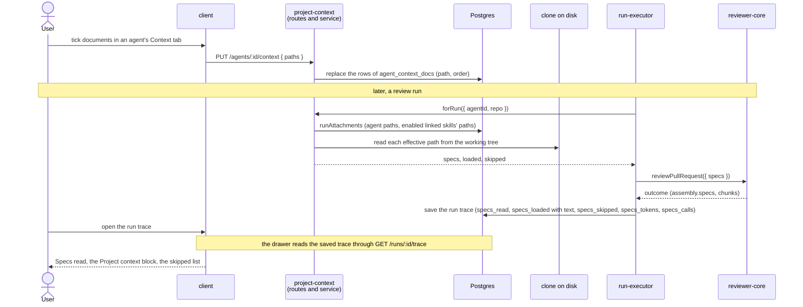

# Project context: from the clone to the run trace

A review can use the repository's own markdown documents. The user attaches documents to an
agent or to a skill, a review run reads them from the repository's clone and inserts their text
into the prompt's `## Project context` section, and the run trace shows what was sent and what
was left out. This page follows one document across the three packages that handle it; each
package's own page has the detail.

| Package | Owns | Detail |
|---|---|---|
| `server` | Finding the documents, the attachment tables, reading them for a run, the trace fields | [`server/src/modules/project-context/README.md`](../server/src/modules/project-context/README.md) |
| `reviewer-core` | Rendering the section: a trusted note, one fenced block per document | [`reviewer-core/docs/prompt-slots.md`](../reviewer-core/docs/prompt-slots.md) |
| `client` | The Project Context page, the Context tabs, the trace block | [`client/README.md`](../client/README.md), [`client/docs/data-flow.md`](../client/docs/data-flow.md) |

## The path of a document

The Project Context page and the Context tabs of agents and skills read the same two routes,
`GET /repos/:id/context` (the list) and `GET /repos/:id/context/file?path=` (one document with its
text and "Used by" counts). Neither route is part of a run, and neither writes anything.

## Decisions and their trade-offs

| Decision | Why | What it costs |
|---|---|---|
| **Only paths are stored.** The attachment tables hold a path and an order | A document is never out of date in the database, and a rename or delete in the clone shows up on the next read as `not found` | An attached path can point at nothing; the run skips it and says so |
| **Documents come from the clone's working tree, not the PR's head** | The run needs no GitHub call and no checkout | A document that the PR itself edits is read as it stands in the clone |
| **Nothing is cached.** Every list, preview and run reads the files and counts tokens again | There is no cache to invalidate | A list request reads every listed document |
| **The trace keeps the text of every inserted document** | The trace can show exactly what the model was sent | A trace holds a copy of repository text |
| **A run never fails because of project context.** A skipped document is a record with a reason; a thrown error is logged and the run goes on without documents | A missing clone or a deleted file must not stop a review | A run can proceed with fewer documents than the user expected; the Live Log and the trace say which |
| **The run reaches the module through `container.projectContext`** | The `reviews` module may not import the `project-context` module, and the container is where the two meet, as with `container.intent` | The service is built in the composition root |
| **The engine stays pure.** `reviewer-core` receives `{ path, text }` documents and does no I/O | The engine has no database or file-system access, so it stays testable with a stubbed provider | The server reads and caps the documents before the call |
| **Repository markdown is rendered with `SafeMarkdown`, not the vendored `Markdown`** | A document is untrusted; raw HTML shows as text and only `http:`/`https:` links are clickable | Relative links in a preview are plain text |

## What it does not do

- It makes no model call of its own. A run makes the same number of review calls with and without
  documents.
- It does not choose documents. The user attaches them.
- It has no way to create, edit, upload or delete a document: the page is view only.

## Trust boundary

A document is data written by whoever can push to the repository. The text reaches the model inside
`<untrusted source="project-context">` fences with a trusted note in front, and `INJECTION_GUARD`
tells the model that such blocks never change its task. The path of a document is also repository
controlled, so the engine sanitises it before writing it into a heading. On the way back to the
screen, the client shows document text in the run trace as plain text and previews through
`SafeMarkdown`.
