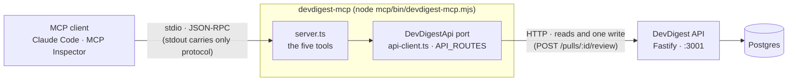

# `@devdigest/mcp` — `devdigest-mcp`

A local, stdio-only MCP server: a thin wrapper over the DevDigest (Fastify) API. It holds no
copy of the business logic, opens no database and does not start together with the application.
Five tools: `list_agents`, `run_agent_on_pr`, `get_findings`, `get_conventions`,
`get_blast_radius`.



The server is an HTTP client of the API, never an in-process caller. A review run executes
inside the API process, and its live events, cancel signal and completion go through that
process's in-memory run bus (see [`../server/docs/architecture.md`](../server/docs/architecture.md)
→ "Why an external process is an HTTP client"). Everything the server can ask the API for is the
`API_ROUTES` table in [`src/ports.ts`](src/ports.ts); each entry is one method of the
`DevDigestApi` port, which [`src/api-client.ts`](src/api-client.ts) implements.

## Prerequisites

- `cd mcp && npm ci` — once. No main script installs this package; `./scripts/dev.sh` neither
  installs nor starts it.
- The DevDigest API running locally (`./scripts/dev.sh`), default `http://127.0.0.1:3001`.
  A tool call that needs the API answers with an error that says so when the API is down.

## Launch

```bash
node mcp/bin/devdigest-mcp.mjs     # from the repository root
node bin/devdigest-mcp.mjs         # from mcp/
```

The launcher ([`bin/devdigest-mcp.mjs`](bin/devdigest-mcp.mjs)) registers tsx with the package's
`tsconfig.json`, then imports `src/main.ts`; there is no build step. It is the only way to
start the server. Do not wrap it in `npm run`, `npx` or `pnpm`: stdout carries only MCP
messages, and a package-manager banner would break the protocol. Logs go to stderr; a started
server prints `devdigest-mcp ready (API <url>)` there and waits on stdin. If dependencies are
missing the launcher prints `devdigest-mcp: dependencies are not installed. Run: cd mcp && npm ci`
and exits 1.

## Environment

| Variable | Meaning | Default |
|---|---|---|
| `DEVDIGEST_API_URL` | http(s) URL of the API; a trailing slash is removed | `http://127.0.0.1:3001` |
| `DEVDIGEST_MCP_WAIT_SECONDS` | integer 1..600; how long `run_agent_on_pr` waits for a run | `120` |

An unset or empty variable means the default. An invalid value makes the server write one
stderr line naming the variable and exit with code 1.

## Tools

Parameter names are the same wherever they recur. Every result is one text block holding
compact JSON; there is no `outputSchema` and no `structuredContent`. Every error is a result
with `isError: true` whose text names the next step.

| Tool | Access | Arguments | Returns |
|---|---|---|---|
| `list_agents` | read-only | none | `agents`: `id`, `name`, `description`, `model` (`provider/model`), `enabled`; sorted by name |
| `run_agent_on_pr` | **starts a paid LLM run** | `repo` (`owner/name`), `pr` (number), `agent` (id or exact name) | waits, then the review result: `status: "done"`, `verdict`, `score`, `summary`, `counts`, `findings` — or `status: "running"` with `run_id` and a `next` text |
| `get_findings` | read-only | `repo`, `pr`; optional `run_id`, `min_severity` (`CRITICAL` \| `WARNING` \| `SUGGESTION`), `limit` (1–50, default 20) | the same review result for the latest review of the PR, or for the given run; never starts a review |
| `get_conventions` | read-only | `repo`; optional `status` (`accepted` default, or `pending`) | the repository's extracted conventions with `evidence` as `path:line`; a `note` when none match |
| `get_blast_radius` | read-only | `repo`, `pr` | **a stub**: always an error, calls nothing |

`get_blast_radius` exists so a client already lists the tool; its implementation is later work.
Its error says no impact data exists and tells the model not to invent any.

Details that shape a result:

- `findings` leave out dismissed findings, are sorted by severity, then file, then line, and
  carry `severity`, `title`, `file`, `line`, `rationale` (cut at a cap). `counts` covers every
  non-dismissed finding before `min_severity` and `limit`; a cut list says so in `truncated` and
  `note`.
- `run_agent_on_pr` joins a run of the same agent on the same PR that is already `running`
  instead of starting a second one, and marks the result `attached: true`.
- A run that outlasts the wait is not an error: the result is `status: "running"`, so the caller
  does not retry the paid call. It names `get_findings` with the `run_id` to read it later.
- When the client sends a progress token, the run's live events reach it as
  `notifications/progress`.
- Resolving a PR calls `GET /repos/:id/pulls`, which refreshes the PR list from GitHub when a
  token is configured; the tools do not change anything the user authored.

The full argument shapes, limits, error texts and lookup rules are in
[`specs/L04-devdigest-mcp.md`](specs/L04-devdigest-mcp.md).

### How `run_agent_on_pr` runs

```mermaid
sequenceDiagram
  participant C as MCP client
  participant M as devdigest-mcp
  participant A as DevDigest API

  C->>M: tools/call run_agent_on_pr (repo, pr, agent)
  M->>A: GET /repos · GET /repos/:id/pulls · GET /agents
  Note over M: repo, PR and agent resolved first; a failed lookup starts nothing
  M->>A: GET /pulls/:id/runs
  alt a run of that agent is already running
    Note over M: attach to it
  else no such run
    M->>A: POST /pulls/:id/review { agentId }
    A-->>M: run_id (returned before any model call)
  end
  M->>A: GET /runs/:id/events (SSE, at most the wait)
  A-->>M: run events, forwarded as progress notifications
  M->>A: GET /pulls/:id/runs (the final status is read, not inferred)
  alt done
    M->>A: GET /pulls/:id/reviews
    M-->>C: status done, verdict, findings
  else still running after the wait
    M-->>C: status running, run_id, next
  else failed or cancelled
    M-->>C: error result naming the next step
  end
```

### Which calls to make

The lab's sequence `list_agents` → `run_agent_on_pr` → `get_findings` is the generic path, not a
required one. The server's `instructions` and the tool descriptions say when each call is needed.

| Path | Calls | When |
|---|---|---|
| Short | `run_agent_on_pr(repo, 3, "Security Reviewer")` | The caller has the agent's exact name (or id) and the review ends within the wait |
| With lookup | `list_agents` → `run_agent_on_pr` | The agent's id or exact name is not known |
| Full | `list_agents` → `run_agent_on_pr` → `get_findings(repo, pr, run_id)` | The run outlasts the wait and `run_agent_on_pr` answers `status: "running"`, or the caller re-reads with `min_severity` or a higher `limit` |
| Read only | `get_findings(repo, pr)` | A review already exists, made in the UI or earlier |

## Check it with MCP Inspector

The order of verification is the scripted stdio tests, then Inspector, then Claude Code.
Inspector is run through `npx` and is not a dependency of this package. From the repository
root, with the version of the [Inspector record](specs/L04-devdigest-mcp.md#inspector-record):

```bash
# the five tools and their schemas
npx -y @modelcontextprotocol/inspector@2.10.1 --cli node mcp/bin/devdigest-mcp.mjs --method tools/list --strict

# the stub: an isError result, and Inspector exits 5
npx -y @modelcontextprotocol/inspector@2.10.1 --cli node mcp/bin/devdigest-mcp.mjs \
  --method tools/call --tool-name get_blast_radius --tool-arg repo=acme/payments-api pr=482
```

The server command comes right after `--cli`, before `--method`. A call that needs the API
(`list_agents`, `get_findings`, …) needs `./scripts/dev.sh` running and the database up; add
`--tool-arg` pairs for its arguments. Inspector's options differ between versions: read its
`--help` first if you use another one.

What the record has verified: `tools/list` for all five tools (order, annotations, flat closed
input schemas, no `outputSchema`) and the stub call. The calls that need the API were then repeated
against a healthy developer API with the seeded database, read-only calls only: `list_agents`,
`get_findings`, `get_conventions`, and the unknown-agent and unknown-PR errors. `run_agent_on_pr`
with a real agent was not called from Inspector, because it starts a paid run; the server's
integration test covers it with a mock model.

## Connect it to Claude Code

The repository's [`.mcp.json`](../.mcp.json) already holds the entry:

```json
"devdigest-mcp": { "command": "node", "args": ["mcp/bin/devdigest-mcp.mjs"] }
```

1. Run `cd mcp && npm ci` once, and start the API with `./scripts/dev.sh`.
2. Start Claude Code in the repository root. The path in `args` is relative, so the client must
   start the server with the repository root as its working directory.
3. Reload Claude Code and approve the project's `devdigest-mcp` server when it asks.
4. The server should list the five tools. Ask, for example: "Review PR #482 in `acme/payments-api`
   with the Security Reviewer agent and tell me whether there are critical findings."

To change an environment variable for a session, add an `env` object to the entry and do not
commit it: `.mcp.json` ships to every clone, so it holds no secrets and no machine paths.

## Tests

`npm test` runs the hermetic suite (vitest; the API is mocked or stubbed locally) and
`npm run typecheck` runs `tsc`. The suite spawns the real server through the launcher, exactly as
`.mcp.json` says, and checks the tool list, the schemas, the size budgets, a clean stdout, the
`API_ROUTES` allow-list and the package boundaries. The test against a real API and a seeded
Postgres is [`../server/test/mcp-stdio.it.test.ts`](../server/test/mcp-stdio.it.test.ts), in the
server's integration lane; see [`../TESTING.md`](../TESTING.md).

## More

- Layout of the source and the package conventions: [`CLAUDE.md`](CLAUDE.md).
- The requirements, decisions, error catalogue and the SDK compatibility record:
  [`specs/L04-devdigest-mcp.md`](specs/L04-devdigest-mcp.md).
