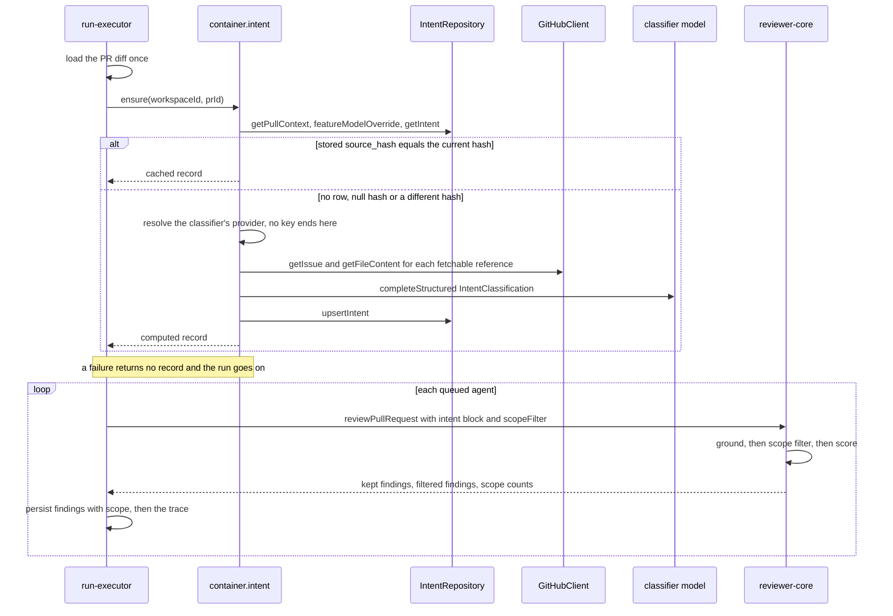

# Server architecture

How the engine is wired beyond a single request: what the DI container owns, how a review run
travels from the HTTP call to persisted findings, how live events reach the browser, and which
module writes which tables. The request pipeline (plugins → validation → module → service →
container → adapters) is drawn in [`../README.md`](../README.md) → "Request & DI flow", and what
the model is actually sent is in its "Review context" section; neither is repeated here.

## The container

`src/platform/container.ts` is built once per app in `buildApp` (`src/app.ts`) and exposed as
`app.container`. Everything external is resolved through it, which is what lets a test swap in
`src/adapters/mocks.ts` by passing `overrides` (per-provider `llm`, `github`, `git`, `embedder`).

| Kind | Members | Notes |
|---|---|---|
| Built at construction | `config` `db` `secrets` `auth` `jobs` `runBus` | `runBus` is the process-wide singleton from `src/platform/sse.ts` |
| Lazy getters | `git` `agentsRepo` `reviewRepo` `intent` `projectContext` `codeIndex` `repoIntel` `depgraph` `tokenizer` `httpFetch` `cloneFiles` `priceBook` | created on first use, then reused |
| Plain getter | `repoIntelLimits` | returns `{ callersPerSymbol }`, the facade's `MAX_CALLERS_PER_SYMBOL`; nothing is created |
| Async, need a secret | `github()` · `llm(provider)` · `embedder()` | cached after the first call; a missing key throws `ConfigError` **at resolve time**, which is why the server boots with no keys at all |

- `llm('openrouter')` is `reviewer-core`'s `OpenRouterProvider`, with the container's `priceBook`
  injected: live OpenRouter prices, falling back to the static table.
- `intent` is the `IntentService` (`modules/intent/service.ts`), built here from narrow
  dependencies — an `IntentRepository`, the lazy `github()` and `llm(provider)` resolvers, and
  `tokenizer` — rather than inside its module. The `reviews` run needs it too, and a module
  never imports another module, so the container is where the two meet.
- `projectContext` is the `ProjectContextService` (`modules/project-context/service.ts`), built the
  same way as `intent`: from a repository, a unit of work, the `cloneFiles` and `tokenizer` getters
  and the configured search roots. The `reviews` run calls its `forRun`, and the module's own routes
  call the rest, so the container is where the two meet. `cloneFiles` is the only file-system access
  of the feature (`FsCloneFiles` over `config.cloneDir`); a test replaces it with `MockCloneFiles`
  through `ContainerOverrides.cloneFiles`, and `projectContext` then reads through the mock.
- `repoIntelLimits` exists so the `blast` module can state the facade's per-symbol caller cap in its
  response (`caller_limit`) without importing `modules/repo-intel/constants.ts`. The container is the
  composition root and already imports that module; the `blast` module reaches the number through
  this getter and the facade through `repoIntel`, both from its `routes.ts`.
- `embedder()` is gated by config: when embeddings are disabled it throws before creating a
  client, so the app makes no OpenAI requests.
- After a key changes in Settings, `invalidateSecretCaches()` drops the cached LLM, GitHub and
  embedder clients so the next call picks up the new key.

## A review run, end to end

1. **Queue.** `POST /pulls/:id/review` → `ReviewService.runReview`
   (`src/modules/reviews/service.ts`) creates one `agent_runs` row per target agent, status
   `running`, and returns their ids **immediately**. Every run in a batch therefore has
   effectively the same `ran_at` (queue time, milliseconds apart), not the time it started.
2. **Detach.** `ReviewRunExecutor.executeRuns` (`run-executor.ts`) is started fire-and-forget. The
   HTTP response doesn't wait for it; if it crashes outright, that is only logged.
3. **Shared pre-work, once per batch.** The PR diff is loaded one time, then the PR's derived
   intent is ensured through `container.intent` (see [Intent in a review run](#intent-in-a-review-run)).
   A single `RunLogger` fans every event out to all queued runs, so each run's live log and trace
   start with the same pre-work lines. If the diff can't be loaded, **every** queued run is marked
   `failed` with that error. A failed intent never fails a run.
4. **Agents run one after another**, in queue order, not in parallel. For each, `runOneAgent`:
   - resolves its LLM via `container.llm(agent.provider)`;
   - if the agent's `repo_intel` toggle is on, adds repo-intel context (callers of the changed
     symbols, the repo map, the "top-ranked files" note);
   - asks `container.projectContext.forRun` for the documents attached to the agent and to its
     enabled skills (see [Project context in a review run](#project-context-in-a-review-run));
   - renders the intent record into the prompt block and decides whether the scope filter runs;
   - calls `reviewer-core`'s `reviewPullRequest` (prompt → LLM → grounding → scope filter → score);
   - persists the review and its findings (each with the reviewer's `scope` tag), marks the PR
     reviewed at its head SHA;
   - writes the per-run summary onto the `agent_runs` row in **one** `completeAgentRun` call
     (tokens, cost, findings count and per-severity breakdown, score, blockers);
   - saves the whole run log as one `run_traces` document and completes the run on the bus.

   One agent failing does not stop the next. A slow agent delays every agent queued after it,
   and each run's `duration_ms` covers only its own agent.
5. **Failure or cancel.** `runOneAgent` catches and writes status `failed` / `cancelled` with the
   error text. Tokens and `findingsCount` are zeroed and grounding reads `0/0 passed`; cost,
   score, blockers and the per-severity breakdown stay `null`. It then saves the trace and
   completes the run on the bus.

## Intent in a review run

The intent is **shared pre-work**: `ReviewRunExecutor.deriveIntent` calls
`container.intent.ensure` once per batch, after the diff is loaded and before the first agent
(`run-executor.ts`). The classifier is a second model call, separate from every agent's review
call; what it reads and how it decides is in
[`../src/modules/intent/README.md`](../src/modules/intent/README.md).

- **Never fatal.** `ensure` returns `computed`, `cached` or `unavailable` (a missing provider key,
  a model failure, a timeout, an answer cut off at the output limit or one that does not match the
  schema) and does not throw for those. On `unavailable` no row is written, the prompt gets no
  intent slot, the model is not asked to tag findings and no scope filter runs: agents run as they did before the
  feature. The executor publishes the step with `runLog.tool`, not `runLog.step`, because
  `step` emits an `error` event on a throw and the client turns every `error` event into a toast;
  an `error` event from the intent service is downgraded to `info` for the same reason.
- **Cache.** A stored intent is reused while its `source_hash` equals the hash of the prompt
  version, the classifier's `provider/model`, the head SHA, the title and the description. The
  seeded demo row has a null hash, so a review run always recomputes it. An edit to a linked issue
  or document alone does not change the hash; the card's **Re-run** covers that.
- **Per agent.** `renderIntentBlock` (`modules/reviews/domain.ts`) turns the record into the
  prompt text, capped at 2000 characters. `scopeFilterEnabled` is true only for a `high` or
  `medium` intent that is not injection-suspected; otherwise the block still tags findings and
  nothing is filtered. The run log says which: `Intent attached · … · scope filter on|off (…)`.
- **In the trace.** `tool_calls` starts with a `classify_intent` entry (`provider/model`, and
  `computed · tokens · cost`, `cached` or `unavailable (<reason>)`), followed by the review's own
  `review_file` entries. `stats.scope_filtered` counts the findings the filter removed and is
  `null` when it did not run. `prompt_assembly.intent` holds the text that was fenced, or `null`.
  The classifier's tokens and cost sit on its `pr_intent` row, not on `agent_runs`.
- **No lock.** Two batches started at once for the same PR both derive the intent and upsert the
  same key; the last write wins.

## Project context in a review run

The attached documents are resolved **per agent**, inside `runOneAgent`, after the agent's skills
and before the engine call. The step is `ReviewRunExecutor.resolveProjectContext`, a thin wrapper
around `container.projectContext.forRun`; the picking, reading and capping are in the service
([`../src/modules/project-context/README.md`](../src/modules/project-context/README.md)), and the path of
a document across the packages is drawn in [`../../docs/project-context.md`](../../docs/project-context.md).

- **Independent of repo-intel.** It runs whether the agent's `repo_intel` toggle is on or off.
- **No model call.** The engine makes the same number of review calls with and without documents.
- **Never fatal.** A document that cannot be used is a skip with a reason. If `forRun` throws, the
  run logs `Project context: unavailable (<message>)` and goes on with no documents. Every line is
  `runLog.info`, never `runLog.step`, for the reason given in "Intent in a review run".
- **In the trace.** `specs_read` lists the inserted paths. `prompt_assembly` gets `specs_loaded`
  (each document's path, origin, tokens and the text the engine received), `specs_skipped`,
  `specs_tokens` and `specs_calls`. A trace therefore holds a copy of the inserted document text.
  A run that fails writes the trace from the log buffer, with an empty `specs_read`.

## Live events: the run bus

`RunBus` (`src/platform/sse.ts`) is **in memory, in one process**:

- Each run has an event buffer. `GET /runs/:id/events` (SSE) replays the buffer, then streams new
  events; a run that has already completed replays and ends the stream at once.
- Nothing is persisted until the run finishes and its log is written to `run_traces`. A restart
  loses the buffers. Runs the dead process left `running` are marked `failed` by the reaper in
  `buildApp`, before the server accepts requests.
- It assumes a single API instance per database; replicas would need per-instance scoping.

**Cancellation** (`POST /runs/:id/cancel`) flags the run on the bus, sets the row to `cancelled`
(only if still `running`), and ends its stream. The engine checks the flag before each LLM call
(`reviewer-core/src/review/run.ts`). In map-reduce mode that stops between files. In
single-pass mode there is one call, so a run already inside it keeps going. When the call
returns, the success path writes `done`, because `completeAgentRun` updates the row without
checking its status. (Read from the code, not reproduced; see `../INSIGHTS.md` → Open Questions.)

## Why an external process is an HTTP client

`devdigest-mcp` ([`../../mcp/README.md`](../../mcp/README.md)) is a separate process that starts
and reads review runs, and it does so only over HTTP, against the running API. It never builds a
`Container`, never opens the database and never executes a run itself. Three properties of the
engine above make that the only safe shape:

| Property of the engine | What an in-process or second-process executor would break |
|---|---|
| A run executes inside the API process, started fire-and-forget by `POST /pulls/:id/review` | A run executed in another process would bypass the API's container, its run bus and its trace log |
| `RunBus` is in memory and per process | Events, the cancel flag and completion exist only where the run executes; a second process would stream and cancel an empty bus |
| The boot reaper marks every `running` row `failed`, assuming no other process owns one | A run owned by another process would be reaped as orphaned the next time the API restarts |

So the MCP process follows a run through existing routes only — `POST /pulls/:id/review` to queue
it, `GET /runs/:id/events` (SSE) to watch it, `GET /pulls/:id/runs` and `GET /pulls/:id/reviews`
to read the outcome — plus the read routes for agents, repos, pull requests and conventions. The
routes it can reach are a fixed table, `API_ROUTES` in
[`../../mcp/src/ports.ts`](../../mcp/src/ports.ts): one write (queueing a review) and no cancel,
delete or settings route. No route, contract or table was added for it.

Consequences worth knowing when changing the engine:

- The tool waits on the SSE stream for at most `DEVDIGEST_MCP_WAIT_SECONDS` (default 120 s), then
  reads the run's status from `GET /pulls/:id/runs`; it never infers the status from the end of the
  stream. A stream that breaks (for example when the API restarts) ends the wait, and the second
  read reports whatever the row says — `failed` once the boot reaper has marked it.
- The MCP process holds no run state between calls. If it is killed, or its client gives up on a
  call, the run keeps going in the API; it is not cancelled.
- A second call for the same agent and PR while a run is `running` joins that run instead of
  queueing another, so a retry after a timeout does not start a second paid run.
- A change to those three routes' response fields is a change to a client outside `server/`; the
  MCP package parses only the fields it uses and reports a mismatch as an error naming the route.

## Who writes which tables

| Module | Writes |
|---|---|
| `reviews` | `agent_runs` · `run_traces` · `reviews` · `findings` · `pull_requests` (review freshness only) |
| `intent` | `pr_intent` (reads `pull_requests` · `repos` · `pr_files` and the `feature_models` key of `settings`) |
| `project-context` | `agent_context_docs` · `skill_context_docs` (paths and order only; reads `repos` · `agents` · `skills` · `agent_skills`, and the clone's files through the `cloneFiles` adapter) |
| `smart-diff` | nothing — read-only (reads `pull_requests` · `pr_files` · `reviews` · `findings`; no GitHub, no model call) |
| `blast` | nothing — read-only (reads `pull_requests` · `pr_files` itself, and the index tables through one `getBlastRadius` and one `getIndexState` call on the `repo-intel` facade; no GitHub, no model call) |
| `pulls` | `pull_requests` · `pr_files` · `pr_commits` (GitHub import and backfill) |
| `polling` | `pull_requests` · `repos` |
| `repos` | `repos` |
| `repo-intel` | `symbols` · `references` · `file_edges` · `file_facts` · `file_rank` · `repo_map_cache` · `repo_index_state` |
| `agents` | `agents` · `agent_versions` · `agent_skills` |
| `settings` | `settings` |

Three read models sit on top:

- **Per run**, the timeline reads the summary columns on `agent_runs` and never joins `findings`.
- **Per PR**, `GET /repos/:id/pulls` computes on read: the latest review's `score`; the **total**
  cost of completed runs; and the latest completed run's findings breakdown plus its finding
  preview. The rules are in [`../specs/L01-run-cost.md`](../specs/L01-run-cost.md) and
  [`../specs/L01-findings-counter.md`](../specs/L01-findings-counter.md).
- **Per PR file list**, `GET /pulls/:id/smart-diff` groups the stored `pr_files` by role on read and
  marks the lines of the counted findings (the newest review of each agent, dismissed ones left out).
  It never reaches GitHub, so it works before the first review and on whatever the last import
  stored. `pr_files` has no position column and is read without an `ORDER BY`, so the domain sorts
  the files of each group by path. The route is in [`../README.md`](../README.md) → "API map"; the
  classifier is explained in
  [`../src/modules/_shared/file-role/README.md`](../src/modules/_shared/file-role/README.md).
- **Per PR blast map**, `GET /pulls/:id/blast` reads the PR's stored file paths and asks the
  `repo-intel` facade for the callers of the symbols declared in them, then groups, orders and counts
  the answer on read. It never touches the clone, GitHub or a model, and it stays read-only even when
  the index is stale or missing: the answer carries a `degraded` mark and a `reason` instead. Resyncing
  the index is a separate call (`POST /repos/:id/resync`). The route, the mark's resolution order and the
  contract are in [`../README.md`](../README.md) → "API map"; the facade's side is in
  [`../src/modules/repo-intel/README.md`](../src/modules/repo-intel/README.md).
