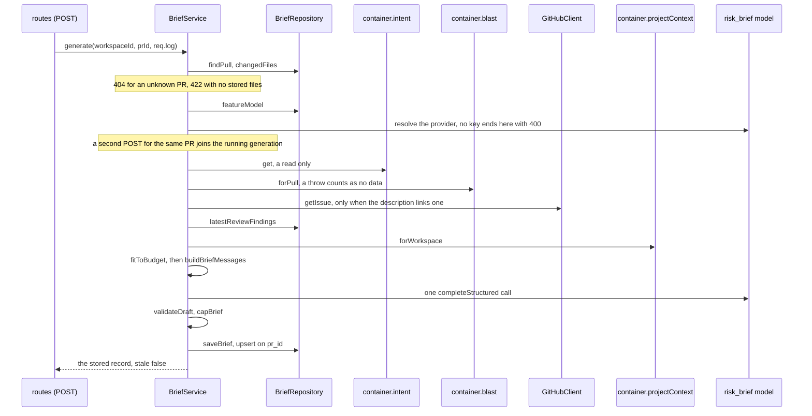

# `brief` — the PR's Why + Risk brief

`brief` writes one short, structured brief per pull request: a summary of what the change does and
why, the risks it carries and where a reviewer should read first. It makes **one** model call over
facts DevDigest already holds (the derived intent, the blast map, the changed files, the latest
completed review's findings, the description, a linked issue and the project documents), checks the
answer against the PR's own files, and stores it in `pr_brief` together with the head SHA it was
written for. The model is the Settings feature model `Risk Brief` (`risk_brief`; its default is in
`FEATURE_MODELS`, [`platform.ts`](../../vendor/shared/contracts/platform.ts)).

Two routes serve it. `GET` reads the stored brief and never calls a model or GitHub; `POST`
generates a new one. Nothing generates a brief on its own: a review run does not, and neither does a
new commit. The UI is the **PR Brief** section on the Overview tab
([`../../../../client/README.md`](../../../../client/README.md) → "UI route map"); the routes are in
[`../../../README.md`](../../../README.md) → "API map".

## Where things live

| File | Owns |
|---|---|
| [`domain.ts`](domain.ts) | The pure rules: the model's output schema, hunk ranges, the linked-issue pick, findings selection, the budget cuts, input statuses, validation and caps. Returns values, never throws |
| [`prompt.ts`](prompt.ts) | The two messages; every section built from repository, GitHub or model text sits in its own `<untrusted>` block |
| [`service.ts`](service.ts) | `BriefService`: `get`, `generate`, the one-per-PR in-flight map and the log lines |
| [`ports.ts`](ports.ts) · [`repository.ts`](repository.ts) | The store port and its Drizzle implementation; the structural ports for `intent`, `blast` and the project documents |
| [`routes.ts`](routes.ts) | `GET` and `POST /pulls/:id/brief`; `POST` carries the per-route rate limit (10 per minute) |
| [`constants.ts`](constants.ts) | The input budget, the output limit, the call timeout, the caps and the schema name |

The module imports no other module. It reaches the three services it needs through the container
and declares them as structural ports in `ports.ts`: `container.intent` (only its `get`, so a brief
never derives an intent), `container.blast` and `container.projectContext` (its `forWorkspace`).
`routes.ts` builds `BriefService` from those. `sanitizeText` and `capWords` come from
[`../_shared/text/plain-text.ts`](../_shared/text/plain-text.ts), where they moved from `intent` so
that both modules use one definition; `intent/domain.ts` re-exports them.

## Generating

The order is fixed, and the cheap failures come first: an unknown PR (`404`) or one with no stored
`pr_files` rows (`422`; a PR the studio has never opened has none) ends the request before a provider
is resolved, and a provider with no key (`400` `brief_unavailable`) ends it before any GitHub call.
Any PR status works: open, closed or merged.

**One generation per PR.** `generate` keeps a map from PR id to the running promise and deletes the
entry in a `finally`. A second `POST` for the same PR while one runs returns the first one's result,
or its error, and makes no model call of its own.

## Inputs and their statuses

The record lists one entry per input kind, always in this order, so the UI can say what the brief
was built without. `status` is `used`, `trimmed` or `missing`; `reason` explains a status that
needs a remark; `omitted` counts what a trim left out.

| Kind | `missing` when (reason) | `trimmed` / `used` |
|---|---|---|
| `intent` | no stored intent (`not_derived`) | `used`; reason `stale` when the stored intent is out of date |
| `blast_radius` | the map holds no changed symbol: its own degraded reason, else `no_data`. A failed read is `no_data` | `trimmed` / `over_budget` with the number of callers left out; else `used`, carrying the map's degraded reason if it has one |
| `diff_stats` | never | `trimmed` / `over_budget` with the number of files left out; else `used` |
| `description` | empty after sanitising (`empty`) | `trimmed` / `over_budget` when cut; else `used` |
| `linked_issue` | `none_linked`, `no_token`, `not_found` or `fetch_failed`; or the issue was dropped for the budget (`over_budget`) | `trimmed` / `over_budget` when its body was cut; else `used` |
| `spec_documents` | nothing attached to any enabled agent (`none_attached`); the repository is not cloned (`not_cloned`); every attached path was skipped (`all_skipped`); every document read was dropped for the budget (`over_budget`) | `trimmed` / `over_budget` with the number of documents left out; else `used` |

Two ties are broken in code (`recordInput` in [`domain.ts`](domain.ts)): `none_attached` wins over
`not_cloned`, and a trim wins over a degraded-but-used blast reason.

The **linked issue** is the first bare `#N` in the sanitised description (`findLinkedIssueNumber`).
`owner/repo#N`, an issue URL, an HTML entity such as `&#39;`, `foo#12` and `#0` do not count. It is
read once with `GitHubClient.getIssue` on the PR's own repository.

The **findings** come from the single newest `reviews` row of kind `review` for the PR, whatever
agent wrote it, **whose run is `done`**. A review row is written before its run is marked `done`, so
a review of a running, failed or cancelled run is skipped, and so is one with no run. Dismissed
findings are left out; the rest are ordered by severity (critical first) and capped.

The **project documents** are the union of the documents attached to every enabled agent and its
enabled skills, with no run cap
([`project-context/README.md`](../project-context/README.md) → "In the PR brief: `forWorkspace`").

## Fitting the budget

The prompt is measured with the tokenizer, system and user message together, against
`INPUT_BUDGET_TOKENS`. While it is over, `fitToBudget` applies these cuts in order, re-measuring
after each one, and stops at the first fit:

1. Project documents, whole, from the last.
2. Review findings, from the end.
3. The linked issue's body, to its token cap; then the whole issue.
4. The description, to its token cap.
5. Blast callers, one at a time from the end.
6. Changed files, one at a time from the end.

The title, the intent and the diff totals are never cut, and the totals are counted over every
changed file before any file is left out. The record's `inputs` say what was cut; the stored `blast`
is the map as sent, without the dropped callers, while the validation below uses the full map.

## What the model is shown

[`prompt.ts`](prompt.ts) builds exactly two messages. The system message is trusted: it says what a
brief is, that every risk cites a listed path, that review focus names changed files with a line
inside a listed range, that missing inputs must not be guessed, that everything in an `<untrusted>` block is data, and
the output limits: at most 6 risks citing at most 3 paths each, at most 6 review-focus items, one
short sentence per explanation and reason, a summary of at most 600 characters. The same limits are
in the `BriefModelOutput` field descriptions, as text only: the schema has no `.max()`, so an answer
over a limit is capped, not rejected. The call allows `OUTPUT_MAX_TOKENS` (4,000) output tokens;
at 2,000, a 100-file PR was cut off with `output_truncated`. The user message holds the sections in this order: title; the list of
missing and trimmed inputs (written by code, outside any fence); intent; changed files; blast
radius; findings; description; linked issue; one block per document.

- **Every fence label is a code-defined constant** (`BRIEF_FENCE_LABELS`). `wrapUntrusted` writes its
  label raw into `source="…"`, so a path or any other data never goes there. A document's path is
  the first line of its content (`path: …`).
- **No patch text reaches the model.** A changed file appears with its path, role, line counts and
  its new-side line ranges (`+start..end`), read from the `@@` headers; a hunk that only deletes
  lines has no range.
- Title, description and issue text are sanitised first (HTML comments and invisible characters
  removed), as in `intent`.

## Validating the answer

The model answers a `BriefModelOutput` (a summary, risks and review-focus items). `validateDraft`
keeps only what the pull request backs:

- A risk keeps the references whose path, after removing a leading `./` and a `:line` or
  `:start-end` suffix, is a changed file of the PR **or a file of the full blast map**. A risk left
  with no reference is dropped. The kept references lose their leading `./`.
- A review-focus item is kept only for a changed file. A line outside every new-side range moves to
  the first line of the nearest range, the earlier one on a tie. A file with no stored patch, or
  only deletion hunks, keeps the model's line.
- `dropped` records how many risks and focus items were removed, before the caps. `capBrief` then
  keeps the first 6 risks, the first 3 references of each, and the first 6 focus items, and cuts the
  summary to 600 characters at a word boundary. Cutting references is a cap, not a drop.

## The stored record

`pr_brief.json` holds a `PrBriefRecord` without `stale` ([`pr_brief` in the schema doc](../../../docs/schema.md)).
Besides the brief it keeps how it was made: the head SHA, `generated_at`, the provider and model, the
tokens and cost of the call, the prompt's token count and budget, `inputs` and `dropped`. `intent` is
the summary and scope lists that were sent, or `null`; `history` is always `{ history: [] }`.

`stale` is computed on every `GET` as "the stored `head_sha` differs from the PR's current one". The
`POST` answer has `stale: false`. A row that no longer parses reads as no brief: `GET` answers
`{ brief: null }` and writes one `info` line, and the next `POST` replaces the row.

## Failure

| Cause | Answer |
|---|---|
| Unknown PR, or one of another workspace | `404` `not_found` |
| The PR has no stored files | `422` `validation_error` |
| No API key for the `risk_brief` model's provider | `400` `brief_unavailable`, before any GitHub call |
| Model error, timeout, an answer cut off at the output limit, an answer that does not match the schema | `502` `external_service_error`, `Brief generation failed (<reason>)`; nothing is written, so the previous brief stays |
| The blast read throws, or the linked issue cannot be fetched | not a failure: the input is recorded `missing` and the brief goes on. A document that cannot be read is left out the same way, and `spec_documents` is `missing` only when none could be |

The call passes `reasoning: false`, a zero temperature, one repair retry and an abort signal that
drops the request on a timeout. An answer cut off at the output limit is not retried
(`OutputTruncatedError`; see
[`../../../../reviewer-core/docs/structured-output.md`](../../../../reviewer-core/docs/structured-output.md)).

## Logging

Each model call writes two lines through `req.log`: `Brief model call →` before it (provider, model,
input tokens, budget, the status of each input, the number of findings) and exactly one
`Brief model call done ←` after it, on success or failure (outcome, reason code, tokens, cost,
attempts, duration and, on success, the dropped counts). Both carry ids, counts and reason codes
only: never PR text, document text, model output or an error message. A `POST` that joins a running
generation writes no line of its own.

## Seed

`pnpm db:seed` inserts a brief for PR #482 in its own idempotent insert, outside the block that seeds
the PR, with `onConflictDoNothing`, so it never overwrites a stored brief
([`seed.ts`](../../db/seed.ts)). Its `head_sha` equals the seeded PR's, so `GET` answers it with
`stale: false` and no model call. Its `blast` is `null`: the live Blast radius block shows the map.
The strings are the fixtures of the browser flow `14-pr-brief`
([`../../../../e2e/specs/seed-fixtures.md`](../../../../e2e/specs/seed-fixtures.md)).

## Tests

| File | Covers |
|---|---|
| `test/brief-domain.test.ts` | The pure rules: ranges, the linked issue, findings selection, the budget cuts, input statuses, validation, caps |
| `test/brief-prompt.test.ts` | Section order, fences with fixed labels, hostile paths and text, no patch text |
| `test/brief-service.test.ts` | The call parameters, the log lines, timeout and failure mapping, one generation per PR, the missing-key `400`, validation against the full blast map |
| `test/brief-rate-limit.test.ts` | The `POST` limit under a high global limit, with no database |
| `test/brief.it.test.ts` | The routes on real Postgres: `GET` after `POST` calls nothing, the `risk_brief` override, an unreadable row, a merged PR, which review's findings are used |
| `test/brief-seed.it.test.ts` | The seeded brief: inserted once, never overwritten, served with no model call |
| `test/contracts-sync.test.ts` | The client's copies of `brief.ts` and `review-api.ts` are byte-identical to the server's |
