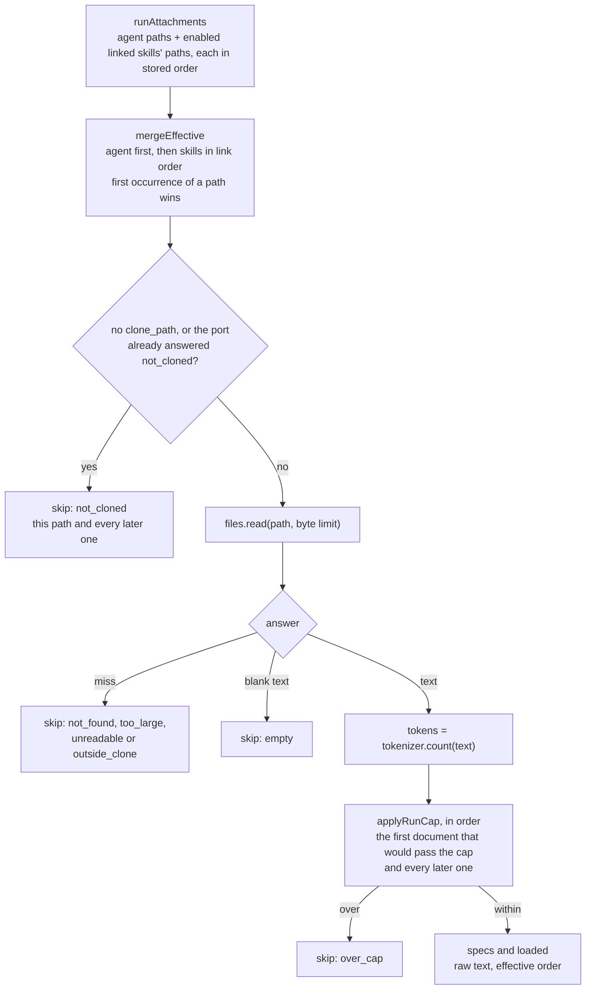

# `project-context` — the repository's own documents

`project-context` finds the markdown documents inside a repository's clone (by default under
`specs/`, `docs/` and `insights/`), previews them, stores which of them an agent or a skill
attaches, and, when a review runs, reads the attached ones and hands their text to the prompt's
`## Project context` slot. It stores paths and their order, never document text.

Everything else about the feature is outside this module: the routes the UI calls are in
[`../../../README.md`](../../../README.md) → "API map", the prompt section is in
[`../../../../reviewer-core/docs/prompt-slots.md`](../../../../reviewer-core/docs/prompt-slots.md), and the
whole path from the clone to the run trace is in
[`../../../../docs/project-context.md`](../../../../docs/project-context.md).

## Where things live

| File | Role |
|---|---|
| [`constants.ts`](constants.ts) | The size, count and token limits, and the folders the walk never enters |
| [`domain.ts`](domain.ts) | Pure rules: what a document is, its `kind`, the sort and cut, the effective list of a run, the run's token cap |
| [`ports.ts`](ports.ts) | `ProjectFiles` (the clone, as this module sees it), `ProjectContextStore` (the tables) and the unit of work |
| [`repository.ts`](repository.ts) | The only file that imports `src/db/`: the two attachment tables, and workspace-scoped reads of `repos`, `agents`, `skills` and `agent_skills` |
| [`service.ts`](service.ts) | `ProjectContextService`: `list`, `file`, the owner reads and writes, and `forRun` |
| [`routes.ts`](routes.ts) | Six thin routes; each calls `container.projectContext` once |

The service is built in `src/platform/container.ts` and reached as `container.projectContext`,
not inside the module, because the `reviews` run needs `forRun` and a module never imports another
module. Its only file-system access is the `cloneFiles` adapter
([`../../adapters/clone-files/index.ts`](../../adapters/clone-files/index.ts)); the module repeats
that port's shape in its own `ports.ts` instead of importing it. Tests swap the adapter with
`ContainerOverrides.cloneFiles` and `MockCloneFiles` (`src/adapters/mocks.ts`).

## What counts as a document

A file in the clone's working tree is a document when both rules hold (`selectDocuments` in
[`domain.ts`](domain.ts)):

- **Its path is valid.** It matches the shared `ContextDocPath` contract: relative, no empty, `.` or
  `..` segment, no control character, `"`, `<`, `>` or `\`, within the length limit, and a `.md`
  extension in any case. The same contract validates the paths a `PUT` stores.
- **Its folder is a search root.** At least one directory segment of the path equals a root,
  matched exactly (case-sensitive). The `kind` of a document is the deepest such segment, so
  `docs/specs/a.md` is `specs`. Roots come from `PROJECT_CONTEXT_ROOTS`
  ([`../../../README.md`](../../../README.md) → "Environment").

Documents are sorted by path in code-unit order and cut to the list limit; `capped` tells the
client the cut happened. The walk lives in the adapter: it skips symbolic links (files and
folders) and the folders in `CONTEXT_EXCLUDED_DIRS`, which repeat repo-intel's excluded set because
a module may not import another module.

The clone is the working tree at `<clone dir>/<owner>/<name>`, whatever branch it is on. It is not
the PR's head commit, so a document edited by the PR under review is read as it stands in the
clone.

### Status and tokens

Each listed document carries a `status` and a token count that is `null` unless the status is `ok`.

| `status` | Meaning |
|---|---|
| `ok` | Read as UTF-8 text within the byte limit; `tokens` is the tokenizer's count of the text |
| `too_large` | Larger than the byte limit. Decided from the file size, so the file is not read |
| `unreadable` | The bytes are not valid UTF-8 |

`list` reads every listed document (a few at a time) and counts its tokens on each request. Nothing
is cached, and a document that disappears between the walk and its read is left out of the list.
`file` runs the same check for one path and returns the text as `content` (`null` unless `ok`).

`list` answers `state: "not_cloned"` with no documents when the repository has no `clone_path` or
the clone directory is missing. `file` answers `404` for a path that the list would not show, which
includes a bad path, an excluded folder and a symbolic link.

## Attaching documents

`PUT /agents/:id/context` and `PUT /skills/:id/context` replace the owner's whole list in one
transaction: delete its rows, insert the new paths with `order` equal to their position in the
body. The route schema rejects too many paths, a duplicate and an invalid path with `422`; the
service then checks again that each path is a document path under a configured root and answers
`422` `validation_error` otherwise. Nothing is stored after a `422`.

- A path does not have to exist in the clone. An attached path that is missing stays in the list
  and is skipped, with a reason, when a run reads it.
- The write never touches the `agents` or `skills` rows and never creates an `agent_versions` or
  `skill_versions` row: attachments are not part of a version.
- Deleting an agent or a skill deletes its attachment rows (`ON DELETE CASCADE`).

`used_by` in `file` counts, inside the workspace: distinct agents that attach the path themselves;
distinct other agents linked through `agent_skills` to an **enabled** skill that attaches it; and
skills that attach it, enabled or not.

## In a review run: `forRun`

`ReviewRunExecutor` calls `container.projectContext.forRun({ agentId, repo })` once per agent, after
the agent's skills are resolved and whatever the agent's `repo_intel` toggle says. The call calls no
model.

- **Each path is read once**, sequentially, from the clone's working tree. The result is
  `{ specs, loaded, skipped }`: `specs` is what the engine receives (`{ path, text }`, the text
  before any escaping), `loaded` adds the origin (`agent` or `skill` with the skill's name) and the
  token count, and `skipped` holds the other paths with their `ContextSkipReason`.
- **The cap is applied in order**, over the readable, non-empty documents only. A smaller document
  after the one that crossed the cap is skipped too.
- **A skipped document is a record, not an error.** Every reason in the diagram reaches the trace.

`run-executor.ts` does the rest: one Live Log line per inserted document
(`Project context: <path> · ~<tokens> tok (agent | skill <name>)`), per skipped document
(`Project context: skipped <path> — <reason>`), or `Project context: none attached`; the lines are
`info`, never `step`, because a throwing `step` is toasted by the client. If `forRun` itself throws
(a database error, an unexpected I/O error), the run logs `Project context: unavailable (<message>)`
and continues without documents. It passes `specs` to the engine only when at least one document
was inserted, and writes these trace fields (shapes in
[`contracts/trace.ts`](../../vendor/shared/contracts/trace.ts)):

| Trace field | Value |
|---|---|
| `specs_read` | The inserted paths |
| `prompt_assembly.specs` | The section as the engine rendered it, or `null` |
| `prompt_assembly.specs_loaded` | The inserted documents with their text, or `null` when none |
| `prompt_assembly.specs_skipped` | The skipped documents with their reason, or `null` when none |
| `prompt_assembly.specs_tokens` | The tokenizer's count of the whole section, or `null` without one |
| `prompt_assembly.specs_calls` | The number of review calls the section was sent with (more than one in map-reduce), or `null` |

## Trust and privacy

- **Document text is untrusted data.** `reviewer-core` fences each document and puts a trusted note
  in front of the section; the path in a heading is sanitised there because the clone controls it
  ([`prompt-slots.md`](../../../../reviewer-core/docs/prompt-slots.md)).
- **The text is read for every list, preview and run, and the attachment tables hold only paths.**
  The text does persist in one place: the run trace keeps `specs_loaded[].text`, and the stored
  prompt holds the section, so a trace holds a copy of every document the run inserted.
- **Reads stay inside the clone.** The adapter resolves the root and the target with `realpath` and
  answers `outside_clone` for a path that leaves the root, for example a committed symbolic link to a
  file elsewhere on the disk. A read that fails for a reason other than a missing path (a permission
  error, for instance) is thrown, not mapped to a miss.
- **The tokenizer counts special-token markers as text.** A document containing `<|endoftext|>`
  is counted as plain characters. Only a failure to load the encoder switches the tokenizer to its
  `chars / 4` estimate for good; a text it cannot encode is estimated on its own.

## Tests

| File | Covers |
|---|---|
| `test/project-context-domain.test.ts` | The pure rules and `parseProjectContextRoots` |
| `test/project-context-service.test.ts` | `list`, `file`, the owner writes and `forRun` over `MockCloneFiles` and a fake store |
| `test/project-context.it.test.ts` | The six routes on real Postgres: shapes, ordering, `422`/`404`, `used_by`, cascade, no version bump |
| `test/project-context-schema.it.test.ts` | The migration and its cascades |
| `test/reviews-project-context.it.test.ts` | A real run: prompt content and order, skip reasons, trace fields, Live Log lines |
| `test/clone-files.test.ts` | The adapter over a temporary directory |
| `test/tokenizer.test.ts` | Special-token markers and the per-text fallback |
