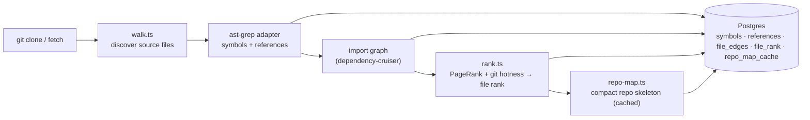

# `repo-intel` — the codebase indexer

`repo-intel` reads a cloned repository **once on clone** (and incrementally on
fetch, keyed by file content hash) and turns it into queryable facts: symbols,
the import graph, a PageRank-based file importance score, and a compact **repo
map** (the project skeleton). On a review it is only **read** — the index is
already computed, so adding context to a prompt costs no analysis at request time.

This is **starter infrastructure**: it works from day 1 (the **Indexed** badge),
but you don't write it. Course lessons build features _on top_ of its facade —
Blast Radius (L04), Conventions samples (L02), Onboarding reading-path (L05),
the Phantom-API gate (L06) — by calling `repoIntel.*`, not by re-indexing.

## Pipeline

Full vs incremental indexing lives in `pipeline/{full,incremental}.ts`; an
unindexed or partially-indexed repo degrades gracefully (the facade returns empty
results rather than throwing).

## Facade (`repoIntel.*`)

Everything downstream reads through one facade (`service.ts`) so consumers never
touch the pipeline internals:

- `getRepoMap(repoId)` → the cached repo skeleton (fed into the **review prompt**).
- `getFileRank(repoId, files)` → importance percentile per changed file.
- `getCallerSignatures(repoId, files, limit)` → callers of changed symbols.
- `getBlastRadius(repoId, files)` → changed symbols, their callers and the endpoints and crons in the calling files (read by the `blast` module, L04).
- `getIndexState(repoId)` → the index row's status, last indexed SHA and degraded reason (read by the `blast` module too).
- `getUnresolvedReferences(repoId, …)` → phantom-symbol detection (used by L06).
- `getConventionSamples(repoId)` → top-ranked files for convention extraction (L02).

In the starter, only `getRepoMap` / `getFileRank` / `getCallerSignatures` are
wired — into `modules/reviews/run-executor.ts`, which adds the repo map and a
high-blast-radius note to the prompt. Toggled by `REPO_INTEL_ENABLED` (global)
and a per-agent `repo_intel` flag.

### Blast radius (L04)

`getBlastRadius` and `getIndexState` are now wired too: the `blast` module
([`../blast/`](../blast), route `GET /pulls/:id/blast`, described in
[`../../../README.md`](../../../README.md) → "API map") calls each once per request. It does not import
this module; `container.repoIntel` is assigned to the `blast` module's own `BlastSource` port, and the
facade's per-symbol caller cap reaches it through `container.repoIntelLimits.callersPerSymbol`.

- **Two paths.** With `REPO_INTEL_ENABLED` on, paths given and a `repo_index_state` row of status
  `full` or `partial`, the answer is built from Postgres only (`symbols`, resolved `references`,
  `file_rank`, `file_facts`) and carries `degraded: false` and `factsByFile`. Otherwise it falls back to
  a best-effort ripgrep read of the clone and answers `degraded: true`, `reason: 'no_data'`, every
  caller at rank `0` and no `factsByFile`.
- **A partial index is not reported as degraded** by this method; the `blast` module reads the status
  from `getIndexState` and marks it `index_partial` itself.
- **The caller cap is per changed symbol.** `tryPersistentBlast` keeps the first
  `MAX_CALLERS_PER_SYMBOL` (20, [`constants.ts`](constants.ts)) callers of each changed symbol, after
  sorting by file rank, highest first. A symbol with many callers no longer pushes the callers of
  its siblings out of the result. The callers are only the resolved ones: a reference whose
  `decl_file` is a changed file and whose own file has a `file_rank` row; a repeat of the same
  file, enclosing symbol and target is dropped before the cap.
- **Ties at the cap are not ordered.** Callers with equal rank keep the database's order, so which
  of them survive the cap is not deterministic.

## Routes

- `GET /repos/:id/index-state` — index status (drives the **Indexed** badge).
- `POST /repos/:id/resync` — enqueue a re-index.
