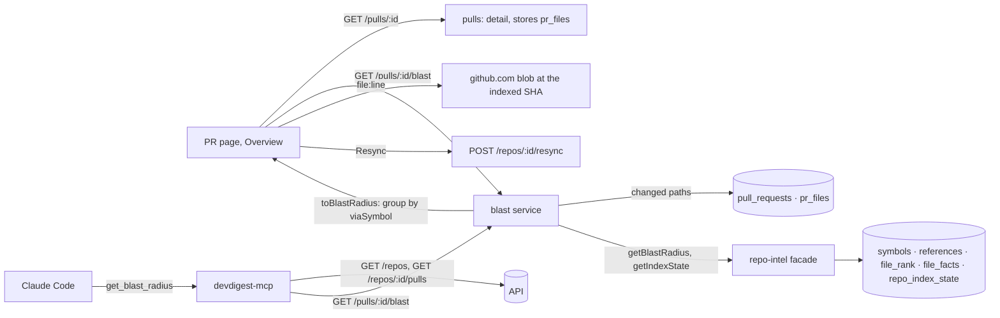

# L04 — Blast Radius

A reviewer reads a diff and does not see what else in the repository the change can reach.
Blast Radius answers that. For a pull request it shows three things: the symbols declared in
the changed files, who imports or calls those symbols (`file:line`), and which HTTP endpoints
and cron jobs live in the calling files.

The feature has two surfaces over one route: a **Blast radius** block on the **Overview** tab
of the PR page, and the `get_blast_radius` tool of `devdigest-mcp`, which until now was a stub.

Nothing is analysed again and no model is called. `repo-intel` built the index when the
repository was cloned; the feature reads it, regroups it and shows it.

This spec states the feature and the rules that span packages. The implementable detail is in
the module specs (see Ownership). There is no plan yet: the `planner` agent writes it from this
spec, and it is saved as `L04-blast-radius-plan.md` once approved.

## Sources

- Course task "Домашнє завдання — Blast Radius" (L04), read on 2026-10-11, including its four
  screenshots (the prototype's Overview tab, the Tree view, the Graph view, and a plain-list
  variant the task accepts). The criteria below keep the task's priorities: `A` is P1 (blocks
  acceptance), `B` is P2, `C` is P3.
- The design prototype `https://claude.ai/artifact/KP2JTS2LE2eDQCTx6MU1hK`, PR #482, Overview
  tab. It shows the filled state only; the empty and the incomplete-index states are designed
  in the client spec.
- The current code on `main` at `1ff22a3`. Per the project rule, the feature is designed from
  the current code and the prototype, not from the repository history.

## Requirements

| Req | Priority | Statement |
|---|---|---|
| A1 | P1 | The Overview tab of a pull request has a Blast radius block |
| A2 | P1 | Its top line is a summary: how many symbols changed, how many callers they have, how many endpoints and crons are affected |
| A3 | P1 | Under each changed symbol: its callers as `file:line`, and under them the endpoints that depend on the symbol |
| A4 | P1 | On a test PR that changes a shared helper, the map shows at least two real callers and at least one HTTP endpoint |
| A5 | P1 | A click on `file:line` opens that line on GitHub |
| A6 | P1 | With no callers, a clear text instead of an empty block. With an incomplete index, a separate mark that names the reason |
| A7 | P1 | `get_blast_radius` in `devdigest-mcp` works instead of the lab stub and returns the same map as the block |
| A8 | P1 | An open pull request in the fork with a description of the implementation and a 1–3 minute demo video |
| B1 | P2 | The server log of a request shows a read of the ready index; the AST and the import graph are not rebuilt |
| B2 | P2 | The route's answer parses as `BlastRadius` |
| B3 | P2 | The mapping of the flat `callers` list into grouped `downstream` is covered by a unit test |
| B4 | P2 | The main path makes no model call |
| B5 | P2 | The file that declares a symbol is not among that symbol's callers |
| B6 | P2 | The limits come from `repo-intel/constants.ts`, not from a component |
| B7 | P2 | `degraded` and `reason` from the facade reach the interface |
| B8 | P2 | `get_blast_radius` follows the lab's tool rules: a short description that says when to call it, a clear argument schema, a concise answer, a useful error for an unknown PR, `readOnlyHint: true` |
| B9 | P2 | The PR description says which subagent did what |
| C1 | P3 | Symbols collapse and expand like the prototype's tree — **not built** (user decision, 2026-10-11) |
| C2 | P3 | A second view, the graph, with a Tree / Graph switch |
| C3 | P3 | A "Prior PRs touching these files" block — **not built** (user decision, 2026-10-11) |
| C4 | P3 | Crons are shown apart from HTTP endpoints |
| C5 | P3 | Symbols are ordered by rank, the most important first |
| C6 | P3 | Next to the incomplete-index mark, a button that calls `POST /repos/:id/resync` |
| C7 | P3 | The block's labels come from `client/messages/en/blast.json` |

All of P1 and P2 and the P3 items C2, C4, C5, C6, C7 are in scope. The P3 items are listed
last in the plan so that they can be cut without touching the rest.

**Out of scope:** the collapsible tree (C1); the Prior PRs block and anything that fills
`PrHistory` (C3); an optional model-written summary (the `summary` field is built from numbers);
the Intent, Risk areas and Review focus blocks of the prototype's Overview tab, and its
two-column layout; a caller of a caller (the facade answers direct references only);
re-indexing from the blast route; fetching a PR's file list from GitHub in the blast route;
any change to how `repo-intel` builds the index.

## What the starter already has

| Piece | Where | State |
|---|---|---|
| `repoIntel.getBlastRadius(repoId, changedFiles)` → `BlastResult` | `server/src/modules/repo-intel/service.ts`, `types.ts` | present; reads `symbols`, `references`, `file_rank`, `file_facts`; never throws |
| `repoIntel.getIndexState(repoId)` → `IndexState` | same | present; always answers |
| `MAX_CALLERS_PER_SYMBOL` (20), `BFS_DEPTH` (2) | `server/src/modules/repo-intel/constants.ts` | present |
| `ChangedSymbol`, `BlastCaller`, `DownstreamImpact`, `BlastRadius` | `contracts/brief.ts` (both copies, identical) | present; no route serves them; no field for `degraded` |
| `GET /repos/:id/index-state`, `POST /repos/:id/resync` | `server/src/modules/repo-intel/routes.ts` | present |
| `useRepoIntelStatus`, `useResyncRepoIntel` | `client/src/lib/hooks/repo-intel.ts` | present |
| `githubBlobUrl(repoFullName, sha, file, startLine)` | `client/src/lib/github-urls.ts` | present |
| `blast.*` strings | `client/messages/en/blast.json` | `stat.*`, `view.*`, `callerCount`, `noDownstream`, `graph.*` present |
| `get_blast_radius` | `mcp/src/tools/get-blast-radius.ts` | a stub: name, description, `repo` + `pr` schema, `readOnlyHint: true`; always an error |
| `resolvePull`, `toolOk`, `sanitizeText`, `cutText` | `mcp/src/resolve.ts`, `mcp/src/tool.ts` | present |
| The Overview tab | `client/.../pulls/[number]/_components/OverviewTab/` | shows the PR description only |

Missing, and built here: the `blast` server module and its route, the response contract, the
client hook and the block, the working tool, and index rows in the seed.

### What the facade really returns

Read from the code, because four points differ from the task's description and each one shapes
a rule below.

1. **The cap is global, not per symbol.** The indexed path ends with
   `callers.slice(0, MAX_CALLERS_PER_SYMBOL)` over the flat list, so a PR gets at most 20
   callers in total. This is fixed in `repo-intel` (Q2).
2. **A partial index is not reported as degraded.** With `repo_index_state.status = 'partial'`
   the facade answers `degraded: false`. No code path of `getBlastRadius` returns
   `index_partial`, `index_failed`, `repo_too_large` or `flag_off`; the only reason it emits is
   `no_data`. The incomplete-index mark (A6) therefore needs `getIndexState` as a second read.
3. **Without an index the facade falls back to the clone.** It then answers with real callers,
   `degraded: true`, `reason: 'no_data'`, `rank: 0` and no `factsByFile`. Data and `degraded`
   can be present together.
4. **`changedSymbols` is every symbol declared in a changed file**, exported or not, touched by
   the diff or not. `BFS_DEPTH` is not used by `getBlastRadius`: callers are direct references.

## End-to-end flow

The server answers the whole map, already grouped, ordered and counted. The block and the tool
render that one answer; neither regroups or recounts it.

## Rules that span packages

- **One route, two readers.** `GET /pulls/:id/blast` is the only source. The block and the tool
  show the same symbols, the same callers in the same order and the same four numbers (A7).
- **One facade call per request.** The service reads the PR's changed paths from `pr_files`,
  calls `getBlastRadius` once and `getIndexState` once. No clone read, no parser, no model and
  no GitHub request is added by the `blast` module (B1, B4).
- **Grouping.** `downstream` holds one entry per changed symbol that has at least one caller,
  built by grouping the flat `callers` by `viaSymbol`. A symbol with no caller stays in
  `changed_symbols` only.
- **A declaring file is never a caller** of its own symbol (B5). The mapper drops such a row
  even if the facade returned it.
- **Endpoints and crons belong to a symbol through its callers' files**: the distinct union of
  `factsByFile[caller.file]` over the group's callers. When the facade gives no `factsByFile`
  (the fallback path), both lists are empty; the response is degraded in that case anyway.
- **Order is part of the answer (C5).** Callers inside a group: rank descending, then file,
  then line. Groups: highest caller rank descending, then symbol name. Clients keep the order.
- **Totals are counted once, on the server.** `symbols` is the number of changed symbols,
  `callers` the number of caller rows shown, `endpoints` and `crons` the distinct values across
  all groups. `summary` is a sentence built from these four numbers.
- **Degraded is a mark, not an error.** The route answers `200` with whatever map exists, plus
  `degraded` and `reason`. Resolution order, first match wins:

  | # | Condition | `degraded` | `reason` |
  |---|---|---|---|
  | 1 | the PR has no stored files | `true` | `pr_files_missing` |
  | 2 | `REPO_INTEL_ENABLED` is off | `true` | `flag_off` |
  | 3 | the index status is `degraded` or `failed` | `true` | the state's `degradedReason`, else `index_failed` |
  | 4 | the facade answered `degraded: true` | `true` | the facade's reason, else `no_data` |
  | 5 | the index status is `partial` | `true` | `index_partial` |
  | 6 | otherwise | `false` | `null` |

  The index state is checked before the facade's own flag (Q5): with a failed index the facade
  falls back to the clone and answers `no_data`, which would hide the real reason. A repository
  with no index row has a synthesised state of status `degraded` and reason `no_data`, so it
  still reads "not indexed yet".

- **Links point at the indexed commit.** Caller lines come from the index, which was built at
  `repo_index_state.last_indexed_sha`; the response carries it as `indexed_sha`. The client
  links to that commit and falls back to the PR's head SHA when it is `null`. Caller files are
  not part of the PR's diff, so the link is a GitHub blob, never the Files changed tab (A5).
- **Limits are stated by the server (B6).** The response carries `caller_limit`
  (`MAX_CALLERS_PER_SYMBOL`). A group whose caller count equals it may be cut, and both readers
  say so; neither holds the number 20.
- **A PR whose files were never stored** (never opened in the studio — `GET /pulls/:id` is what
  writes `pr_files`) gets an empty map with `pr_files_missing`. The tool's answer tells the
  agent to open the PR in DevDigest once (Q4).
- **No new dependency.** The graph (C2) is hand-written SVG; no lock file changes.

## Contract surface (`@devdigest/shared`)

| Contract | Change |
|---|---|
| `ChangedSymbol`, `BlastCaller`, `DownstreamImpact`, `BlastRadius` (`brief.ts`) | unchanged |
| `BlastDegradedReason` (`review-api.ts`) | new enum: `flag_off`, `index_failed`, `index_partial`, `repo_too_large`, `no_data`, `pr_files_missing` |
| `BlastTotals` (`review-api.ts`) | new: `symbols`, `callers`, `endpoints`, `crons`, non-negative integers |
| `BlastRadiusResponse` (`review-api.ts`) | new: `BlastRadius.extend({ totals, degraded, reason, indexed_sha, caller_limit })` |

`BlastRadiusResponse` extends `BlastRadius`, so the route's body still parses as `BlastRadius`
(B2). Authored in `server/src/vendor/shared/contracts/review-api.ts`; the same lines are added
to `client/src/vendor/shared/contracts/review-api.ts`. `brief.ts` is not edited and its two
copies stay identical.

## Ownership

| Package | Owns | Spec |
|---|---|---|
| `@devdigest/shared` (authored in `server/`) | the three new contracts above | this file |
| `server` | the `blast` module (route, service, repository, pure mapper), the per-symbol cap fix in `repo-intel`, the index rows in the seed | [`server/specs/L04-blast-radius.md`](../server/specs/L04-blast-radius.md) |
| `client` | the hook, the Blast radius block with its Tree and Graph views, the states, the resync button, the strings | [`client/specs/L04-blast-radius.md`](../client/specs/L04-blast-radius.md) |
| `mcp` | the ninth API route in the port, the working `get_blast_radius` tool, its compact view | [`mcp/specs/L04-blast-radius.md`](../mcp/specs/L04-blast-radius.md) |
| `e2e` | one read-only flow on seeded data | `e2e/specs/12-pr-blast-radius.flow.json` |
| `reviewer-core` | nothing | — |

## Delivery (A8, B9)

- Branch `feature/l04-blast-radius`, cut from `main` at `1ff22a3`.
- Built through the lab pipeline: `planner` → `implementer` and `test-writer` per phase →
  (`architecture-reviewer` ∥ `plan-verifier`) → `doc-writer`, then `/pr-self-review` and
  `npm run e2e:hermetic`. The PR description names what each agent did and what `plan-verifier`
  found.
- **Test PR** (made by the user in a fork that is added to DevDigest as a repository): it
  changes an exported function imported by at least two other files, one of which declares an
  HTTP route. In DevDigest itself: a function in `server/src/modules/reviews/helpers.ts` or
  `client/src/components/diff-viewer/helpers.ts`. Before the run, `GET /repos/:id/index-state`
  must answer `status: full`.
- **Video script** (recorded by the user):
  1. Open the test PR → Overview → the Blast radius block → the summary line: symbols, callers,
     endpoints, crons.
  2. Under a changed symbol: its callers as `file:line`, and the endpoints under them.
  3. Open one or two callers in the code: they use the changed function, they are not its own
     dependencies.
  4. Click a `file:line` → that line opens on GitHub.
  5. The state with no callers (a PR that changes an unused or docs-only file), and the state
     with an incomplete index (see the client spec, "How to show each state").
  6. In Claude Code, ask for the impact map of the same PR → the answer matches the block.
  7. One sentence on why the map calls no model and does not parse the repository again.

## Resolved

Settled by the user on 2026-10-11.

| # | Question | Decision |
|---|---|---|
| Q1 | Which P3 items are built? | The Graph view with the Tree / Graph switch (C2) and the resync button (C6), plus the three small ones: crons apart (C4), order by rank (C5), strings from `blast.json` (C7). The collapsible tree (C1) and the Prior PRs block (C3) are not built |
| Q2 | The facade cuts the flat caller list to 20 in total, not 20 per symbol | **Fix it in `repo-intel`**: cap per changed symbol, highest rank first, with a unit test |
| Q3 | The seed has no index rows, so seeded data and the hermetic e2e run would only ever show the degraded state | **Seed the index** for the demo PR #482 and add one read-only e2e flow |
| Q4 | A PR never opened in the studio has no `pr_files`, so a request through MCP has no file list | **An honest degraded answer** with its own reason; no GitHub call from the blast route |

Settled by the user on 2026-10-11, after the planner's open questions:

| # | Question | Decision |
|---|---|---|
| Q5 | With a failed index the facade falls back and answers `no_data` first, so `index_failed` and `repo_too_large` could never reach the block | **The index status is checked first** (rows 3 and 4 of the degraded table), so a failed index names its real reason and every reason is reachable through the route |
| Q6 | The contract attributes endpoints and crons to a symbol's group, not to a caller. How does the Graph view connect them? | **An edge from the changed symbol to each of its endpoints and crons.** No caller-to-endpoint edge is drawn, because the data does not hold one |
| Q7 | The planner's other recommendations | Accepted: the `blast` module declares its own structural input types and ports and receives the caller limit through a getter on the container, because `arch:check` forbids a module importing another module, types included; the request logger is a parameter of `forPull`; seeding the index also gives the demo repository's Conventions screen evidence links, which is accepted and recorded in `seed-fixtures.md`; the wording of the new strings is the plan's; the MCP view does not repeat the server's `caller_limit`, since its own cap is lower and always states what was cut |

## Decided without asking

Change any of these by saying so; none needs a question.

| # | Decision | Why |
|---|---|---|
| D1 | `degraded` and `reason` travel in a new `BlastRadiusResponse` that extends `BlastRadius`; `brief.ts` is not edited | `BlastRadius` is also a part of `PrBrief`, where a degraded flag has no meaning; the same pattern as `SmartDiffResponse` |
| D2 | The incomplete-index mark is derived in the `blast` service from `getIndexState`, not by changing what the facade reports | See "What the facade really returns", point 2; the facade's degraded contract is used by other consumers |
| D3 | The four numbers are a `totals` object counted on the server | The block, the tool and the `summary` sentence must agree; three separate counts would drift |
| D4 | `file:line` links to `indexed_sha`, falling back to the head SHA | The line numbers were recorded at the indexed commit; on the PR's head they can be off |
| D5 | `downstream` lists only symbols that have callers; the block mentions the rest in one muted line | The task's own plain-list screenshot shows "14 symbols · 6 callers" with four cards |
| D6 | Two changed symbols with the same name in different files share one group | The facade keys a caller by `viaSymbol` (a name) only; splitting them needs a facade change that is out of scope |
| D7 | The block is full width inside `OverviewTab`, under the Intent card and above Description | The page is one column, 1080 px wide; the prototype's two-column brief is not part of this lesson |
| D8 | The Tree view is a flat, always-open list: symbol row, callers, chips | C1 is not built; the task accepts a plain list |
| D9 | The view lives in the URL: `?blast=graph`; no parameter means the tree | `client/docs/ui-architecture.md`: what should survive a reload lives in the URL |
| D10 | The blast query starts only after `GET /pulls/:id` has answered, and is keyed by the head SHA | `GET /pulls/:id` is what writes `pr_files`; asking in parallel on a fresh PR would read an empty table (the Smart Diff rule D9) |
| D11 | In the tool, a degraded or empty map is a normal result with a `note`, not `isError` | The data is real and the agent should report it; an error would read as "the tool is broken" |
| D12 | The tool's view is capped (symbols, callers per symbol, chips) and states what was cut | The lab rule "concise answer"; the full map stays in the block |

## Acceptance (cross-package)

- [ ] A1, A2 — the test PR's Overview tab shows the Blast radius block with the four numbers,
      and they equal `totals` of `GET /pulls/:id/blast`.
- [ ] A3, A4, C4 — under a changed helper there are at least two callers as `file:line` and at
      least one endpoint chip; cron chips are a separate row with their own style.
- [ ] A5 — a `file:line` link opens `github.com/<owner>/<repo>/blob/<indexed sha>/<file>#L<line>`
      in a new tab.
- [ ] A6 — a PR whose symbols have no callers shows the "no downstream callers" text; a
      repository with a `partial` index shows the mark with its reason, and the map under it.
- [ ] A7, B8 — `get_blast_radius` with `repo` and `pr` returns the same symbols, callers and
      totals as the block; an unknown PR returns an error that names the next step; the tool
      has `readOnlyHint: true`.
- [ ] B1, B4 — the server log of one request has one `blast` line with the index status and the
      counts, and no model call, clone read or index job.
- [ ] B2 — the route's body parses as `BlastRadiusResponse` and as `BlastRadius`.
- [ ] B3, B5 — the mapper's unit test covers grouping, the declaring-file filter, the order and
      the totals.
- [ ] B6, Q2 — with 25 callers of one symbol and 5 of another, the answer holds 20 and 5; the
      number 20 appears only in `repo-intel/constants.ts`.
- [ ] B7 — every reason of the degraded table is reachable through the route and reaches the
      block's mark. Row 4 is a safety net the current facade cannot produce (rows 1–3 win
      first); it is covered with an injected facade.
- [ ] C2 — the Tree / Graph switch shows the graph and back; the choice survives a reload.
- [ ] C5 — groups and callers are in rank order in the route's answer, the block and the tool.
- [ ] C6 — Resync next to the mark calls `POST /repos/:id/resync`, and the map is read again
      when the index state advances.
- [ ] C7 — no Blast radius label is written in a component.
- [ ] `pnpm typecheck`, `pnpm test` and `pnpm arch:check` are green in `server`; `pnpm
      typecheck` and `pnpm test` are green in `client`; `npm run typecheck` and `npm test` are
      green in `mcp`; the e2e flow passes on a fresh seed.
