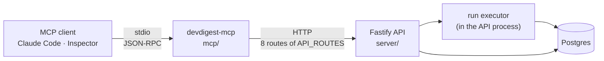

# L04 — `devdigest-mcp`, a local MCP server

**Status:** implemented · **Plan:** [`L04-devdigest-mcp-plan.md`](L04-devdigest-mcp-plan.md) (revision 3) · **Package spec:** [`../mcp/specs/L04-devdigest-mcp.md`](../mcp/specs/L04-devdigest-mcp.md)

DevDigest gains one more entry point: a local MCP server, `devdigest-mcp`, that an MCP client
(Claude Code in the terminal, MCP Inspector, any other client) starts as a child process and
talks to over stdio. It exposes exactly five tools — `list_agents`, `run_agent_on_pr`,
`get_findings`, `get_conventions`, `get_blast_radius` — so that a model can ask DevDigest to
review a pull request and read the verdict and findings back.

The server is a thin local wrapper over the Fastify API. It holds no copy of the business
logic, opens no database and executes no review: it calls the running API over HTTP and
projects the answers into small, flat, model-readable results. It does not start together with
the application: it has its own launch command, `node mcp/bin/devdigest-mcp.mjs`.

It is a fifth standalone package, `mcp/` (`@devdigest/mcp`, npm). `get_blast_radius` is an
honest stub that always answers with an error.

This spec states the feature and the rules that span packages. The implementable detail is in
[`mcp/specs/L04-devdigest-mcp.md`](../mcp/specs/L04-devdigest-mcp.md). The plan, saved as
`L04-devdigest-mcp-plan.md`, holds the phases.

## Sources

- The course lab page — lesson "L04: MCP-сервери & гібридні патерни", block "Hands-On Lab
  (відео 2) — будуємо devdigest-mcp" — as read and translated by the main session on
  2026-10-10. It is the primary requirement source. The planner had no web access and did not
  open it.
- The requirements R1–R4 come from the lesson slides; P1–P19 from researched practice for
  MCP servers; L1–L3 are lab requirements added in revision 3 of the plan.
- The current code on `main`: the `reviews`, `agents`, `conventions`, `repos` and `pulls`
  modules of `server/`, and the shared contracts in `server/src/vendor/shared`.

## Flow

A review run is asynchronous inside the API: `POST /pulls/:id/review` returns run ids at once,
execution is fire-and-forget, and completion is observed on the run's SSE stream
(`GET /runs/:id/events`) and by a second read. The run bus is in memory and per process, and
on boot the API marks every `running` row `failed`. So the MCP process never executes a run
and never opens the database (D2).

## The five tools

| Tool | Does | Annotations |
|---|---|---|
| `list_agents` | Lists the reviewer agents: `id`, `name`, `description`, `model`, `enabled` | `readOnlyHint: true` |
| `run_agent_on_pr` | Runs one agent on a PR, waits (120 s by default), returns the verdict and findings; the only write tool | `readOnlyHint: false`, `destructiveHint: false`, `openWorldHint: true` |
| `get_findings` | Returns the verdict and findings of a finished review: the latest, or the run given by `run_id`. Never starts a review | `readOnlyHint: true` |
| `get_conventions` | Returns the accepted coding conventions of a repository (`pending` on request) | `readOnlyHint: true` |
| `get_blast_radius` | Stub: always `isError: true` ("not implemented"), calls nothing | `readOnlyHint: true` |

Arguments are flat: `repo` is `owner/name`, `pr` is the PR number, `agent` is an agent id or its
exact unique name, `run_id` is a run id. `list_prs` and `list_repos` are deliberately not
added.

## Requirements

IDs are used in the plan's `Done when` lines. R = slide principle, P = researched practice,
L = lab requirement added in revision 3.

| ID | Requirement | Met by |
|---|---|---|
| R1 | Result, not operation | `run_agent_on_pr` creates, waits and fetches in one call (D4, D9, D20) — phase 6; `get_findings` returns the verdict, not a run record — phase 5 |
| R2 | Flat arguments | Every `inputShape` holds scalars and enums only — phases 3, 5, 6; the stdio test rejects any nested object or array property — phase 6 |
| R3 | Concise structured response | The review result and the "Dropped" lists; `review-view.ts` — phase 5 |
| R4 | The error leads onward | The error catalogue: every text names the next step, and unknown repos and PRs list valid values — phases 3–6 |
| P1 | Small startup payload | Budget test: the `tools/list` result is at most 4,000 characters and `instructions` at most 500 — phases 2, 6 |
| P2 | Names stand on their own; no reliance on deferral | The five fixed names; P1's budget covers clients that load everything — phase 6 |
| P3 | Short descriptions that say when to call, no JSON examples, no schema restated; few parameters; enums; no descriptions on obvious fields | The five description strings (each at most 240 characters); descriptions only on `repo`, `pr`, `agent`, `run_id` — phases 3, 5, 6 |
| P4 | `outputSchema` decided per tool | D6: none on any of the five; the test asserts no tool lists one — phase 6 |
| P5 | Instructions of a few lines with the call order, without forcing all three calls | "Server metadata" in the package spec, D20 — phases 2, 6 |
| P6 | Signal only | "Dropped" lists; no internal id except `id` in `list_agents` and `run_id` — phase 5 |
| P7 | Defaults that bound size; say when truncated and how to narrow | `limit` (20, max 50), `min_severity`, `truncated` + `note`, caps on every free text — phase 5 |
| P8 | `response_format` only if it earns its cost | D21: not added |
| P9 | Claude Code output thresholds | Worst-case size test: at most 36,000 characters at `limit: 50` — phase 5 |
| P10 | Bounded wait, clear timeout result, progress notifications | D4 (120 s); the `status: "running"` result; `ctx.progress` forwards run events as `notifications/progress` when the request carries a progress token — phases 3, 6 |
| P11 | Verb-first snake_case; identical parameter names | The five names; `repo`, `pr`, `run_id` reused — phases 3, 5, 6 |
| P12 | Annotations; read tools have `readOnlyHint: true` | `true` on four tools; `run_agent_on_pr` is `readOnlyHint: false`, `destructiveHint: false`, `openWorldHint: true` — phases 3, 5, 6 |
| P13 | Execution errors as `isError` results; protocol errors only for malformed requests | `executeTool` + `toolError` — phases 3, 4 |
| P14 | Zod on every input; no secrets, no stack traces | `executeTool` (`.strict()`), `loadMcpConfig`, the API views, `sanitizeText`, E-INTERNAL — phases 3, 4 |
| P15 | Spec 2025-11-25: no-parameter schema; text copy of `structuredContent` | `list_agents` schema target; D6 returns no `structuredContent` — phases 3, 5 |
| P16 | stdout carries only MCP messages; anything imported is checked | `main.ts` logs to stderr only; the launcher writes nothing to stdout; `boundaries.test.ts` (D12); no package-manager wrapper (D16); the stdio tests read the stream — phases 2, 3 |
| P17 | Thin adapter over existing services and contracts; no copy of the business logic | D2 (existing routes only), `.pick()` views over the aliased contracts, one Zod (D15), no new route or contract — phases 2, 4–6 |
| P18 | Verified by driving it from `.mcp.json`; no secrets or machine paths there | `mcp/test/stdio.test.ts` (hermetic) and `server/test/mcp-stdio.it.test.ts` (real API) both spawn the entry read from `.mcp.json` — phases 3, 5, 6 |
| P19 | SDK compatibility check as an explicit early step | Phase 2, with stop rules; runtime facts recorded in phase 3 |
| L1 | A separate launch command, independent of DevDigest's main scripts | D16, D18: `node mcp/bin/devdigest-mcp.mjs`; no change under `scripts/`; the prerequisite is documented and the launcher reports a missing install — phases 2, 3 |
| L2 | Verified with MCP Inspector, then connected to Claude Code | D17: Inspector records after phases 3 and 6; the Claude Code acceptance comes after them |
| L3 | The domain code limits the real permissions | D19: `API_ROUTES` (eight routes, one write), a port with no generic request, no database, no secret, no filesystem or subprocess import; pinned by `api-client.test.ts`, `boundaries.test.ts` and the tool tests — phases 3–6 |

## Decisions

One line each; the reasoning, the evidence and the rejected alternatives are in the plan.

| # | Decision |
|---|---|
| D1 | A fifth standalone package: folder `mcp/`, package `@devdigest/mcp`; the MCP server name and the `.mcp.json` key are `devdigest-mcp` |
| D2 | The MCP process reaches DevDigest only over HTTP, against the running API (default `http://127.0.0.1:3001`) |
| D3 | `repo` is `owner/name`; `pr` is the PR number; `agent` is the agent's id or its exact, unique name |
| D4 | `run_agent_on_pr` waits on the run's SSE stream for at most 120 s (`DEVDIGEST_MCP_WAIT_SECONDS`, 1–600), then reads the run's status once; a run still going is a non-error `status: "running"` result |
| D5 | `get_findings` takes `repo` and `pr`, plus an optional `run_id` |
| D6 | Every result is one text block holding compact JSON; no `outputSchema`, no `structuredContent` |
| D7 | SDK: `@modelcontextprotocol/sdk@^1.32.1`, installed in `mcp/` with npm |
| D8 | TypeScript runs through tsx with no build step |
| D9 | `run_agent_on_pr` attaches to a `running` run of the same agent on the same PR instead of starting a second one |
| D10 | `get_blast_radius` returns `isError: true` with a fixed text and calls nothing |
| D11 | `get_conventions` returns candidates with status `accepted` by default (`pending` on request) from `GET /repos/:id/conventions` |
| D12 | Boundaries are checked by `mcp/test/boundaries.test.ts`, inside the package's own suite |
| D13 | The real-API driving test is `server/test/mcp-stdio.it.test.ts`, in `server`'s integration lane, with a hand-written newline-delimited JSON-RPC client |
| D14 | Package manager: npm |
| D15 | One Zod instance: tsconfig paths and vitest aliases for `@devdigest/shared` and `zod`; `main.ts` refuses to start when the contracts and the package see different copies |
| D16 | The separate launch command is `node mcp/bin/devdigest-mcp.mjs`: a launcher that registers tsx with the package's `tsconfig.json` and imports `src/main.ts`; `.mcp.json` runs the same file with that one relative argument |
| D17 | MCP Inspector is a manual check by the main session, run through `npx` at a version written into the record; not a dependency of `mcp/`, not run in CI |
| D18 | The server is independent of the main scripts: `scripts/dev.sh` is not changed; `cd mcp && npm ci` is a documented prerequisite; CI installs it itself |
| D19 | The real permissions are limited by code, not by annotations: tools reach the API only through `DevDigestApi`, whose eight methods are bound to the eight routes of `API_ROUTES` — seven reads and one write, `POST /pulls/:id/review` |
| D20 | `run_agent_on_pr` returns the full review result; `list_agents` and `get_findings` are called when needed, not always |
| D21 | A finding carries `severity`, `title`, `file`, `line` and `rationale` cut at 240 characters; no `suggestion`, no `response_format` parameter |
| D22 | Resolving a PR calls `GET /repos/:id/pulls`, which refreshes the PR list from GitHub when a token is configured; the tools that use it keep `readOnlyHint: true` |
| D23 | `security` is the only review skill routed to `mcp/src` |
| D24 | When `mcp/node_modules` is missing, `server/test/mcp-stdio.it.test.ts` **fails** with the command to run (`cd mcp && npm ci`); it does not skip. The price is a red `server` suite on a fresh clone until that command has run. Decided by the user on 2026-10-10 (the answer to the plan's one open question, option (a)) |

## The lab's scenario and the three-call sequence (D20)

The lab's request: "Review PR #3 in the repository with the Security Reviewer agent and tell
me whether there are critical findings."

| Path | Calls | When |
|---|---|---|
| Short | `run_agent_on_pr(repo, 3, "Security Reviewer")` → `status: "done"` with `counts.CRITICAL` and the findings | The caller was given the agent's exact name (or already has its id) and the review ends within the wait |
| With lookup | `list_agents` → `run_agent_on_pr` | The agent's id or exact name is not known, or E-AGENT-UNKNOWN said to call `list_agents` |
| Full — the lab's sequence | `list_agents` → `run_agent_on_pr` → `get_findings(repo, pr, run_id)` | The run outlasts the wait and `run_agent_on_pr` answers `status: "running"`; or the caller re-reads the result with `min_severity: "CRITICAL"` or a higher `limit` |
| Read only | `get_findings(repo, pr)` | A review already exists, made in the UI or earlier |

The answer holds DevDigest's findings, not the model's guess, because every result is the API's
data projected without paraphrase (free text is capped, its whitespace collapsed and token-like strings shown as `***` — a deliberate change of 2026-10-10, see the package spec), an unknown value is an error that names how to find a valid
one, and the stub says outright that no data exists.

## Lab conformance

| # | Lab statement | Plan item | Status |
|---|---|---|---|
| 1 | One more entry point: Claude Code in the terminal, or any MCP client | A stdio server; the `.mcp.json` entry; the manual acceptance | implemented — phases 3, 6 |
| 2 | "A thin local wrapper over the Fastify API" | D2, D19, P17 | implemented — phases 4–6 |
| 3 | "It does not start together with the whole application" | D16, D18; nothing under `scripts/` changes | implemented — changed in revision 3 |
| 4 | "Contains no copy of the business logic" | D2: the tools resolve names, project fields, sort and cap. One product rule is mirrored on purpose — dismissed findings are not shown (`server/README.md:113-115`) | implemented, with that note |
| 5 | A local MCP server in TypeScript over stdio | D7, D8 | implemented — phases 2, 3 |
| 6 | Four working tools and one interface for the next step | Phases 5 and 6; the stub in phase 3 | implemented |
| 7 | `list_agents` returns the configured reviewer agents | Tool 1 | implemented — phase 5 |
| 8 | `run_agent_on_pr` starts a review and returns the result after it completes | Tool 2, D4, D20; a run longer than the 120 s wait returns `status: "running"` with the next step | implemented — phase 6 |
| 9 | `get_findings` gives the concise structured verdict of a finished run | Tool 3, the review result | implemented — phase 5 |
| 10 | `get_conventions` returns the repository conventions from L02 | Tool 4, D11 | implemented — phase 5 |
| 11 | `get_blast_radius` may be an honest stub | Tool 5, D10 | implemented — phase 3 |
| 12 | A separate launch, independent of the main scripts | L1 | implemented — phases 2, 3 |
| 13 | Verification through MCP Inspector, then connecting it to Claude Code | L2 | Inspector half done (see the Inspector record); the Claude Code connection awaits the manual acceptance |
| 14 | `list_prs` and `list_repos` are not added; `list_agents` stays | Exactly five tools, asserted by the stdio test; unknown repos and PRs are answered by an error that lists the imported values, not by a tool | implemented — phase 6 |
| 15 | A short description explains when to call the tool | The five descriptions; at most 240 characters each | implemented — phase 6 |
| 16 | The arguments have a clear schema | R2, P3; flat shapes, checked over stdio and in Inspector | implemented — phase 6 |
| 17 | The response is structured and contains nothing extra | R3, P6, D6 | implemented — phase 5 |
| 18 | An error suggests the next step | R4, the error catalogue | implemented — phases 3–6 |
| 19 | Read tools have `readOnlyHint: true` | P12 | implemented — phase 6 |
| 20 | The domain code limits the real permissions | L3, D19 | implemented — added in revision 3 |
| 21 | Scenario: Claude Code goes through `list_agents → run_agent_on_pr → get_findings` | D20 and "The lab's scenario": the sequence is the generic path; shorter paths are valid (user decision) | tools and tests done; the run in Claude Code awaits the manual acceptance |
| 22 | The answer contains DevDigest's actual findings, not the model's assumptions | Results are the API's data projected without paraphrase (capped, whitespace collapsed, token-like strings masked); the stub and every not-found case are errors | the projection is proven by tests; the model's answer awaits the manual acceptance |
| 23 | Check: Inspector sees all five tools and correct schemas | The Inspector record after phase 6 | implemented |
| 24 | Check: `devdigest-mcp` starts with a separate command | L1; `mcp/test/single-zod.test.ts`, `mcp/test/stdio.test.ts` | implemented — phases 2, 3 |
| 25 | Check: Claude Code goes through the sequence | Manual acceptance | awaits the manual acceptance |
| 26 | Check: for an unknown agent or PR the response suggests how to find a correct value | E-AGENT-UNKNOWN, E-PR-UNKNOWN; tests in phases 5 and 6 | implemented |
| 27 | Token audit (`/context` figures, `ENABLE_TOOL_SEARCH`, `GITHUB_TOOLSETS`, `GITHUB_READ_ONLY`) and its two self-check items | — | **excluded** by the user: manual experiments, not part of the MCP feature |

## Ownership

| Package | Owns |
|---|---|
| `mcp` | The server: the five tools, the API port, its HTTP adapter and its mock, the launcher, the package's hermetic suite and CI workflow, the package documents |
| `server` | One integration test, `test/mcp-stdio.it.test.ts`, with its helper, which drives the real server against a real API and a seeded database; the integration workflow gains `mcp/**` and installs `mcp/`. No file under `server/src/` changes. The shared contracts (`server/src/vendor/shared`) are read by `mcp` through a tsconfig alias and are not changed |
| repository root | The `.mcp.json` entry `devdigest-mcp`; the `routing.json` lines that route `mcp/src/**/*.ts` to the `security` skill (D23) |
| `client`, `reviewer-core`, `e2e` | Nothing |

No change to `scripts/`, `@devdigest/shared`, the DB schema or any API route.

## Out of scope

- **The lab's token audit**: the `/context` experiments with the GitHub MCP,
  `ENABLE_TOOL_SEARCH`, `GITHUB_TOOLSETS`, `GITHUB_READ_ONLY`, and the two self-check items
  that record them. User decision: they are manual experiments, not part of the MCP feature.
  No step, test or document of this feature covers them.
- Implementing Blast Radius: no `blast` module, no route, no read of `repo-intel` from the MCP
  server. The stub's signature (`repo`, `pr`) is the only commitment.
- `list_prs`, `list_repos` or any sixth tool (`list_runs`, `cancel_run`, …); MCP resources or
  prompts.
- Any `client/` screen, any `e2e/` flow, any change to `reviewer-core/`, any file under
  `server/src/`, any file under `scripts/`.
- A remote or HTTP MCP transport, authentication, deployment, a published package, a build step
  or a `dist/` entry.
- Any new or changed API route or shared contract — in particular `GET /runs/:id`, a no-sync PR
  lookup, or a guard on `completeAgentRun`.
- `outputSchema`, `structuredContent`, a `response_format` parameter, a `suggestion` field in
  findings; splitting the result of `run_agent_on_pr`.
- Cancelling a run when the MCP client cancels the call; retrying a failed run; running several
  agents in one call.
- A `start` script or any npm wrapper around the launcher; a `bin` field in `package.json`;
  Windows-specific launch handling.
- MCP Inspector as a dependency of `mcp/` or as a CI step.
- A dependency-cruiser setup for `mcp/`, a rule in `server/.dependency-cruiser.cjs`, routing
  `mcp/` to `onion-architecture`, or any edit to that skill.
- Adding the MCP SDK to `server/`; moving `server` test helpers.

## Acceptance

Cross-package checklist, taken from the `Done when` lines of phases 2–6 of the plan. The
package-level checklist is in the package spec.

### Phase 2 — scaffold, SDK check, launcher, one Zod

- [x] D14 — `mcp/` is installable with `npm ci` alone and holds `package-lock.json` and no pnpm file.
- [x] P19 — the SDK compatibility record names the installed SDK version (1.32.1 or a later 1.x), its Zod range and the import paths.
- [x] D15 — `npm ls zod` shows one Zod, and `assertSingleZod()` passes under vitest and through the launcher.
- [x] L1 — `node mcp/bin/devdigest-mcp.mjs` starts the entry from the repository root, from `mcp/` and from an unrelated directory, and nothing under `scripts/` changed.
- [x] D18 — without installed dependencies the launcher exits 1 and says `cd mcp && npm ci` on stderr.
- [x] `npm run typecheck` passes with `@devdigest/shared` resolved from `../server/src/vendor/shared`, and `mcp/CLAUDE.md` lists `npm ci`, `npm test`, `npm run typecheck` and the launch command.

### Phase 3 — stdio skeleton, the stub, registration, CI, first Inspector check

- [x] P18 — the server started from the `.mcp.json` entry answers `initialize`, `tools/list` and a `tools/call` over stdio, with only `mcp/node_modules` needed.
- [x] P16 — nothing but JSON-RPC messages appears on stdout during that session, the startup line is on stderr, and `boundaries.test.ts` passes.
- [x] L1 — `.mcp.json`, the hand launch and the stdio test all start the same file, `mcp/bin/devdigest-mcp.mjs`.
- [x] D10 — `get_blast_radius` answers `isError: true` with E-BLAST and makes no API call.
- [x] P13, P14 — invalid arguments and an unexpected throw both come back as `isError` results, the latter with no message or stack of the original error.
- [x] `.github/workflows/mcp.yml` filters on `mcp/**`, `server/src/vendor/shared/**` and `.mcp.json`, and runs `npm ci`, `npm run typecheck`, `npm test`; `routing.json` routes `mcp/src/**/*.ts` to `security`.
- [x] The "SDK compatibility record" has every field filled.
- [x] L2 — the "Inspector record" holds an entry for this phase stating that Inspector connected through the launch command, listed `get_blast_radius` with `repo` and `pr` in its schema, and received the "not implemented" error.

### Phase 4 — the API port, its HTTP adapter and its mock

- [x] P17 — every API response is parsed through a view derived from a shared contract with `.pick()` / `.extend()`; `mcp/src/` declares no object schema of its own for an API shape.
- [x] L3 — the process can send only the eight requests of `API_ROUTES`, one of them a write; `HttpDevDigestApi` exposes no generic request; `fetch` is called in one file.
- [x] `HttpDevDigestApi` and `MockDevDigestApi` both declare `implements DevDigestApi`, and the mock lives in `mcp/src/mocks.ts`.
- [x] P14 — each failure mode of the HTTP boundary (unreachable, timeout, non-2xx, wrong shape) is an `ApiError` of the matching kind, and `waitForRun` never throws.
- [x] R4 — every `ApiError` kind maps to a catalogue text that names the next step.

### Phase 5 — the read tools and the real-API test

- [x] R3, P6 — a `get_findings` result holds only the fields of the review result; `list_agents` never returns a system prompt.
- [x] P7, P9 — `limit` and `min_severity` bound the result, a cut list says so and how to narrow it, and the worst case at `limit: 50` is at most 36,000 characters.
- [x] R4 — every not-found and not-ready case of the three tools answers with its catalogue text; an unknown repo or PR lists valid values.
- [x] D5 — `get_findings` works with `repo` and `pr` alone and with a `run_id`.
- [x] D11 — `get_conventions` returns accepted candidates by default and explains an empty result.
- [x] L3 — the read tools start no run: no `startReview` call against the mock, and no new `agent_runs` row against the real API.
- [x] P18, D13 — the three tools return real data over stdio from a seeded database, with `server/test/mcp-stdio.it.test.ts` executed, not skipped.
- [x] `server-integration.yml` installs `mcp/` and is triggered by `mcp/**` and `.mcp.json`; no file under `server/src/` or `scripts/` changed.

### Phase 6 — the write tool, the second Inspector check

- [x] R1, D20 — one `run_agent_on_pr` call, given the agent's name, creates the run, waits and returns `{ verdict, findings }`; the integration test proves it over stdio with one `agent_runs` row and no other tool call.
- [x] P10, D4 — the default wait is 120 s; a wait that outlasts it returns a non-error `status: "running"` result that names `get_findings` and the run id; the run is not started twice.
- [x] D9 — a second call while a run of that agent is in flight attaches to it.
- [x] R2, P11, P12 — `tools/list` holds exactly the five tools, with flat inputs, shared parameter names and the annotations above.
- [x] P1, P3, P4, P5 — the `tools/list` and instructions budgets hold, no tool has an `outputSchema`, and neither the instructions nor the `list_agents` description tells the caller to always call it first.
- [x] R4 — an unknown agent answers with "Call list_agents" and starts nothing.
- [x] L2 — the "Inspector record" holds an entry for this phase stating that Inspector saw all five tools with correct schemas.
- [x] Both spec rows read `implemented`; `server/test/mcp-stdio.it.test.ts` ran (not skipped); `git status` shows no change under `server/src/` or `scripts/`.

### Manual acceptance in Claude Code

With `./scripts/dev.sh` running, `cd mcp && npm ci` done and a provider key set; reload Claude
Code and approve the `devdigest-mcp` server; it must connect and list five tools.

- [ ] **Short path** — ask the lab's sentence for a real imported PR. Expected: `run_agent_on_pr` (possibly after `list_agents`) returns `status: "done"`, the answer quotes DevDigest's findings and its `CRITICAL` count, and the same run appears in the DevDigest UI.
- [ ] **Full path — the lab's three calls** — make the wait short for one session (`DEVDIGEST_MCP_WAIT_SECONDS=1`), ask for a review by an agent the request does not name exactly, and check the calls are `list_agents` → `run_agent_on_pr` (answering `status: "running"`) → `get_findings` with that `run_id`, and that no second run was started. Remove the override afterwards.
- [ ] **Existing review** — ask what the last review of `acme/payments-api` PR 482 found; expected: `get_findings` alone.
- [ ] **Unknown values** — ask for a review with an agent that does not exist, and of a PR number that is not imported; expected: the answer follows the error's next step (`list_agents`; the list of imported PRs).
- [ ] **Stub and outage** — ask for the blast radius of a PR (it must come back as "not implemented", with nothing invented); stop the API and repeat one call to see E-API-UNREACHABLE.
