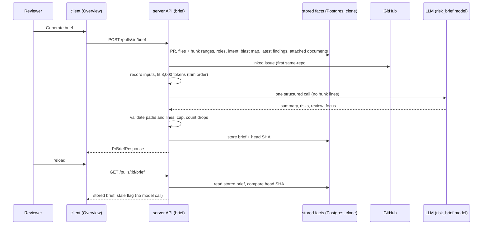

# Spec: PR Why + Risk Brief (L05 homework — PR Brief)
Spec ID: SPEC-2026-10-17-pr-brief
Status: approved
Supersedes: —

## Problem and user

A reviewer often opens someone else's pull request cold: they do not know why the change exists,
what in it is risky, or which file to read first. DevDigest already answers parts of this on
separate surfaces — the derived Intent (L03), the role-ordered Smart Diff (L03) and the Blast
radius map (L04) — but the reviewer has to assemble the picture alone, and nothing says which
lines deserve attention first.

The user is the person reviewing a pull request in the studio. With this feature the Overview tab
of a pull request carries one **PR Brief**: a short summary of what the PR does and why, the
Intent and Blast radius blocks side by side, model-written **Risk areas** (each tied to a file),
and a **Review focus** list of `file:line — reason` entries in reading order. One click on a
Review focus entry opens that file in Files changed. The brief is written by exactly one model
call over facts DevDigest has already computed — never the diff code itself — is cached against
the pull request's head commit, and says plainly which facts it had to do without.

## Goals / Non-goals

**Goals**
- A "PR Brief" section on the Overview tab with a Generate brief button while no brief exists,
  and, once generated, the summary, the Intent and Blast radius blocks side by side, Risk areas
  and Review focus.
- Generation by exactly one structured model call, with the model chosen in Settings
  (`risk_brief`), over computed facts only: the title, the stored intent, the blast-radius summary
  and caller files, diff stats with roles and new-side hunk ranges, the description, the linked
  issue, the attached spec documents, and the latest completed review's findings. No diff hunk
  body reaches the model.
- A model input budget of 8,000 tokens with a fixed trimming order, and a record of every input
  that was used, trimmed or missing, shown on the brief.
- Post-call validation that removes every file reference the pull request and its blast-radius map
  do not contain, so the brief names no invented path.
- A cache per pull request bound to the head SHA: a reload shows the stored brief with no model
  call, a newer commit marks it stale, and a Regenerate button replaces it.
- A jump from a Review focus entry to that file — and line — in the Files changed tab.
- The contract change: `summary` and `review_focus[{ file, line, reason }]` added to `PrBrief`,
  in the server's contracts and in the client's synced copy.

**Non-goals**
- The P3 criteria of the course task — the verdict banner with the latest review's verdict and PR
  score, a risk expanding to its explanation, a click on a risk opening its file, the "File not in
  this PR's diff" message, and a skeleton while generating. P3, deferred by the user in discovery;
  they keep their IDs in "Deferred" below. Until then the summary is plain text at the top of the
  brief, risk file references are plain text, and Regenerate sits in the section header.
- The course's delivery criteria — `spec.md` and `plan.md` committed before the code, the
  cross-model plan-review note, the plan-verifier report, the workflow-retro and cost report, the
  open PR with its demo video. They are tracked by the main session, not by this spec (Q19).
- Prior PRs touching these files (`PrBrief.history`, L04 P3): the field stays and is always empty;
  nothing renders it.
- Deriving an intent, or any second model call, while generating a brief (Q11).
- Automatic generation after a review run or on opening a pull request. Declined in discovery
  (P8): every generation costs a model call, and the task asks for a manual Generate.
- A `devdigest-mcp` tool for the brief. Declined in discovery (P7): not asked for by the task, and
  it would add an `mcp` change.
- A confirmation step before Regenerate. Declined in discovery (P9): the button is explicit and a
  generation costs at most two model requests.
- Choosing the spec documents per pull request or per agent. The brief uses every enabled agent's
  attachments (Q5).
- Any table or column change: the brief is stored in the starter's existing brief table, with
  the head SHA inside the stored JSON.
- Rendering the explanation of a risk (it is stored, not shown, while AC-86 is deferred).

## User stories
- US-1 — As a reviewer, I want a PR Brief block on the Overview tab with a Generate brief button,
  so that I can get a brief for a pull request that has none.
- US-2 — As a reviewer, I want the brief to show what the PR does and why, its risks with the file
  each concerns, and where to start reading, next to the Intent and Blast radius blocks, so that I
  start the review knowing what matters.
- US-3 — As a reviewer, I want to click a Review focus entry and land on that file and line in
  Files changed, so that I read the important lines first.
- US-4 — As a reviewer, I want a reload to show the same brief at once, and a button that
  regenerates it, so that I do not pay for a brief twice and can refresh it after the PR changes.
- US-5 — As a reviewer, I want the brief to name only files that are really in the PR or its
  blast radius, and to say which facts were missing, so that I can trust what it points at.
- US-6 — As the person paying for model calls, I want one bounded call per brief with the model I
  chose in Settings, visible in the logs, so that the cost stays predictable.

## Acceptance criteria (EARS)

The **six inputs** are intent, blast radius, diff stats, description, linked issue and spec
documents. "The PR Brief section" is the section headed "PR Brief" on the Overview tab.

| ID | Priority | Requirement | Story | Verify by |
|---|---|---|---|---|
| AC-1 | P1 | The Overview tab shall show a section headed "PR Brief". | US-1 | unit (client) |
| AC-2 | P1 | WHILE the pull request has no stored brief, the PR Brief section shall show the text "Brief not available yet." and a "Generate brief" button. | US-1 | unit (client) |
| AC-3 | P2 | WHILE the pull request has no stored brief, the PR Brief section shall show the Intent block and the Blast radius block. | US-1 | unit (client) |
| AC-4 | P1 | WHEN the user presses "Generate brief", the PR Brief section shall show the brief the API returns without a page reload. | US-1, US-2 | unit (client) |
| AC-5 | P1 | WHILE a brief is shown, the PR Brief section shall show the brief's summary as text above the Intent and Blast radius blocks. | US-2 | unit (client) |
| AC-6 | P1 | WHILE a brief is shown, the PR Brief section shall show the Intent block and the Blast radius block side by side in two columns. | US-2 | unit (client) |
| AC-7 | P1 | WHILE a brief is shown, the PR Brief section shall show, in the Intent column, a "Risk areas" block that lists each risk's title and each of its file references as plain text. | US-2, US-5 | unit (client) |
| AC-8 | P1 | WHILE a brief is shown, the PR Brief section shall show a "Review focus — read these first" block that lists each item as `<file>:<line> — <reason>` in the order the brief stores them. | US-2 | unit (client) |
| AC-9 | P2 | IF the brief has no risks, THEN the Risk areas block shall show "No notable risks flagged.". | US-2 | unit (client) |
| AC-10 | P2 | IF the brief has no review-focus items, THEN the Review focus block shall show "No review focus items.". | US-2 | unit (client) |
| AC-11 | P1 | IF an input was missing when the brief was generated, THEN the PR Brief section shall show a line that names each missing input with its reason. | US-5 | unit (client) |
| AC-12 | P2 | IF an input was trimmed to fit the input budget, THEN the PR Brief section shall name that input as trimmed in the same line. | US-5 | unit (client) |
| AC-13 | P2 | IF the brief records dropped risks or review-focus items, THEN the PR Brief section shall show how many risks and how many review-focus items were dropped. | US-5 | unit (client) |
| AC-14 | P2 | WHILE a brief is shown, the PR Brief section shall show a footer with the brief's model, its cost, the time since it was generated, and its input tokens out of the 8,000-token budget. | US-6 | unit (client) |
| AC-15 | P2 | The Intent block on the Overview tab shall not show the intent's risk-area tags. | US-2 | unit (client) |
| AC-16 | P2 | The Intent card on the Agent runs tab shall show the intent's risk-area tags as it did before this feature. | US-2 | unit (client) |
| AC-17 | P2 | WHILE the viewport is narrower than 900 px, the PR Brief section shall show the Intent column above the Blast radius column. | US-2 | unit (client) |
| AC-18 | P2 | The Overview tab shall show the Description section below the PR Brief section. | US-2 | unit (client) |
| AC-19 | P2 | The Review focus block shall show a path longer than 56 characters as its head and tail around "…" within 56 characters, with the full `<file>:<line>` as the row's tooltip whether the path is shortened or not. | US-2 | unit (client) |
| AC-20 | P2 | The PR Brief section shall take every user-facing label from the client's localized `brief` strings, with none written into the component. | US-2 | unit (client) |
| AC-21 | P1 | WHEN the user reloads the page of a pull request with a stored brief, the PR Brief section shall show that brief without requesting a new one. | US-4 | unit (client) |
| AC-22 | P1 | WHEN the user presses the Regenerate button in the PR Brief section header, the PR Brief section shall request a new brief and show it when it arrives. | US-4 | unit (client) |
| AC-23 | P2 | WHILE a request for a new brief is in flight, the PR Brief section shall show its Generate brief or Regenerate control disabled with the text "Generating…". | US-4, US-6 | unit (client) |
| AC-24 | P2 | WHILE a new brief is being generated, the PR Brief section shall keep showing the previous brief. | US-4 | unit (client) |
| AC-25 | P2 | IF loading the stored brief fails, THEN the PR Brief section shall show an error text with a Retry action and no "Generate brief" button. | US-1 | unit (client) |
| AC-26 | P2 | IF generation fails because the `risk_brief` provider has no API key, THEN the PR Brief section shall show a message that names the provider and links to Settings. | US-6 | unit (client) |
| AC-27 | P2 | IF generation fails for any other reason, THEN the PR Brief section shall show the error text and keep showing the previous brief. | US-4 | unit (client) |
| AC-28 | P2 | WHILE the stored brief is stale, the PR Brief section shall show "Generated for `<short SHA>`; the PR has newer commits" with a Regenerate action. | US-4 | unit (client) |
| AC-29 | P2 | The PR page shall request a new brief only when the user presses "Generate brief" or Regenerate. | US-6 | unit (client) |
| AC-30 | P2 | The PR Brief section shall render each Review focus item as a button whose accessible name is "Open `<file>:<line>` in Files changed". | US-3 | unit (client) |
| AC-31 | P2 | The PR Brief section shall give the Regenerate button the accessible name "Regenerate brief". | US-4 | unit (client) |
| AC-32 | P1 | WHEN the user clicks a Review focus item, the PR page shall show the Files changed tab with that item's file open and scrolled into view. | US-3 | unit (client) |
| AC-33 | P2 | WHEN the user clicks a Review focus item whose line is shown in the file's diff, the Files changed tab shall scroll that line into view. | US-3 | unit (client) |
| AC-34 | P2 | WHEN the Files changed tab scrolls to a target line, the Files changed tab shall mark that line and remove the mark within 2,000 ms. | US-3 | unit (client) |
| AC-35 | P2 | WHEN the user clicks a Review focus item, the PR page shall put `tab=diff`, `file=<path>` and `line=<n>` in its URL. | US-3 | unit (client) |
| AC-36 | P2 | WHEN the user clicks a Review focus item, the PR page shall add a browser-history entry, so that Back returns to the Overview tab. | US-3 | unit (client) |
| AC-37 | P2 | WHEN the target file lies in a collapsed role group or has a collapsed file card, the Files changed tab shall expand the group and the card. | US-3 | unit (client) |
| AC-38 | P2 | IF the target line is not shown in the file's diff, THEN the Files changed tab shall scroll to the file and mark no line. | US-3 | unit (client) |
| AC-39 | P2 | IF the target file is not in the pull request's diff, THEN the Files changed tab shall open without scrolling and without an error message. | US-3 | unit (client) |
| AC-40 | P2 | WHEN the PR page loads with `tab=diff`, `file` and `line` in its URL, the Files changed tab shall perform the jump once. | US-3 | unit (client) |
| AC-41 | P2 | WHEN the user changes tab by hand, the PR page shall remove `file` and `line` from its URL. | US-3 | unit (client) |
| AC-42 | P2 | The Files changed tab shall perform the jump in both the Smart and the Original order. | US-3 | unit (client) |
| AC-43 | P1 | WHEN `POST /pulls/:id/brief` is called for a pull request of the caller's workspace, the API shall answer `200` with a brief that holds a summary, a list of risks and a list of review-focus items. | US-1, US-2 | integration (server) |
| AC-44 | P1 | WHEN `POST /pulls/:id/brief` succeeds, the API shall store the brief with the pull request's head SHA, replacing any earlier brief of that pull request. | US-4 | integration (server) |
| AC-45 | P1 | WHEN `GET /pulls/:id/brief` is called for a pull request with a stored brief, the API shall answer that brief without calling the model. | US-4 | integration (server) |
| AC-46 | P1 | WHILE a pull request has no stored brief, `GET /pulls/:id/brief` shall answer `200` with `brief: null`. | US-1 | integration (server) |
| AC-47 | P1 | The API shall keep in a generated brief only the risk file references whose path is a changed file of the pull request or a file of its blast-radius map. | US-5 | unit (server) |
| AC-48 | P1 | IF a risk has no file reference left after validation, THEN the API shall drop the risk. | US-5 | unit (server) |
| AC-49 | P1 | The API shall keep in a generated brief only the review-focus items whose file is a changed file of the pull request. | US-5 | unit (server) |
| AC-50 | P2 | IF a review-focus item's line lies outside every new-side hunk of a file whose diff is stored, THEN the API shall move the line to the start of the nearest new-side hunk of that file. | US-3, US-5 | unit (server) |
| AC-51 | P2 | The API shall record in each generated brief the number of risks and the number of review-focus items that validation dropped. | US-5 | unit (server) |
| AC-52 | P2 | The API shall store at most 6 risks, at most 6 review-focus items and a summary of at most 600 characters per brief. | US-2, US-6 | unit (server) |
| AC-53 | P1 | WHEN the pull request has no derived intent, no blast-radius map, or neither, the API shall still generate a brief. | US-2, US-5 | integration (server) |
| AC-54 | P1 | The API shall record in each generated brief, for each of the six inputs, whether it was used, trimmed or missing, with the reason. | US-5 | unit (server) |
| AC-55 | P2 | The API shall build the model input from the pull request's title, its stored intent, the blast-radius summary with its caller files, the diff totals, each changed file with its additions, deletions, role and new-side hunk ranges, the description, the linked issue, the attached spec documents, and at most 20 non-dismissed findings of the latest completed review, ordered CRITICAL → WARNING → SUGGESTION, each as `file:line severity title`. | US-2, US-6 | integration (server) |
| AC-56 | P2 | The API shall send no added, removed or context line of any diff hunk to the model. | US-6 | integration (server) |
| AC-57 | P2 | The API shall keep the model input of a brief at or below 8,000 tokens, counted with the `cl100k_base` tokenizer over all messages of the call. | US-6 | unit (server) |
| AC-58 | P2 | WHEN the model input would exceed 8,000 tokens, the API shall trim it in this order until it fits: spec documents, whole, last first; the latest review's findings, from the end; the linked issue's body to 1,000 tokens, then the linked issue; the description to 1,500 tokens; the blast-radius caller list, keeping the summary and totals; the changed-file list from its end, recording how many files were left out. | US-6 | unit (server) |
| AC-59 | P2 | The API shall never trim the title, the intent or the diff totals. | US-6 | unit (server) |
| AC-60 | P2 | The API shall make exactly one structured model call per brief generation, with at most one repair attempt inside it. | US-6 | integration (server) |
| AC-61 | P2 | WHEN a brief generation calls the model, the API shall write one log line before the call and one after it that carry the provider, the model, the input tokens and budget, the inputs' status, the output tokens, the cost, the attempts, the duration and the dropped counts, and no pull-request text or model output. | US-6 | integration (server) |
| AC-62 | P2 | The API shall call the provider and model set for `risk_brief` in the workspace's Settings, or the registry default when none is set. | US-6 | integration (server) |
| AC-63 | P2 | The `PrBrief` contract shall hold `summary` and `review_focus` items of `{ file, line, reason }`, identical in the server's contracts and in the client's copy. | US-2 | unit (server) |
| AC-64 | P2 | IF the model's answer does not match the brief schema after one repair attempt, THEN the API shall answer `502` and leave the stored brief unchanged. | US-5 | integration (server) |
| AC-65 | P2 | WHEN `GET /pulls/:id/brief` answers a brief whose head SHA differs from the pull request's current head SHA, the API shall mark it `stale: true`. | US-4 | integration (server) |
| AC-66 | P2 | The API shall take the spec documents from the union of the documents attached to every enabled agent of the workspace and to those agents' enabled linked skills, agents in name order, each path once at its first position. | US-2 | integration (server) |
| AC-67 | P2 | IF no document is attached to any enabled agent or its enabled linked skills, THEN the API shall record the spec documents input as missing with the reason `none_attached`. | US-5 | unit (server) |
| AC-68 | P2 | IF the pull request's repository has no clone, THEN the API shall record the spec documents input as missing with the reason `not_cloned`. | US-5 | unit (server) |
| AC-69 | P2 | The API shall not derive an intent while generating a brief. | US-6 | integration (server) |
| AC-70 | P2 | IF the stored intent is stale, THEN the API shall use it and record the intent input with the reason `stale`. | US-5 | unit (server) |
| AC-71 | P2 | IF the blast-radius map is degraded and still holds symbols, THEN the API shall use it and record the blast radius input with the degraded reason. | US-5 | unit (server) |
| AC-72 | P2 | IF the blast-radius map holds no symbol, THEN the API shall record the blast radius input as missing with the map's degraded reason, or `no_data`. | US-5 | unit (server) |
| AC-73 | P2 | The API shall read the linked issue from GitHub as the first same-repository `#N` reference in the pull request's description. | US-2 | integration (server) |
| AC-74 | P2 | IF no issue is referenced or the referenced issue cannot be read, THEN the API shall record the linked issue input as missing with the reason. | US-5 | unit (server) |
| AC-75 | P2 | IF the `risk_brief` provider has no API key, THEN `POST /pulls/:id/brief` shall answer `400` with the code `brief_unavailable` and a message that names the provider. | US-6 | integration (server) |
| AC-76 | P2 | IF the model call fails or takes longer than 60 s, THEN `POST /pulls/:id/brief` shall answer `502` and leave the stored brief unchanged. | US-4 | integration (server) |
| AC-77 | P2 | IF the pull request has no stored changed files, THEN `POST /pulls/:id/brief` shall answer `422`. | US-5 | integration (server) |
| AC-78 | P2 | IF the pull request does not exist in the caller's workspace, THEN `GET` and `POST /pulls/:id/brief` shall answer `404`. | US-1 | integration (server) |
| AC-79 | P2 | WHILE a brief generation for a pull request is in flight, the API shall answer a second `POST /pulls/:id/brief` for that pull request with the same result and make no second model call. | US-6 | integration (server) |
| AC-80 | P2 | IF a client sends more than 10 `POST /pulls/:id/brief` requests within one minute, THEN the API shall answer `429`. | US-6 | integration (server) |
| AC-81 | P2 | IF the stored brief does not parse as the brief contract, THEN `GET /pulls/:id/brief` shall answer `brief: null`. | US-4 | integration (server) |
| AC-82 | P2 | The API shall generate a brief for a pull request whatever its status: open, closed or merged. | US-1 | integration (server) |
| AC-83 | P2 | WHEN the user of the seeded stack opens the Overview tab of PR #482, the PR Brief section shall show the seeded brief without a model call. | US-4 | e2e |
| AC-84 | P2 | WHEN the user of the seeded stack clicks the `src/config.ts:12` Review focus item of PR #482, the PR page shall show the Files changed tab with `src/config.ts` open and line 12 marked. | US-3 | e2e |

### Deferred

These P3 criteria of the course task are deferred by the user's decision in discovery
(2026-10-17): "P3, deferred by the user in discovery". They keep their IDs, are not part of this
delivery, and no remaining criterion depends on them. Taking one up later means moving it back
into the table above together with its module requirements, which are deferred in the client
spec.

| ID | Priority | Requirement | Story | Verify by |
|---|---|---|---|---|
| AC-85 | P3 — deferred | WHILE a brief is shown and the pull request has a completed review, the PR Brief section shall show a banner with that review's verdict, findings count and PR score above the summary. | US-2 | unit (client) |
| AC-86 | P3 — deferred | WHEN the user expands a risk, the Risk areas block shall show that risk's explanation as text. | US-2 | unit (client) |
| AC-87 | P3 — deferred | WHEN the user clicks a risk, the PR page shall show the Files changed tab with the risk's first referenced file open. | US-3 | unit (client) |
| AC-88 | P3 — deferred | IF the file of a clicked risk or Review focus item is not in the pull request's diff, THEN the PR page shall show the message "File not in this PR's diff" and stay on the Overview tab. | US-3 | unit (client) |
| AC-89 | P3 — deferred | WHILE a brief is being generated, the PR Brief section shall show a skeleton in place of the summary, Risk areas and Review focus. | US-1 | unit (client) |

## Edge cases
| ID | Case | Expected behaviour | Covered by |
|---|---|---|---|
| EC-1 | No brief exists yet | Empty state with Generate brief; Intent and Blast radius still shown | AC-2, AC-3 |
| EC-2 | The PR has no derived intent | The brief is generated; intent recorded missing `not_derived` and named on the brief; no intent derivation | AC-53, AC-54, AC-11, AC-69 |
| EC-3 | The stored intent is stale | Used, recorded with `stale` | AC-70 |
| EC-4 | Blast map degraded (`index_partial`, …) or empty (flag off, not indexed) | Partial map used with its reason; empty map recorded missing, and risk refs are validated against PR files only | AC-71, AC-72, AC-47 |
| EC-5 | No issue referenced; no GitHub token; issue not found | Linked issue recorded missing with the reason | AC-74 |
| EC-6 | No document attached; repository not cloned; every attached document unreadable | Spec documents recorded missing `none_attached`, `not_cloned` or `all_skipped` | AC-67, AC-68, AC-54 |
| EC-7 | The PR has no completed review | The input carries no findings; not listed as a missing input | AC-55 |
| EC-8 | The facts exceed 8,000 tokens | Trimmed in the fixed order; each cut recorded and shown | AC-58, AC-12 |
| EC-9 | Title, intent and diff totals alone exceed 8,000 tokens | Cannot occur: a GitHub title is at most 256 characters and the L03 intent is clamped | accepted: no handling |
| EC-10 | The model names a path that is in neither the PR nor the blast map | The reference or item is dropped and counted | AC-47, AC-48, AC-49, AC-51 |
| EC-11 | The model writes `./src/a.ts` or `src/a.ts:12` as a Review focus file | One leading `./` is removed before matching; any other form does not match and the item is dropped | AC-49 |
| EC-12 | A risk cites a caller file of the blast map that the PR does not change | Kept | AC-47 |
| EC-13 | A Review focus item cites a blast-only file | Dropped: Review focus is limited to changed files | AC-49 |
| EC-14 | A Review focus line lies outside the file's changed ranges | Moved to the start of the nearest new-side hunk | AC-50 |
| EC-15 | A focus file has no stored patch (binary, too large) | Line kept as given; the jump scrolls to the file header | AC-50, AC-38 |
| EC-16 | Validation drops every risk or every focus item | Empty-list texts and the dropped counts | AC-9, AC-10, AC-13 |
| EC-17 | The model returns more than 6 risks or focus items, or a long summary | Cut to 6 and 600 characters | AC-52 |
| EC-18 | The model's JSON does not match the schema | One repair attempt, then `502`; the stored brief is unchanged | AC-60, AC-64 |
| EC-19 | No API key for the `risk_brief` provider | `400 brief_unavailable`; message naming the provider with a Settings link | AC-75, AC-26 |
| EC-20 | Model error or a call over 60 s | `502`; the previous brief stays shown | AC-76, AC-27 |
| EC-21 | Double click, a second tab, or a reload while a generation runs | The control is disabled while in flight; a second `POST` joins the running generation | AC-23, AC-79 |
| EC-22 | A new commit is pushed after the brief | Marked stale with Regenerate; no automatic regeneration | AC-65, AC-28, AC-29 |
| EC-23 | The intent, blast map or Settings model changes without a new commit | The brief is not marked stale | accepted: no handling |
| EC-24 | The stored JSON no longer parses (contract change) | Treated as no brief | AC-81 |
| EC-25 | The PR's changed files are not loaded yet | `422` | AC-77 |
| EC-26 | The PR has more than 100 changed files | Only the first 100 that GitHub lists are known; references to the others are dropped | accepted: no handling |
| EC-27 | The PR is closed or merged | Generation and the jump still work | AC-82 |
| EC-28 | The jump target sits in a collapsed group or a collapsed file card | Both are expanded | AC-37 |
| EC-29 | A stale brief points at a file that the PR no longer changes | Files changed opens without scrolling and without a message | AC-39 |
| EC-30 | A reload with `file` and `line` in the URL; a manual tab change | The jump repeats once; a manual tab change clears the parameters | AC-40, AC-41 |
| EC-31 | Files changed is in Original order | The jump still works | AC-42 |
| EC-32 | A very long file path in Review focus | Over 56 characters: head and tail around "…"; the row's tooltip always holds the full `<file>:<line>` | AC-19 |
| EC-33 | A narrow window | The two columns stack | AC-17 |
| EC-34 | The description, issue or a document says "ignore your instructions" | Fenced as untrusted data; output validated | NFR-5 |
| EC-35 | Model output contains HTML or markdown | Rendered as text | NFR-5 |
| EC-36 | The model returns a risk kind the UI has no icon for | A generic warning icon | accepted: no handling beyond the generic icon |
| EC-37 | Repeated generation requests | `429` after 10 per minute | AC-80 |
| EC-38 | A generation started in another tab | This tab does not show "Generating…"; its next `POST` joins the running one | AC-79; accepted: no indicator |
| EC-39 | The L03 risk-area tags and the brief's Risk areas would both show on Overview | Tags hidden on Overview, kept on Agent runs | AC-15, AC-16 |
| EC-40 | Regenerate fails | Previous brief stays | AC-27, AC-76 |
| EC-41 | The seeded stack has no API key | The seeded brief shows from the cache | AC-83 |

## Non-functional requirements
- NFR-1 — LLM budget: model input at most 8,000 tokens per generation, counted with `cl100k_base`
  over every message; output at most 2,000 tokens; temperature 0; one structured model call
  with at most one repair attempt, so at most 2 provider requests and at most 20,000 tokens
  (2 × (8,000 + 2,000)) per generation. `GET /pulls/:id/brief` makes 0 model calls and 0 GitHub
  calls.
- NFR-2 — Latency: the model call is aborted after 60 s. Collecting the inputs before the call
  makes at most one GitHub request (the linked issue).
- NFR-3 — Reliability: a failed generation never changes or deletes the stored brief; at most one
  generation per pull request runs at a time in a server process.
- NFR-4 — Limits: at most 6 risks and 6 review-focus items; summary at most 600 characters;
  at most 20 review findings in the input;
  linked-issue body at most 1,000 tokens; description at most 1,500 tokens when trimming applies;
  each spec document at most 100 KB (the project-context read limit); `POST` at most 10 requests
  per minute.
- NFR-5 — Security: every input taken from the repository, GitHub or an earlier model answer is
  wrapped with `wrapUntrusted()` and follows a trusted note that calls it data, not instructions;
  no diff hunk line reaches the model; the model's output is validated by the schema, its file
  references and focus files are checked against the PR and blast-map paths, and every text it
  produced is rendered as text, never HTML. Log lines carry counts, ids and reasons, never
  pull-request text, document text, model output or keys. `groundFindings()` is not involved: the
  brief creates no review findings, and review runs are unchanged.
- NFR-6 — Accessibility: every Review focus item and the Regenerate control are buttons with
  accessible names, reachable with Tab and activated with Enter or Space.

## Inputs and provenance
**Sources of this spec**
- Course task "L05 Homework — PR Why + Risk Brief" (`edu.goit.global/uk/learn/53989320/53167848/53168004/homework`),
  Ukrainian original, read on 2026-10-17 from the saved copy; its five screenshots (Overview with
  the brief; Files changed after a Review focus click; the banner, Risk areas and Review focus
  outlined; Files changed scrolled to a finding). Priorities P1/P2/P3 are the task's.
- Design: the decoded PR-detail screen of `docs/DevDigest Design (context).html`
  (`screen_pr_detail.jsx`: `BriefCard`, `BriefEmpty`, `BriefSkeleton`, `RiskPillRow`,
  `ReviewFocusBlock`, `goto` and the navigation toast), its mock data (`RISKS`, `REVIEW_FOCUS`),
  `findings.jsx` (`VerdictBanner`) and `diff.jsx` (the deep-link scroll and line pulse).
- The verified starting state of the code (`facts.md`, 2026-10-17) and the code at base commit
  `f4b7252` (`origin/main`; branch `feature/l05-pr-brief`).
- Discovery report and the user's answers, 2026-10-17: scope = P1 and the product P2 criteria,
  P3 deferred (Q1); the design's layout with the L03 tag row hidden on Overview (Q2, Q3); the
  contract shape (Q4); spec documents from every enabled agent (Q5); the budget and trim order
  (Q6); hunk ranges and the latest review's findings as inputs (Q7, P6); the remaining questions,
  gaps and proposals as recorded in the Spec report.
- The user's answers to the draft's open questions, 2026-10-18: the latest review's findings
  enter the input as at most 20 non-dismissed findings, CRITICAL → WARNING → SUGGESTION, each
  `file:line severity title`, trimmed from the end right after the spec documents and before the
  linked issue (former OQ-1; AC-55, AC-58); the criteria derived in discovery rather than from a
  task criterion — AC-3, AC-9, AC-10, AC-12–AC-20, AC-23–AC-31, AC-35–AC-42, AC-50–AC-52, AC-55,
  AC-58, AC-59, AC-66–AC-84 — stay P2 (former OQ-2).

**Data flow**
| Data | Produced by | Contract | Consumed by | When unavailable |
|---|---|---|---|---|
| Stored intent (summary, scope lists, `stale`) | `server` — intent module | `PrIntentRecord` (read inside the server) | brief generation; `client` Intent block (live, `GET /pulls/:id/intent`) | input `missing: not_derived`; never derived by the brief |
| Blast-radius summary, totals, changed-symbol files, caller files | `server` — blast module over the repo-intel index | `BlastRadiusResponse` | brief generation (input and validation set); `client` Blast radius block (live) | degraded reason recorded; no symbol → `missing`, validation uses PR files only |
| Changed files: path, +/−, new-side hunk ranges | `server` — pulls (stored files, refreshed by `GET /pulls/:id`) | `PrDetail.files` | brief generation; `client` Files changed tab | no files → `422` |
| File roles | `server` — file-role rules (Smart Diff) | `SmartDiffRole` | brief generation | always computable |
| Title, description, head SHA | `server` — pulls | `PrDetail` | brief generation; stale check | empty description → `missing: empty` |
| Linked issue | GitHub, at generation | `IssueMeta` | brief generation | none, no token, not found, fetch failure → `missing` with the reason |
| Spec documents | `server` — project context, from the clone | document text | brief generation | none attached, not cloned, all skipped → `missing`; over budget → `trimmed` |
| Latest completed review's findings (at most 20, non-dismissed, by severity) | `server` — reviews | `FindingRecord` | brief generation | no completed review → no findings in the input; over budget → trimmed from the end |
| Model choice | Settings `feature_models.risk_brief` | `FeatureModelChoice` | brief generation | registry default `openai / gpt-4.1` |
| The brief | `server` — new brief module, stored per pull request | `PrBriefResponse` / `PrBriefRecord` / extended `PrBrief` | `client` PR Brief section | `brief: null` → empty state; request error → error with Retry |
| Jump target | `client` — Review focus click | URL `?tab=diff&file=&line=` | `client` Files changed tab | file not in the diff → tab opens without scrolling |

## Ownership
| Part | Package | Module spec |
|---|---|---|
| The `brief` module and its two routes, input collection and budget, the model call, validation, the cache and stale flag, errors, logs, rate limit, the seeded brief, and every `@devdigest/shared` contract change | `server/` | [`server/specs/L05-pr-brief.md`](../server/specs/L05-pr-brief.md) |
| The PR Brief section and its states on the Overview tab, the Intent / Blast radius placement, strings, and the jump into Files changed | `client/` | [`client/specs/L05-pr-brief.md`](../client/specs/L05-pr-brief.md) |
| No change (`wrapUntrusted()` is used as it is) | `reviewer-core/` | — |
| No change | `mcp/` | — |
| The flows of AC-83 and AC-84 | `e2e/` | written by `test-writer` in `e2e/specs/` |

## Untrusted inputs
| Input | Origin | Reaches | Handling |
|---|---|---|---|
| PR title and description | the PR author, through GitHub | the model input; the stored intent snapshot | Sanitised as the intent module does (HTML comments and invisible characters removed); description trimmed to 1,500 tokens when over budget; wrapped with `wrapUntrusted()`; never rendered by the brief. |
| Linked issue title and body | anyone who can open an issue | the model input | Same; body at most 1,000 tokens; wrapped with `wrapUntrusted()`. |
| Spec document text | the repository's default branch, through the clone | the model input | The existing project-context read rules (inside the clone after symlinks, at most 100 KB, strict UTF-8); each document wrapped with `wrapUntrusted()` under its path; trimmed first. Not stored in the brief. |
| Stored intent and latest findings' titles | earlier model answers over untrusted text | the model input; the intent snapshot in the brief | Treated as untrusted: wrapped with `wrapUntrusted()`. |
| File paths, hunk ranges, blast caller names, endpoints, crons | the repository and GitHub | the model input; the validation set; the URL | Paths and names inside the fence; hunk ranges sent as numbers only, never a hunk's lines or the text after `@@`. |
| Model output: summary, risk kinds, titles, explanations, file references, focus files, lines, reasons | the `risk_brief` model | the stored brief; the PR Brief section; the URL `file` parameter | Validated by the schema (one repair attempt); capped; references and focus files checked against the PR and blast-map paths; lines are integers ≥ 1 and moved into a changed range; every text rendered as a text node, never as HTML or markdown; the URL `file` value is only compared with the PR's file paths. |
| `:id` of `GET` / `POST /pulls/:id/brief` | the client | a database lookup | Route schema `IdParams`; workspace scoping answers `404` for another workspace's pull request; `POST` has no body. |

## Open questions
None. The user answered both questions of the first draft on 2026-10-18 (see Inputs and provenance).
