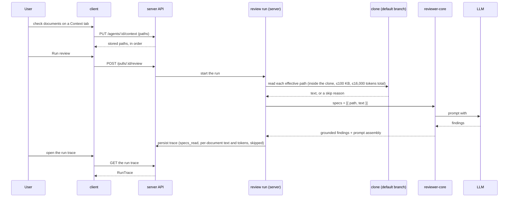

# Spec: Project Context (L05 — Project Context Folder)
Spec ID: SPEC-2026-10-16-project-context
Status: approved
Supersedes: —

## Problem and user

A team writes its rules down — specifications, architecture notes, incident write-ups — in
markdown files inside the repository. The DevDigest reviewer never sees them: it reads the diff,
the PR text, skills, the derived intent and repo-intel context, so a pull request that breaks a
written invariant ("module `api/` does not import `db/` directly") passes unless the rule was
copied by hand into an agent's system prompt or a skill.

The user is the person who configures reviewer agents and skills in the studio. With this
feature they find every markdown document of the repository on one page, attach the ones that
matter to an agent or to a skill, see what each costs in tokens before a run, and afterwards see
in the run trace exactly which documents went into the prompt and read the text that was sent.
A specification stops being a document only for humans and starts steering the reviewer.

## Goals / Non-goals

**Goals**
- Discover every `.md` file under folders named `specs`, `docs` or `insights` (the search roots,
  set in server configuration) at any depth of a repository's clone, and list it with its path,
  type and token count.
- A view-only **Project Context** page that lists the documents, previews each one, shows the
  totals and where a document is used.
- A **Context** tab in the agent editor and in the skill editor ("Project context to use") to
  attach documents by hand, in an order, with a filter, a preview and a token total.
- Store only the attached **paths**; read the files at run time and insert their text into the
  existing `## Project context` prompt slot as untrusted, fenced data, with zero extra LLM calls.
- Make every run transparent: `specs_read`, each document's token count, the skipped documents
  with a reason, and each inserted document's full text as sent, in the run trace.

**Non-goals**
- Automatic selection of documents from the PR's content (the "flash-selector"). A later
  feature; the lab and the user both put it out of scope.
- Any extra LLM call to select, summarise or shorten documents.
- Indexing, chunking or embedding documents: the design's "Re-index", "Indexed: 12 files ·
  1,240 chunks" and the COVERAGE ring are not built. Documents are read whole.
- Creating, uploading, editing or deleting files from the Project Context page (the design's New
  file, New folder, Upload, Edit). The page is view-only: the clone is a read-only mirror that a
  resync overwrites (`reset --hard`), so an edit would be lost and would never reach GitHub. The
  instructor allows a view-only page ([29:10]). Declined in discovery (G4).
- Storing document content in the database. Only attached paths are stored.
- Reading documents from the PR's head or from a local branch. Documents come from the
  repository's default branch as last cloned or resynced; a document must be merged to the
  default branch to be seen ([40:20]).
- Versioning attachments: attaching or detaching does not bump an agent's or a skill's version
  and is not part of an agent's version snapshot ([30:01], Q12).
- The skill section's "Serializes as" preview from the design. It shows a format the prompt does
  not use. Declined in discovery (G13).
- Per-repository attachment sets. Paths are stored without a repository, so the same path is
  resolved against whichever repository a PR belongs to, and the "Used by" count is across all
  agents and skills of the workspace. Accepted limitation (Q2, P2).
- Project context in the CI / GitHub Action runner (L06), and any change to `devdigest-mcp`.
- A UI to edit the search roots; they are a server setting only.
- Scanning documents for secrets. A document the user attaches is sent to the model by the
  user's choice.
- Automating the live check below; it is a manual verification.
- The design's Evals, Stats, CI and Versions tabs, the Onboarding generator and the PR Brief card
  (other features of L05 and later lessons).

## User stories
- US-1 — As an agent author, I want to see every specification and other markdown document of
  the repository on a Project Context page with its path, type, token count and content, so that
  I know what context exists and what it would cost.
- US-2 — As an agent author, I want to attach documents to an agent in its Context tab, in an
  order, and see the tokens they add, so that the agent's reviews check the team's written rules.
- US-3 — As an agent author, I want to attach documents to a skill, so that every agent that
  uses the skill inherits them.
- US-4 — As a reviewer of a pull request, I want the review agent to receive the attached
  documents' text from the project as untrusted data in its prompt, so that it flags a change
  that breaks a documented rule and names the document.
- US-5 — As an agent author, I want the run trace to show which documents were inserted, their
  size in tokens, and the full text sent, so that I can check what the model actually saw.
- US-6 — As an agent author, I want to see how many agents and skills use a document, so that I
  know the impact of changing it.

## Acceptance criteria (EARS)

"A Context tab" means either the agent editor's Context tab or the skill editor's Context tab
("Project context to use"); a criterion whose subject is "the Context tab" holds for both.

| ID | Priority | Requirement | Story | Verify by |
|---|---|---|---|---|
| AC-1 | P1 | WHEN `GET /repos/:id/context` is called for a cloned repository, the API shall return every `.md` file that lies under a folder named after a search root, at any depth of the clone's working tree. | US-1 | integration (server) |
| AC-2 | P1 | WHERE the server's search-root setting is not set, the API shall use the search roots `specs`, `docs` and `insights`. | US-1 | unit (server) |
| AC-3 | P2 | WHERE the server's search-root setting names other folder names, the API shall search under folders with those names instead of the defaults. | US-1 | unit (server) |
| AC-4 | P1 | The API shall leave out every file inside a directory named `node_modules`, `dist`, `build`, `coverage`, `.next`, `out`, `vendor` or `.git`. | US-1 | unit (server) |
| AC-5 | P1 | The API shall leave out every file and directory that is reached through a symbolic link. | US-1 | unit (server) |
| AC-6 | P1 | The API shall return, for each document, its path relative to the repository root, its type, its size in bytes and its token count. | US-1 | unit (server) |
| AC-7 | P1 | The API shall set a document's type to the name of the nearest search-root folder that encloses it (`docs/specs/a.md` is `specs`). | US-1 | unit (server) |
| AC-8 | P1 | The API shall read documents from the clone's working tree, which holds the repository's default branch as last cloned or resynced. | US-1 | integration (server) |
| AC-9 | P2 | The API shall leave out a path that contains a control character, a double quote, `<`, `>` or a backslash, or that is longer than 512 characters. | US-1 | unit (server) |
| AC-10 | P2 | IF a document is larger than 100 KB, THEN the API shall mark it `too_large`. | US-1 | unit (server) |
| AC-11 | P2 | IF a document cannot be decoded as UTF-8 text, THEN the API shall mark it `unreadable`. | US-1 | unit (server) |
| AC-12 | P2 | WHEN a repository holds more than 1,000 documents, the API shall return the first 1,000 by path and mark the list as capped at 1,000. | US-1 | unit (server) |
| AC-13 | P2 | IF the repository has no clone on disk, THEN the API shall answer `200` with the state `not_cloned` and an empty document list. | US-1 | integration (server) |
| AC-14 | P1 | The API shall store no document content in the database. | US-2 | integration (server) |
| AC-15 | P1 | The API shall count a document's tokens with the same token counter the run trace uses. | US-1 | unit (server) |
| AC-16 | P1 | WHEN the user opens the Project Context page of a repository, the Project Context page shall list every document the API returned with its path, its type badge (coloured for `specs`, `docs` and `insights`, neutral for any other search root) and its token count. | US-1 | unit (client) |
| AC-17 | P1 | WHEN the user selects a document on the Project Context page, the Project Context page shall show that document's content rendered as markdown. | US-1 | unit (client) |
| AC-18 | P1 | The Project Context page shall offer no control that creates, uploads, edits or deletes a file. | US-1 | unit (client) |
| AC-19 | P1 | The sidebar's WORKSPACE section shall show a "Project Context" item that opens the Project Context page of the active repository. | US-1 | unit (client) |
| AC-20 | P2 | The Project Context page footer shall show "N files · T tokens total" for the listed documents. | US-1 | unit (client) |
| AC-21 | P2 | WHEN the user presses Refresh on the Project Context page, the Project Context page shall request the document list again. | US-1 | unit (client) |
| AC-22 | P2 | WHEN the user types in the Project Context page's filter, the Project Context page shall show only the documents whose path contains the typed text, ignoring case. | US-1 | unit (client) |
| AC-23 | P2 | The Project Context page shall keep the selected document's path in the URL. | US-1 | unit (client) |
| AC-24 | P2 | IF the repository has no documents, THEN the Project Context page shall show "No markdown under specs/, docs/ or insights/ in `<repository>`" with a Resync action. | US-1 | unit (client) |
| AC-25 | P2 | WHILE the document list is loading, the Project Context page and the Context tab shall show a loading skeleton. | US-1, US-2 | unit (client) |
| AC-26 | P2 | IF the document list request fails, THEN the Project Context page and the Context tab shall show an error state with a Retry action. | US-1, US-2 | unit (client) |
| AC-27 | P2 | WHILE the repository is not cloned, the Project Context page and the Context tab shall show "Repository not cloned yet". | US-1, US-2 | unit (client) |
| AC-28 | P2 | WHEN the document list is capped, the Project Context page shall show a mark that names the 1,000-document cap. | US-1 | unit (client) |
| AC-29 | P2 | WHEN the user selects a document, the Project Context page shall show "Used by N agents · M skills", where N also counts each agent that receives the document only through an enabled linked skill and states how many agents do so (e.g. "Used by 2 agents (1 via skill) · 1 skill"). | US-6 | unit (client) |
| AC-30 | P2 | WHEN `GET /repos/:id/context/file` is called for a document, the API shall return the number of agents, enabled or disabled, that attach it directly; the number of other agents that link an enabled skill attaching it; and the number of skills, enabled or disabled, that attach it. | US-6 | integration (server) |
| AC-31 | P3 | The Project Context page header shall show the branch and the short commit SHA the documents were read from. | US-1 | unit (client) |
| AC-32 | P3 | The Project Context page shall offer a type filter with one option per document type and the number of documents of that type. | US-1 | unit (client) |
| AC-33 | P1 | The agent editor shall show a Context tab after the Skills tab. | US-2 | unit (client) |
| AC-34 | P1 | The skill editor shall show a Context tab, titled "Project context to use", between the Config and Preview tabs. | US-3 | unit (client) |
| AC-35 | P1 | WHEN the user opens a Context tab, the Context tab shall list every document of the active repository with a checkbox, its path, its type badge (coloured for `specs`, `docs` and `insights`, neutral for any other search root) and a Preview control. | US-2, US-3 | unit (client) |
| AC-36 | P1 | The Context tab shall list the attached documents first, in their attached order, and then the other documents by path. | US-2, US-3 | unit (client) |
| AC-37 | P1 | WHEN the user checks or unchecks a document, the Context tab shall save the new list of attached paths at once. | US-2, US-3 | unit (client) |
| AC-38 | P1 | WHEN `PUT /agents/:id/context` or `PUT /skills/:id/context` receives an ordered list of paths, the API shall store exactly those paths in that order and return them. | US-2, US-3 | integration (server) |
| AC-39 | P1 | WHEN the user types in the Context tab's filter, the Context tab shall show only the documents whose path contains the typed text, ignoring case. | US-2, US-3 | unit (client) |
| AC-40 | P1 | WHEN the user presses Preview on a row, the Context tab shall open a drawer that shows the document rendered as markdown and an Attach / Attached toggle. | US-2, US-3 | unit (client) |
| AC-41 | P1 | The Context tab shall show "≈ T tokens", the sum of the token counts of the attached documents. | US-2, US-3 | unit (client) |
| AC-42 | P2 | WHEN the user drags an attached row to a new position, the Context tab shall save the attached paths in the new order. | US-2, US-3 | unit (client) |
| AC-43 | P2 | WHILE the Context tab's filter is not empty, the Context tab shall disable reordering. | US-2, US-3 | unit (client) |
| AC-44 | P2 | IF the attached total exceeds 4,000 tokens, THEN the Context tab shall show an "over 4K soft cap" badge and keep attaching enabled. | US-2, US-3 | unit (client) |
| AC-45 | P2 | IF the attached total exceeds 16,000 tokens, THEN the Context tab shall show a note that names the documents a run will skip. | US-2, US-3 | unit (client) |
| AC-46 | P2 | IF an attached path is not found in the active repository, THEN the Context tab shall show it at its attached position, marked "not found in `<repository>`", counted as 0 tokens, with a checkbox that still detaches it. | US-2, US-3 | unit (client) |
| AC-47 | P2 | IF a document is marked `too_large` or `unreadable`, THEN the Context tab shall show the mark and disable the document's checkbox. | US-2, US-3 | unit (client) |
| AC-48 | P2 | IF saving the attached list fails, THEN the Context tab shall restore the last saved state and show an error message. | US-2, US-3 | unit (client) |
| AC-49 | P2 | WHILE a save is in flight, the Context tab shall queue further changes so that the stored list ends equal to the last list shown. | US-2, US-3 | unit (client) |
| AC-50 | P2 | IF no document matches the filter, THEN the Context tab shall show "No documents match '`<text>`'". | US-2, US-3 | unit (client) |
| AC-51 | P2 | IF no repository is active, THEN the Context tab shall show "Add a repository" with a link to add one. | US-2, US-3 | unit (client) |
| AC-52 | P2 | The Context tab shall give each checkbox an accessible name that contains the document's path. | US-2, US-3 | unit (client) |
| AC-53 | P2 | The Context tab shall let the user reorder attached rows with the keyboard. | US-2, US-3 | unit (client) |
| AC-54 | P2 | The agent editor and the skill editor shall keep an open Context tab in the URL as `?tab=context`. | US-2, US-3 | unit (client) |
| AC-55 | P2 | WHEN the attached paths of an agent or a skill change, the API shall leave the agent's and the skill's version unchanged. | US-2, US-3 | integration (server) |
| AC-56 | P2 | WHEN an agent or a skill is deleted, the API shall delete its attached paths. | US-2, US-3 | integration (server) |
| AC-57 | P2 | The preview drawer shall show "Used by N agents · M skills", counted as on the Project Context page (AC-29, AC-30). | US-6 | unit (client) |
| AC-58 | P3 | The agent's Context tab shall also list, read-only and marked "via skill `<name>`", the documents attached to the agent's enabled linked skills, and include them in its token total. | US-2, US-3 | unit (client) |
| AC-59 | P3 | WHEN `GET /agents/:id/context` is called, the API shall return the documents the agent inherits from its enabled linked skills, each with the skill's name. | US-2, US-3 | integration (server) |
| AC-60 | P3 | The Context tab shall show each document's token count on its row. | US-2, US-3 | unit (client) |
| AC-61 | P3 | IF the active repository has no documents, THEN the Context tab shall show an empty state with a link to the Project Context page. | US-2, US-3 | unit (client) |
| AC-62 | P1 | WHEN a review run starts for an agent that has attached documents, the run shall insert the text of each attached document into the `## Project context` section of the prompt. | US-4 | integration (server) |
| AC-63 | P1 | WHERE an agent links an enabled skill that has attached documents, the run shall also insert that skill's documents. | US-3, US-4 | integration (server) |
| AC-64 | P1 | The run shall insert the agent's documents first in their attached order, then each linked skill's documents in the agent's skill order and in each skill's attached order. | US-4 | integration (server) |
| AC-65 | P1 | IF a path is attached more than once across the agent and its skills, THEN the run shall insert it once, at its first position. | US-4 | integration (server) |
| AC-66 | P1 | The run shall read attached documents from the clone's working tree of the pull request's repository and never from the pull request's head. | US-4 | integration (server) |
| AC-67 | P1 | The `## Project context` section shall show each document's path on its own heading line before that document's text. | US-4 | unit (reviewer-core) |
| AC-68 | P1 | The `## Project context` section shall fence each document's text as untrusted data. | US-4 | unit (reviewer-core) |
| AC-69 | P1 | The `## Project context` section shall open with a trusted note that calls the documents data rather than instructions, asks the model to name a document's path in the rationale of a finding that rests on it, and forbids omitting, softening or descoping a finding because of a document. | US-4 | unit (reviewer-core) |
| AC-70 | P1 | The run shall make no LLM call for project context beyond the review calls it makes without project context. | US-4 | integration (server) |
| AC-71 | P2 | IF an attached document is missing, unreadable, larger than 100 KB, empty, or resolves outside the clone, THEN the run shall skip that document, continue, and record it with its reason. | US-4, US-5 | integration (server) |
| AC-72 | P2 | IF the pull request's repository has no clone on disk, THEN the run shall continue without project context and record every attached document as skipped with the reason `not_cloned`. | US-4, US-5 | integration (server) |
| AC-73 | P2 | WHEN the documents to insert exceed 16,000 tokens in total, the run shall insert documents in order up to the cap and skip each remaining document whole with the reason `over_cap`. | US-4, US-5 | integration (server) |
| AC-74 | P2 | WHERE an agent has repo-intel turned off, the run shall still insert the agent's project context. | US-4 | integration (server) |
| AC-75 | P2 | WHEN a run inserts or skips a document, the Live Log shall show one line with the document's path and either its token count or its skip reason. | US-5 | integration (server) |
| AC-76 | P2 | IF no document is inserted, THEN the prompt shall contain no `## Project context` section. | US-4 | unit (reviewer-core) |
| AC-77 | P1 | WHEN a run that inserted documents completes, the trace's `specs_read` shall list the inserted paths in prompt order. | US-5 | integration (server) |
| AC-78 | P1 | WHEN the user opens the trace of a run that inserted documents, the "Specs read" row of the Configuration section shall show each inserted path with its token count. | US-5 | unit (client) |
| AC-79 | P1 | The Prompt assembly section shall show a block labelled "Project context — attached specs (untrusted)" with the block's token count. | US-5 | unit (client) |
| AC-80 | P1 | WHEN the user expands a document under the Project context block, the trace drawer shall show the full text of that document exactly as it was sent in that run. | US-5 | unit (client) |
| AC-81 | P1 | The run shall persist the sent text of every inserted document in the run's trace. | US-5 | integration (server) |
| AC-82 | P2 | WHEN a run skipped attached documents, the Prompt assembly section shall list each skipped path with its reason. | US-5 | unit (client) |
| AC-83 | P2 | WHILE a run used the map-reduce strategy, the Project context block shall show its per-call token count and "sent in N calls". | US-5 | unit (client) |
| AC-84 | P2 | IF a run inserted no document, THEN the "Specs read" row shall show "none" and the Prompt assembly section shall show no Project context block. | US-5 | unit (client) |
| AC-85 | P2 | WHEN the user opens the trace of a run recorded before this feature, the trace drawer shall render it as before. | US-5 | unit (client) |
| AC-86 | P1 | The Project Context page and the preview drawer shall render raw HTML inside a document as text and make only `http` and `https` links clickable. | US-1 | unit (client) |
| AC-87 | P3 | IF a document's path does not fit its row, THEN the row shall shorten the path in the middle and show the full path in a tooltip. | US-1, US-2 | unit (client) |
| AC-88 | P1 | IF `PUT /agents/:id/context` or `PUT /skills/:id/context` receives more than 200 paths, a duplicate path, or a path that is absolute, contains a `..` segment, does not end in `.md`, does not lie under a search-root folder, or breaks the character rules of AC-9, THEN the API shall answer `422`. | US-2, US-3 | integration (server) |
| AC-89 | P1 | IF `GET /repos/:id/context/file` is asked for a path that is not a discovered document of that repository, THEN the API shall answer `404`. | US-1 | integration (server) |
| AC-90 | P2 | IF the repository, agent or skill named in a request does not exist in the caller's workspace, THEN the API shall answer `404`. | US-1, US-2, US-3 | integration (server) |

## Edge cases
| ID | Case | Expected behaviour | Covered by |
|---|---|---|---|
| EC-1 | The repository has no `.md` under any search root | Empty state on the page with a Resync action; empty state on the tabs linking to the page | AC-24, AC-61 |
| EC-2 | The repository is not cloned yet, or its clone is missing on disk | `200` with `not_cloned`; "Repository not cloned yet" on page and tabs; runs continue without project context | AC-13, AC-27, AC-72 |
| EC-3 | No repository is active when an editor's Context tab opens | "Add a repository" with a link | AC-51 |
| EC-4 | The list is loading, or its request fails | Skeleton; error state with Retry | AC-25, AC-26 |
| EC-5 | More than 1,000 documents | First 1,000 by path, a cap mark | AC-12, AC-28 |
| EC-6 | A document is larger than 100 KB | Listed as `too_large`, cannot be attached; skipped at run time if attached earlier | AC-10, AC-47, AC-71 |
| EC-7 | A `.md` file is not valid UTF-8 | Listed as `unreadable`, cannot be attached | AC-11, AC-47, AC-71 |
| EC-8 | An empty document | Listed with 0 tokens; skipped at run time with the reason `empty` | AC-6, AC-71 |
| EC-9 | A file name with a newline, quote, `<`, `>` or backslash, or a path over 512 characters | Not discovered, cannot be attached | AC-9, AC-88 |
| EC-10 | A committed symlink named `docs/x.md` pointing at `~/.devdigest/secrets.json` | Not discovered; never read at run time | AC-5, AC-71 |
| EC-11 | Nested roots: `docs/specs/a.md` | Type `specs` | AC-7 |
| EC-12 | Markdown under `node_modules/**/docs/` or a `vendor/` folder | Not discovered | AC-4 |
| EC-13 | An attached path does not exist in the active repository | Row "not found in `<repository>`", 0 tokens, can be detached | AC-46 |
| EC-14 | An attached path does not exist in the PR's repository at run time | Skipped and recorded; the run continues ([29:56]) | AC-71 |
| EC-15 | The same path is attached to the agent and to one of its skills | Inserted once, at its first position | AC-65 |
| EC-16 | A skill with documents is disabled or unlinked | Its documents are not inserted | AC-63 |
| EC-17 | Attached total over 4,000 tokens; effective total over 16,000 tokens | Soft-cap badge, still attachable; a note naming what a run will skip; the run skips the overflow whole | AC-44, AC-45, AC-73 |
| EC-18 | The user toggles several rows quickly; a save fails | Saves queued, the final stored list equals the last list shown; on failure the last saved state comes back with an error | AC-48, AC-49 |
| EC-19 | The filter matches nothing | "No documents match" text | AC-50 |
| EC-20 | A PR edits an attached document to weaken its rule | The run reads the default branch, not the PR head | AC-66 |
| EC-21 | A document changes after a run | The trace keeps the text that was sent | AC-81 |
| EC-22 | Attachments change while a run is in progress | The run reads the files once when it starts; later changes apply to the next run | accepted: no handling |
| EC-23 | A map-reduce run sends the section with every per-file call | The trace shows the per-call tokens and the number of calls | AC-83, NFR-2 |
| EC-24 | The agent has repo-intel turned off | Project context is still inserted | AC-74 |
| EC-25 | A run fails or is cancelled | Its trace keeps an empty `specs_read`, as today | accepted: no handling |
| EC-26 | A trace recorded before this feature | Rendered as before | AC-85 |
| EC-27 | An agent or a skill is deleted | Its attached paths are deleted with it | AC-56 |
| EC-28 | The same path exists in two repositories | One stored path; resolved against the PR's repository; "Used by" counts across the workspace | Non-goal (accepted limitation) |
| EC-29 | A document contains raw HTML, a `javascript:` link or a relative link | HTML shown as text; only http and https links are clickable | AC-86 |
| EC-30 | A document says "ignore these issues" or "do not flag X" | Fenced as data; the trusted note and the injection guard forbid waiving a finding | AC-68, AC-69 |
| EC-31 | The user wants to edit a document | Not on this page; edit it in the repository and resync | AC-18, Non-goal |
| EC-32 | A document contains a secret | Sent to the model only if attached | Non-goal |
| EC-33 | A very long path | Shortened in the middle, full path in a tooltip | AC-87 |
| EC-34 | Attaching changes an agent or a skill | No version bump, no snapshot ([30:01]) | AC-55 |
| EC-35 | A forged attach request with `../../.devdigest/secrets.json` or an absolute path | `422`; nothing stored | AC-88 |
| EC-36 | A document counted by name and description only, instead of its body | Not done: tokens are always counted from the document's full text ([25:46]) | AC-15 |

## Non-functional requirements
- NFR-1 — Performance: `GET /repos/:id/context` answers in at most 2,000 ms for a clone with up
  to 5,000 files and 1,000 documents, on the developer machine that runs the studio.
  `GET /repos/:id/context/file` answers in at most 500 ms for a 100 KB document.
- NFR-2 — LLM cost: project context adds 0 LLM calls. Per LLM call, it adds at most 16,000
  tokens of document text (the hard cap). A map-reduce run sends the section with each of its N
  review calls, so its project-context cost is at most N × 16,000 tokens; the trace shows N.
- NFR-3 — Limits: one document at most 100 KB; at most 1,000 documents listed per repository;
  at most 200 attached paths per agent or skill; a path at most 512 characters. The soft cap of
  4,000 tokens and the hard cap of 16,000 tokens are defined once on the server and returned to
  the client.
- NFR-4 — Token counts: the page, the tabs and the trace use one counter (the server tokenizer,
  `cl100k_base`). For a file that did not change, the count shown on the page equals the count
  in the trace. Counts are shown as approximate ("≈").
- NFR-5 — Security: reads stay inside the clone after symlinks are resolved; discovery never
  follows a symlink; every document's text is fenced with `wrapUntrusted()`; the shared
  `INJECTION_GUARD` stays appended to every system prompt, unchanged; every finding still passes
  `groundFindings()`, so a finding must cite a real diff line whatever a document says.
- NFR-6 — Reliability: project context never fails a run. Every problem with an attached document
  becomes a skipped entry with a reason, a Live Log line and a trace entry.
- NFR-7 — Accessibility: each checkbox has an accessible name that includes the path; reordering
  works with the keyboard; the preview drawer closes with Esc.

## Live check

A manual verification the user performs; it has no automated acceptance criterion and no setup
steps in this spec. Attach to a reviewer agent a document that states the invariant "module
`api/` does not import `db/` directly", merge that document to the repository's default branch
(documents are read from there, [40:20]), open a pull request that adds such an import, run the
reviewer, and confirm that it flags the import and names the document's path in its finding.
Because the model's output varies, the deterministic part is checked automatically instead: the
prompt carries the attached document's path and full text (AC-62, AC-67, AC-81).

## Inputs and provenance
**Sources of this spec**
- Course task L05 Hands-On Lab, Step 2 "Feature 1: Project Context Folder"
  (`edu.goit.global/…/53168004/training?blockId=53198287`), read on 2026-10-16 from the saved
  excerpt. The lab gives no A/B/C priorities; P1/P2/P3 here are the user's answer (Q1).
- The user's requirements, additional user story and clarifications, 2026-10-16.
- The course lab video transcript, read on 2026-10-16: the Project Context part
  [24:43]–[32:05] (page scope and view-only editing [29:10], skip-and-record and "used by"
  [29:56], no versioning [30:01], "tokens total" instead of chunks [32:05]) and the demo
  [40:20]–[42:25] (documents come from the default branch; the Prompt assembly block opens the
  full document text).
- Design `docs/DevDigest Design (context).html`, read through its decoded source: N2b Agent
  editor · Context tab, N2c Skill editor · Project context to use, N6 Project Context page and its
  empty state, N10 Run trace · Prompt assembly, the sidebar entry "Project Context".
- Discovery report and the user's answers to Q1–Q14, G1–G21 and P1–P7, 2026-10-16.
- The user's answers to the draft's open questions, 2026-10-16: a type badge for any search root
  other than `specs`, `docs` and `insights` is neutral (former OQ-1, AC-16, AC-35); "Used by"
  counts every agent and skill that attaches the path, enabled or disabled, and an agent counts
  as "via skill" only through an enabled skill linked to it (former OQ-2, AC-29, AC-30, AC-57).
- The code at base commit `6ef278b` (`feature/sdd-agents`, 0 commits behind `origin/main`).

**Data flow**
| Data | Produced by | Contract | Consumed by | When unavailable |
|---|---|---|---|---|
| Discovered documents: path, type, size, tokens, status; list state, caps, branch and SHA | `server` — walks the clone | `GET /repos/:id/context` → `ProjectContextList` | `client` — Project Context page, both Context tabs | `not_cloned` → state message; unknown repository → `404`; request error → error state with Retry |
| One document's content and its "Used by" counts | `server` — reads one file inside the clone; counts attachments | `GET /repos/:id/context/file?path=` → `ProjectContextFile` | `client` — page preview, preview drawer | not a discovered document → `404`; error → error state |
| An agent's attached paths, and the documents it inherits from skills | `server` | `GET` / `PUT /agents/:id/context` → `AgentContext` | `client` — agent Context tab; `server` run | unknown agent → `404`; save failure → tab reverts |
| A skill's attached paths | `server` | `GET` / `PUT /skills/:id/context` → `SkillContext` | `client` — skill Context tab; `server` run | unknown skill → `404`; save failure → tab reverts |
| The run's effective documents with their text | `server` — the review run reads the clone of the PR's repository once per agent run | the engine's `specs` input (path + text) | `reviewer-core` — `## Project context` section | each problem → skipped with a reason; no clone → all skipped `not_cloned`; the run continues |
| Trace: `specs_read`, the section's tokens, per-document path / origin / tokens / text, skipped entries, the number of calls | `server` — the review run | `RunTrace.specs_read`, `PromptAssembly` new fields | `client` — run trace drawer | old traces lack the fields → "none" and no block |
| A run started over MCP | `devdigest-mcp` `run_agent_on_pr` → the same server run | unchanged | — | unchanged; no MCP change |

## Ownership
| Part | Package | Module spec |
|---|---|---|
| Discovery and its routes, the search-root setting and the limits, attachment storage and routes, "Used by" counts, reading and capping documents in the review run, Live Log lines, trace fields, every `@devdigest/shared` contract change | `server/` | [`server/specs/L05-project-context.md`](../server/specs/L05-project-context.md) |
| The Project Context page and its nav item, both Context tabs and the preview drawer, every state above, the run trace changes | `client/` | [`client/specs/L05-project-context.md`](../client/specs/L05-project-context.md) |
| The `## Project context` section: per-document heading and fence, the trusted note, omission, the prompt-assembly record | `reviewer-core/` | [`reviewer-core/specs/L05-project-context.md`](../reviewer-core/specs/L05-project-context.md) |
| No change | `mcp/` | — |
| Browser flows from the `e2e` hints above | `e2e/` | written by `test-writer` in `e2e/specs/` |

## Untrusted inputs
| Input | Origin | Reaches | Handling |
|---|---|---|---|
| Document text | a file in the repository, written by anyone who can commit to its default branch | page and drawer preview; the LLM prompt; the persisted trace | Read only from inside the clone, at most 100 KB, valid UTF-8 only. Rendered as markdown with raw HTML shown as text and only `http`/`https` links clickable; shown as plain text in the trace. In the prompt each document is fenced with `wrapUntrusted()` (which escapes a literal `</untrusted>`), after a trusted note; `INJECTION_GUARD` is unchanged and never weakened; `groundFindings()` remains the gate every finding passes. |
| Document path (file name) | the repository | UI, the prompt's heading line, the trace | Discovery drops paths with control characters, `"`, `<`, `>`, `\` or over 512 characters. The engine also replaces any such character in a heading. The UI renders paths as text. |
| Paths in `PUT /agents/:id/context` and `PUT /skills/:id/context` | the client | the database; file reads at run time | Validated by the route schema and the search roots: at most 200 paths, no duplicates, relative, no `..` segment, ending in `.md`, under a search-root folder, the AC-9 character rules → otherwise `422`. At read time the path must still resolve inside the clone after symlinks. |
| The `path` query of `GET /repos/:id/context/file` | the client | one file read | Same rules; must be a discovered document of that repository → otherwise `404`. |
| Symbolic links in the clone | the repository | discovery and reads | Discovery never follows them; a read whose target resolves outside the clone is refused and recorded as skipped. |
| LLM output that cites a document | the model | findings | Unchanged: the rationale is rendered as text, and grounding drops any finding without a real diff line. |

## Open questions
None. The user answered both questions of the draft on 2026-10-16 (see Inputs and provenance).
