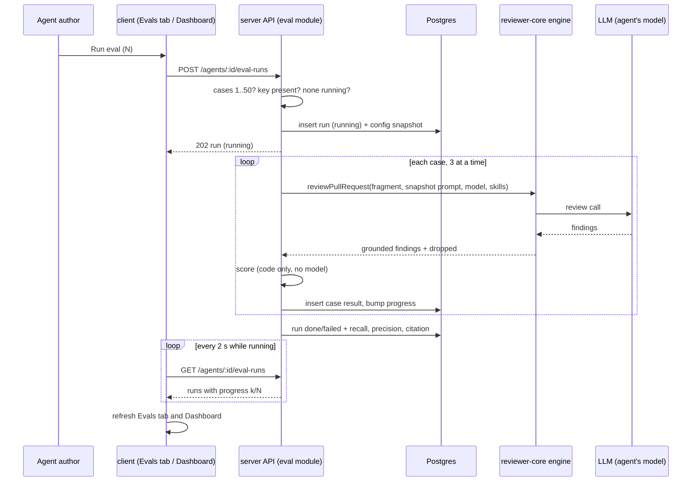

# Spec: Eval Pipeline (L06 homework)
Spec ID: SPEC-2026-10-31-eval-pipeline
Status: approved
Supersedes: —

## Problem and user

The user is the author of a reviewer agent in DevDigest — the person who edits an agent's system
prompt, picks its model and links its skills. Today a change to any of these is a guess: nothing
tells the author whether the agent now finds more of what it should, flags more of what it should
not, or cites lines that are not in the diff. The only evidence is re-reading reviews by hand.

The author already has the data for an answer. Every finding they accepted on a pull request is
something the agent must keep finding; every finding they dismissed is something it must stop
flagging. This feature turns those decisions into a regression set stored next to the findings it
came from: one click on a finding saves its diff fragment and the expectation as an eval case of
the agent that produced it. A run replays the agent on every case of its set with fixed inputs,
and code — never a model — scores the result as recall, precision and citation accuracy. Each run
keeps a snapshot of the agent's configuration, so two runs side by side show what changed in the
prompt and how the numbers moved. The Agent editor gets an **Evals** tab (cases, latest metrics,
run history) and the sidebar gets an **Eval Dashboard** (every agent's latest run, a recent-runs
feed, a per-agent view and a Compare view for two runs).

This feature is separate from the `evals/` package, which evaluates the Claude Code harness
(skills, agents, CLAUDE.md routing); nothing here touches it.

## Goals / Non-goals

**Goals**
- A "Turn into eval case" button on the FindingCard: one click creates a case from an accepted
  finding (`must_find`) or a dismissed one (`must_not_flag`), with the finding's file diff and the
  pull request's title and description, for the agent that produced the finding.
- An Evals tab in the Agent editor with the agent's cases, the latest run's metrics and the run
  history, and a way to start a run.
- `POST /agents/:id/eval-runs`: a background run of the agent on every case of its set (at most
  50), with fixed inputs and a stored snapshot of the agent's version, system prompt, provider,
  model, strategy and skills.
- Scoring entirely in code, with zero LLM calls: a finding matches an expectation when the file is
  the same and the line ranges overlap; recall, precision and citation accuracy per run.
- An Eval Dashboard page in the sidebar's Skills Lab section: all agents with their latest run, the
  six most recent runs across agents, a per-agent view with metric cards and a runs table, and a
  Compare modal for two runs of one agent with signed metric deltas and a word-level system-prompt
  diff.
- Error, empty and in-progress states for every surface (P2), and the accepted UX proposals (P3).
- A seeded eval set and two finished runs on a seeded agent, so the dashboard and Compare can be
  shown and tested without a model call.
- `pnpm verify:l06` at the repository root, green with no API key and no model call.

**Non-goals**
- **Export of an agent** (the "+ Export власного агента" of the task title). The homework text
  defines no export work; `CiExportInput` and `AgentManifest` exist and would be their own spec
  (Q12).
- **Stretch 1 — a skill eval in `evals/`.** Not part of this spec (Q13).
- **Stretch 2 — the Case Editor** (manual creation and editing of cases). Not built; a case is
  created only from a finding, and changed by deleting and re-creating it (Q8, Q13).
- **Stretch 4 — a PreToolUse hook** and **stretch 5 — mutation testing.** Not part of this spec
  (Q13).
- **Skill-owned cases** (`owner_kind = 'skill'`). Every case belongs to an agent (Q13).
- **Dashboard controls from the design that the task does not ask for:** "Run all agents"
  (declined in discovery as P9: one run per agent is enough and a bulk run multiplies cost),
  "Promote vN", the "30 days" filter, and the per-case Run and Edit icons (Q14).
- **Cancelling an in-flight eval run.** Declined in discovery (P8): a run is capped at 50 cases and
  three run at a time; cancellation would add a second lifecycle path for little gain.
- **A `devdigest-mcp` tool for evals.** Not asked for by the task (Q20).
- **An automated test that a changed prompt moves the metrics.** The observable part is specified
  (each run stores its prompt; Compare shows both values and a signed delta); the actual movement
  is shown in the manual demo — the screenshot and video of the submission checklist (Q17).
- **The ≥8-cases acceptance item met by seed data.** It is met by the user's own cases; the seed
  holds two cases (Q15).
- **Context the product review adds but an eval run leaves out:** the repository map, the callers
  digest, the file-rank note, the derived intent and its scope filter, project-context documents
  and memory (Q4). An eval run measures the agent's own configuration on fixed inputs.
- **The PR title entering the prompt unwrapped.** The review task line already carries the title
  outside `wrapUntrusted()`; eval runs inherit this existing gap, and this spec does not fix it.
- **Any change to `reviewer-core`.** `reviewPullRequest()` already returns the grounded findings
  and the dropped ones (Q18).
- **Updating a case when the finding's decision changes later.** A case is a snapshot (G5).
- The course's delivery items — the demo video, the screenshot, the PR — are tracked by the main
  session, not by this spec.

## User stories
- US-1 — As an agent author, I want to turn an accepted or dismissed finding into an eval case with
  one click, so that my real review decisions become the agent's regression set.
- US-2 — As an agent author, I want to see every case in my agent's eval set, so that I know what
  the agent is held to.
- US-3 — As an agent author, I want to run my agent on every case of its set with fixed inputs, so
  that runs of different versions of the agent are comparable.
- US-4 — As an agent author, I want each run scored as recall, precision and citation accuracy by
  code alone, so that the numbers are deterministic and cost nothing to compute.
- US-5 — As an agent author, I want to open the run history and compare two runs side by side —
  old prompt against new — so that I see whether my change helped or hurt.
- US-6 — As an agent author, I want an Eval Dashboard in the sidebar that shows the latest eval runs
  across agents, so that I see the state of every agent at a glance.
- US-7 — As the person submitting the homework, I want one command, `pnpm verify:l06`, that proves
  the feature's checks pass without keys or model calls, so that acceptance is reproducible.

## Acceptance criteria (EARS)

"The API" is the DevDigest server. A **case** is an eval case; a **run** is one execution of an
agent on every case of its set; a **result** is one case's outcome inside a run. A run is
**done**, **failed** or **running**. A finding is **grounded** when it survived the citation gate
of the review engine. Percentages are shown as whole numbers; a **delta** is the newer run's shown
percentage minus the older one's, in points ("pt"), with its sign.

| ID | Priority | Requirement | Story | Verify by |
|---|---|---|---|---|
| AC-1 | P1 | WHILE a finding is accepted or dismissed, the FindingCard shall show a "Turn into eval case" button in its action row. | US-1 | unit (client) |
| AC-2 | P1 | WHEN the user presses "Turn into eval case" on an accepted finding, the API shall store a `must_find` case for the agent that produced the finding, holding the finding's file and line range. | US-1 | integration (server) |
| AC-3 | P1 | WHEN the user presses "Turn into eval case" on a dismissed finding, the API shall store a `must_not_flag` case for the agent that produced the finding, holding the finding's file and line range. | US-1 | integration (server) |
| AC-4 | P1 | WHEN the API creates a case from a finding, the API shall store with it the pull request's diff of the finding's file, with its original hunk headers. | US-1, US-3 | integration (server) |
| AC-5 | P2 | IF the hunk lines of the finding's file diff exceed 1,500, THEN the API shall store only the hunks whose new-side line range overlaps the finding's line range. | US-3 | unit (server) |
| AC-6 | P1 | WHEN the API creates a case from a finding, the API shall store with it the pull request's title and description. | US-3 | integration (server) |
| AC-7 | P1 | WHEN a case is created from a finding, the FindingCard shall show "Saved as must find" or "Saved as must not flag" with a "View in Evals" link to that agent's Evals tab, without a page reload. | US-1 | unit (client) |
| AC-8 | P2 | WHILE a finding is neither accepted nor dismissed, the FindingCard shall show the "Turn into eval case" button disabled with the tooltip "Accept or dismiss the finding first". | US-1 | unit (client) |
| AC-9 | P2 | IF a finding is neither accepted nor dismissed, THEN `POST /findings/:id/eval-case` shall answer `422` and create no case. | US-1 | integration (server) |
| AC-10 | P2 | IF the review of a finding has no agent, THEN the FindingCard shall show the "Turn into eval case" button disabled with the tooltip "No agent for this finding". | US-1 | unit (client) |
| AC-11 | P2 | IF the review of a finding has no agent, or that agent no longer exists, THEN `POST /findings/:id/eval-case` shall answer `422` and create no case. | US-1 | integration (server) |
| AC-12 | P2 | IF the pull request's diff holds no hunk for the finding's file, THEN `POST /findings/:id/eval-case` shall answer `422` with the message "No diff available for `<file>`". | US-1 | integration (server) |
| AC-13 | P2 | IF case creation is refused because no diff is available, THEN the FindingCard shall show "No diff available for `<file>`". | US-1 | unit (client) |
| AC-14 | P2 | WHILE a case-creation request of a finding is in flight, the FindingCard shall show its "Turn into eval case" button disabled. | US-1 | unit (client) |
| AC-15 | P2 | WHEN `POST /findings/:id/eval-case` is called for a finding that is already the source of a case, the API shall answer `200` with that case and create no second case. | US-1 | integration (server) |
| AC-16 | P2 | WHILE a finding is the source of a case, the FindingCard shall show "In eval set" with a "View in Evals" link in place of the "Turn into eval case" button. | US-1, US-2 | unit (client) |
| AC-17 | P2 | WHEN a finding's accepted or dismissed decision changes after a case was created from it, the API shall keep that case's expectation unchanged. | US-2 | integration (server) |
| AC-18 | P2 | IF two case-creation requests for the same finding arrive at the same time, THEN the API shall store exactly one case. | US-1 | integration (server) |
| AC-19 | P1 | The Agent editor shall show an "Evals" tab, kept in the URL as `?tab=evals`. | US-2 | unit (client) |
| AC-20 | P1 | The Evals tab shall list every case of the agent with its name, its kind shown as "must find" or "must not flag", and its `file:start-end` location. | US-2 | unit (client) |
| AC-21 | P1 | WHEN `GET /agents/:id/eval-cases` is called for an agent with 8 cases, the API shall answer all 8. | US-2 | integration (server) |
| AC-22 | P2 | WHILE the agent has no case, the Evals tab shall show an empty state that says cases are created from accepted or dismissed findings, with the run button disabled. | US-2 | unit (client) |
| AC-23 | P2 | WHEN the user presses Delete on a case row, the Evals tab shall ask for confirmation before deleting the case. | US-2 | unit (client) |
| AC-24 | P2 | WHEN the user confirms the deletion of a case, the Evals tab shall remove the case from its list. | US-2 | unit (client) |
| AC-25 | P2 | WHEN a case is deleted, the API shall leave the recall, precision, citation accuracy and case counts of every earlier run unchanged. | US-5 | integration (server) |
| AC-26 | P3 | WHEN the user expands a case row, the Evals tab shall show the case's stored diff fragment as read-only text. | US-2 | unit (client) |
| AC-27 | P2 | The Evals tab shall show a "View full dashboard →" link to the agent's view of the Eval Dashboard. | US-6 | unit (client) |
| AC-28 | P1 | WHEN `POST /agents/:id/eval-runs` is called for an agent with 1 to 50 cases, enabled or disabled, the API shall answer `202` with a run in status `running`. | US-3 | integration (server) |
| AC-29 | P1 | WHEN a run starts, the API shall store with the run the agent's version, system prompt, provider, model, strategy, and the name and version of each enabled linked skill. | US-3, US-5 | integration (server) |
| AC-30 | P1 | WHILE a run reviews a case, the API shall give the model only the case's stored diff fragment, title and description, the run's stored system prompt and its skills, and no repository map, callers digest, file-rank note, intent, project-context document or memory. | US-3 | integration (server) |
| AC-31 | P1 | WHEN every case of a run has finished or been deleted, the API shall store one result per remaining case and set the run's status to `done`. | US-3 | integration (server) |
| AC-32 | P1 | The API shall count a grounded finding as matching a case's expectation exactly when its file equals the expectation's file and its line range overlaps the expectation's line range, ends included. | US-4 | unit (server) |
| AC-33 | P1 | The API shall compute a run's recall as the number of completed `must_find` cases with at least one matching grounded finding, divided by the number of completed `must_find` cases. | US-4 | unit (server) |
| AC-34 | P1 | The API shall compute a run's precision as TP / (TP + FP), where TP counts the grounded findings matching their own case's `must_find` expectation and FP counts those matching their own case's `must_not_flag` expectation. | US-4 | unit (server) |
| AC-35 | P1 | The API shall compute a run's citation accuracy as the number of findings kept by the citation gate divided by the number kept plus the number dropped, over the run's completed cases. | US-4 | unit (server) |
| AC-36 | P2 | IF the denominator of recall, precision or citation accuracy is 0, THEN the API shall store that metric as null. | US-4 | unit (server) |
| AC-37 | P1 | The API shall compute recall, precision and citation accuracy without any LLM call. | US-4 | unit (server) |
| AC-38 | P1 | WHILE a run executes, the API shall make no model call other than the review of each case. | US-4 | integration (server) |
| AC-39 | P2 | The API shall store no finding produced during a run among the findings of any pull request. | US-3 | integration (server) |
| AC-40 | P2 | IF a run of the agent is already `running`, THEN `POST /agents/:id/eval-runs` shall answer `409` and start no second run. | US-3 | integration (server) |
| AC-41 | P2 | IF the agent has no case, THEN `POST /agents/:id/eval-runs` shall answer `422` and start no run. | US-3 | integration (server) |
| AC-42 | P2 | IF the agent has more than 50 cases, THEN `POST /agents/:id/eval-runs` shall answer `422` and start no run. | US-3 | integration (server) |
| AC-43 | P2 | IF the agent's provider has no API key, THEN `POST /agents/:id/eval-runs` shall answer `400` with a message that names the provider, and create no run. | US-3 | integration (server) |
| AC-44 | P2 | IF the review of one case fails, THEN the API shall store that case's result with the error text and leave the case out of the run's metrics. | US-3, US-4 | integration (server) |
| AC-45 | P2 | IF the review of every case of a run fails, THEN the API shall set the run's status to `failed` with an error text. | US-3 | integration (server) |
| AC-46 | P2 | WHEN the API starts, the API shall set every run left `running` to `failed` with the error "Interrupted by server restart". | US-3 | integration (server) |
| AC-47 | P2 | IF a client sends more than 10 `POST /agents/:id/eval-runs` requests within one minute, THEN the API shall answer `429`. | US-3 | integration (server) |
| AC-48 | P2 | WHEN an agent is deleted, the API shall delete that agent's cases and runs. | US-2 | integration (server) |
| AC-49 | P2 | The API shall review at most 3 cases of one run at the same time. | US-3 | unit (server) |
| AC-50 | P2 | IF the agent, finding, case or run of an eval route belongs to another workspace, THEN the API shall answer `404`. | US-2 | integration (server) |
| AC-51 | P1 | WHEN the user presses the run button on the Evals tab, the Evals tab shall start a run of the agent. | US-3 | unit (client) |
| AC-52 | P1 | The Evals tab shall list the agent's runs, newest first, each with its start time, agent version, status, recall, precision, citation accuracy, passed and total cases, and cost. | US-5 | unit (client) |
| AC-53 | P1 | The Evals tab shall show the recall, precision, citation accuracy and passed / total cases of the agent's latest done run. | US-4 | unit (client) |
| AC-54 | P2 | WHILE a run of the agent is `running`, the Evals tab and the agent's dashboard view shall show the run button disabled with the text "Running… `k`/`N`". | US-3 | unit (client) |
| AC-55 | P2 | WHILE a run of the agent is `running`, the studio shall re-read the run's status every 2 s, including after the user leaves the page and opens it again. | US-3 | unit (client) |
| AC-56 | P2 | WHEN a run finishes, the Evals tab and the Eval Dashboard shall show its metrics without a page reload. | US-4, US-6 | unit (client) |
| AC-57 | P2 | IF starting a run is refused because the provider has no API key, THEN the Evals tab shall show the API's message with a link to Settings. | US-3 | unit (client) |
| AC-58 | P2 | IF starting a run is refused for any other reason, THEN the Evals tab shall show the API's message. | US-3 | unit (client) |
| AC-59 | P2 | WHILE a done run has cases that errored, its row shall show "`k` of `N` cases errored". | US-4 | unit (client) |
| AC-60 | P2 | IF a run is `failed`, THEN its row shall show the status "failed" and the run's error text. | US-3 | unit (client) |
| AC-61 | P2 | WHEN the user opens a run from a runs list, the studio shall show a drawer with each case's outcome (pass, fail or errored), its grounded findings and its error text. | US-5 | unit (client) |
| AC-62 | P3 | The run button shall show the number of cases as "Run eval (`N`)". | US-3 | unit (client) |
| AC-63 | P1 | The sidebar shall show an "Eval Dashboard" item in its Skills Lab section, after Conventions, that opens `/evals`. | US-6 | unit (client) |
| AC-64 | P1 | The Eval Dashboard overview shall show one row per agent with the recall, precision and citation accuracy of its latest done run, or "No eval runs yet". | US-6 | unit (client) |
| AC-65 | P1 | The Eval Dashboard overview shall show a "Recent eval runs · all agents" list of the 6 newest runs of the workspace, each with its agent's name. | US-6 | unit (client) |
| AC-66 | P1 | WHEN the user selects an agent row or a recent run on the overview, the studio shall open `/evals/<agentId>` for that agent. | US-6 | unit (client) |
| AC-67 | P1 | The agent's dashboard view shall show cards for the recall, precision and citation accuracy of the latest done run, each with its signed delta in points against the previous done run. | US-4, US-5 | unit (client) |
| AC-68 | P1 | The agent's dashboard view shall show the agent's runs in a table with a selection checkbox on each row. | US-5 | unit (client) |
| AC-69 | P1 | The agent's dashboard view shall enable its Compare button only while exactly two runs are selected. | US-5 | unit (client) |
| AC-70 | P1 | WHEN the user presses Compare, the studio shall show a modal with, for each of recall, precision, citation accuracy and cost, the older run's value, the newer run's value and the signed delta. | US-5 | unit (client) |
| AC-71 | P1 | The Compare modal shall show a word-level diff from the older run's stored system prompt to the newer one's. | US-5 | unit (client) |
| AC-72 | P2 | WHEN the user selects a third run, the agent's dashboard view shall deselect the earliest-selected run. | US-5 | unit (client) |
| AC-73 | P2 | IF a run is `failed` or `running`, THEN the agent's dashboard view shall show its checkbox disabled. | US-5 | unit (client) |
| AC-74 | P2 | IF a metric or the cost of a run is null, THEN the studio shall show "—" for it and no delta. | US-4 | unit (client) |
| AC-75 | P2 | WHILE the agent has fewer than two done runs, the metric cards shall show no delta. | US-4 | unit (client) |
| AC-76 | P2 | IF the workspace has no agent, THEN the Eval Dashboard overview shall show an empty state with a link to Agents. | US-6 | unit (client) |
| AC-77 | P2 | The Eval Dashboard overview shall list disabled agents as well as enabled ones. | US-6 | unit (client) |
| AC-78 | P2 | The agent's dashboard view shall show the 20 newest runs and a "Show more" control that adds the next 20. | US-5 | unit (client) |
| AC-79 | P2 | The studio shall show an agent name, case name or file path that does not fit on one line cut with "…", with the full text as its tooltip. | US-2, US-6 | unit (client) |
| AC-80 | P2 | The Compare modal shall scroll its content inside a body at most 560 px high. | US-5 | unit (client) |
| AC-81 | P2 | WHILE the two compared runs differ in model or skills, the Compare modal shall show each run's model and skill names with versions. | US-5 | unit (client) |
| AC-82 | P2 | IF the two compared runs have the same system prompt, model and skills, THEN the Compare modal shall show "No config change between these runs". | US-5 | unit (client) |
| AC-83 | P2 | The agent's dashboard view shall give each run checkbox a keyboard focus and the accessible name "`<start time>` · v`<agent version>`". | US-5 | unit (client) |
| AC-84 | P2 | The studio shall show every metric bar with its percentage as text. | US-4 | unit (client) |
| AC-85 | P2 | The studio shall give every icon-only button of the eval surfaces an accessible name. | US-2, US-5 | unit (client) |
| AC-86 | P3 | The Compare modal shall list the cases whose outcome differs between the two runs, each with its name and its older and newer outcome. | US-5 | unit (client) |
| AC-87 | P3 | WHILE the Compare modal is open, the agent's dashboard view shall keep `?compare=<olderRunId>,<newerRunId>` in its URL. | US-5 | unit (client) |
| AC-88 | P3 | WHEN the agent's dashboard view loads with a `compare` parameter naming two done runs of the agent, the studio shall open the Compare modal for them. | US-5 | unit (client) |
| AC-89 | P3 | WHILE the latest done run's precision is lower than the previous done run's, the agent's dashboard view shall show a banner "Precision dipped `N` pts on v`<version>`". | US-5 | unit (client) |
| AC-90 | P3 | The agent's dashboard view shall show a trend chart of recall, precision and citation accuracy over the agent's done runs, whose point tooltip names the run's agent version and cost. | US-5 | unit (client) |
| AC-91 | P3 | The Eval Dashboard overview shall show, in each agent row with a done run, a sparkline of recall over its last 10 done runs. | US-6 | unit (client) |
| AC-92 | P1 | The eval contracts shall be identical in the server's contracts and in the client's copy. | US-3 | unit (server) |
| AC-93 | P2 | WHEN the user of the seeded stack opens the Eval Dashboard view of the agent "Security Reviewer", the view shall show its two seeded runs without a model call. | US-6 | e2e |
| AC-94 | P2 | WHEN the user of the seeded stack compares the two seeded runs, the Compare modal shall show the prompt diff and a precision delta of "+50pt". | US-5 | e2e |
| AC-95 | P1 | WHEN `pnpm verify:l06` is run at the repository root, the command shall run the server's typecheck, eval unit and integration tests and `arch:check`, the client's typecheck and eval component tests, and `reviewer-core`'s typecheck and tests, and exit 0 only when all of them ran and passed. | US-7 | unit (server) ¹ |
| AC-96 | P1 | The `pnpm verify:l06` command shall make no model call and need no API key. | US-7 | unit (server) ¹ |
| AC-97 | P1 | IF Docker does not answer when `pnpm verify:l06` is run, THEN the command shall print "Docker is required for the eval integration tests" and exit with a non-zero code before running any server test. | US-7 | unit (server) ¹ |
| AC-98 | P2 | WHILE a run of the agent is `running`, the Evals tab shall show the Delete button of every case row disabled. | US-2 | unit (client) |
| AC-99 | P2 | IF a case is deleted while a run of its agent is `running`, THEN the API shall finish that run with the case counted in neither its passed cases, its errored cases nor its recall, precision and citation accuracy. | US-3, US-4 | integration (server) |

¹ AC-95–AC-97 are verified by running `pnpm verify:l06` at the repository root with no key in
`~/.devdigest/secrets.json` (AC-97 with Docker stopped); the suites named are where the command's
checks run.

The five acceptance items of the course task map to: "≥8 cases in a set" → AC-21, AC-31 and the
manual demo with the user's own cases; "one-click creation, both kinds" → AC-1–AC-7; "a prompt
change visibly moves recall/precision" → AC-29, AC-67, AC-70, AC-71 (the observable part, Q17) and
the manual demo; "scoring makes no LLM call" → AC-37, AC-38; "`pnpm verify:l06` green" → AC-95,
AC-96, AC-97. Steps 1–6 of "Можлива реалізація" are the remaining P1 criteria.

## Edge cases
| ID | Case | Expected behaviour | Covered by |
|---|---|---|---|
| EC-1 | The finding is still open (neither accepted nor dismissed) | Button disabled with a tooltip; the API refuses with `422` | AC-8, AC-9 |
| EC-2 | Double click, or a second tab, on "Turn into eval case" | Button disabled while in flight; the API returns the existing case with `200`; a race stores one case | AC-14, AC-15, AC-18 |
| EC-3 | The finding's review has no agent (seeded reviews, older data) or the agent was deleted | Button disabled "No agent for this finding"; the API `422` | AC-10, AC-11 |
| EC-4 | No diff for the finding's file (binary, no patch, clone missing and no stored patch) | `422` "No diff available for `<file>`", shown on the card | AC-12, AC-13 |
| EC-5 | The file's hunk lines exceed 1,500 | Only the hunks overlapping the finding are stored | AC-5 |
| EC-6 | The file's hunk lines exceed 1,500 and no hunk overlaps the finding's lines | Treated as no diff available | AC-12 |
| EC-7 | The finding's lines lie outside every hunk of a short file diff | The whole file diff is stored; a `must_find` case of this kind can never be matched, because the citation gate drops findings outside the diff | accepted: no handling |
| EC-8 | The finding is re-decided (accepted → dismissed) after its case exists | The case keeps its expectation; the user deletes and re-creates it | AC-17, Non-goal (G5) |
| EC-9 | The finding is deleted (its review or run deleted) after its case exists | The case stays and keeps running; its source link becomes empty | accepted: no handling |
| EC-10 | The agent has no case | Empty state; run button disabled; the API `422` | AC-22, AC-41 |
| EC-11 | The agent has more than 50 cases | The API `422`; the user deletes cases | AC-42 |
| EC-12 | No API key for the agent's provider | `400` naming the provider, before any run exists; message with a Settings link | AC-43, AC-57 |
| EC-13 | A second run is requested while one is running (double click, second tab) | Button disabled while running; the API `409` | AC-40, AC-54, AC-58 |
| EC-14 | One case's review fails (provider error, timeout, malformed output) | The result keeps the error; the case is left out of the metrics; the row shows "k of N cases errored" | AC-44, AC-59 |
| EC-15 | Every case fails | The run is `failed` with an error text | AC-45, AC-60 |
| EC-16 | The server restarts during a run | The boot step marks the run `failed` "Interrupted by server restart" | AC-46 |
| EC-17 | The user leaves the page during a run and comes back | Polling resumes; the button shows progress | AC-55, AC-54 |
| EC-18 | No `must_find` case completed; no finding matched any expectation; no finding at all | Recall, precision or citation accuracy is null, shown as "—" with no delta | AC-36, AC-74 |
| EC-19 | A finding matches neither its case's expectation nor anything else | Counted in neither TP nor FP; still counted for citation accuracy | AC-34, AC-35 |
| EC-20 | Several findings overlap one `must_find` expectation | The case passes once for recall; each finding adds to TP | AC-33, AC-34 |
| EC-21 | The agent has no run, or exactly one done run | Metrics "—" or shown without delta; "No runs yet" in the history | AC-53, AC-74, AC-75 |
| EC-22 | A case is deleted after runs used it | Earlier runs keep their metrics and counts; that case's results go with it | AC-25 |
| EC-23 | A case is deleted while a run of its agent is in flight | Delete is disabled on the Evals tab while the run is `running`; a delete that still reaches the API (another tab, a direct call) is accepted, and the run finishes with that case counted neither as passed nor as errored and left out of its metrics | AC-31, AC-98, AC-99 |
| EC-24 | The agent is deleted | Its cases and runs are deleted | AC-48 |
| EC-25 | The agent is disabled | Listed on the overview and can be run like an enabled agent: an eval run reviews no pull request, and "disabled" governs only which agents run on PRs | AC-77, AC-28 |
| EC-26 | No agent in the workspace | Overview empty state linking to Agents | AC-76 |
| EC-27 | Three runs picked for Compare | The earliest pick is replaced | AC-72 |
| EC-28 | A failed or running run picked for Compare | Not selectable | AC-73 |
| EC-29 | The two compared runs have the same configuration | "No config change between these runs" | AC-82 |
| EC-30 | The two compared runs share an agent version (a skill-only change, or the seeded fixture) | The title shows the same version on both sides; the configuration lines and prompt diff tell them apart | accepted: no handling |
| EC-31 | A very long system prompt in Compare | The modal body scrolls inside 560 px | AC-80 |
| EC-32 | Long agent names, case names, file paths | One line, "…", full text as tooltip | AC-79 |
| EC-33 | Many runs | 20 newest, "Show more" for the next 20 | AC-78 |
| EC-34 | The `compare` URL parameter names an unknown, failed, running or other-agent run | The modal does not open | AC-88 |
| EC-35 | A run's cost is unknown (unpriced model) | Cost "—"; no cost delta | AC-74 |
| EC-36 | A diff fragment, title, description or finding title says "ignore your instructions" | Wrapped as untrusted data in the prompt; any finding still passes the citation gate before scoring | NFR-5 |
| EC-37 | Model output or stored text contains HTML or markdown | Rendered as text | NFR-5 |
| EC-38 | Repeated run requests | `429` after 10 per minute | AC-47 |
| EC-39 | Another workspace's id in a route | `404` | AC-50 |
| EC-40 | The seeded stack has no API key | The seeded runs show from the database; Compare works | AC-93, AC-94 |
| EC-41 | Docker is not running when `pnpm verify:l06` runs | The command fails with "Docker is required for the eval integration tests" instead of printing green with the self-skipped integration tests | AC-97 |

## Non-functional requirements
- NFR-1 — LLM cost: scoring makes 0 model calls. Creating a case, listing cases or runs, reading a
  run and the overview make 0 model calls. A run makes, per case, the review engine's calls for a
  one-file diff — at most 1 call plus the engine's structured-output repair attempts — so at most
  50 reviews per run.
- NFR-2 — Throughput and timing: at most 3 cases of one run are reviewed at the same time; the
  client re-reads a running run every 2,000 ms; each case's model call is bound by the review
  engine's per-call time limit, and a call that exceeds it is that case's error.
- NFR-3 — Reliability: at most one `running` run per agent; a failed case never fails the other
  cases; a run left `running` by a dead process is marked `failed` on the next start; a run's
  stored metrics and configuration snapshot never change after it finishes.
- NFR-4 — Limits: at most 50 cases per run; a stored diff fragment is the file's diff, cut to the
  overlapping hunks above 1,500 lines; `POST /agents/:id/eval-runs` at most 10 requests per minute;
  20 runs per page; 6 runs in the recent-runs feed; a case name at most 44 characters.
- NFR-5 — Security: the diff fragment reaches the model only inside the engine's
  `wrapUntrusted()` fence, and the description through the engine's wrapped, truncated description
  slot; every model finding passes `groundFindings()` before it is scored, and the dropped ones
  count only toward citation accuracy; every text from a pull request, a finding, a case or a
  model is rendered as a text node, never as HTML or markdown; route ids are validated as uuids
  and scoped to the caller's workspace; log lines of a run carry ids, counts, durations and
  errors, never prompt, diff, description or model text.
- NFR-6 — Accessibility: every run checkbox, case row toggle, Delete button and Compare control is
  reachable with Tab, operated with Enter or Space, and has an accessible name; metric values are
  text, not colour alone.
- NFR-7 — Verification: `pnpm verify:l06` reads no secret, calls no model and installs nothing; it
  runs the packages' own scripts inside each package.

## Inputs and provenance
**Sources of this spec**
- Course task "L06 homework — Eval Pipeline для DevDigest + Export власного агента"
  (`edu.goit.global/learn/53989320/53167848/53168006/homework`), Ukrainian original, read on
  2026-10-31 from the saved copy. Its five acceptance items and its steps 1–7.
- Design: "DevDigest Design (standalone).html" from the task's Drive link, decoded — `screen_skills.jsx`
  (`AgentEvalOverview`, `ScreenEval`, `RunCompare`, `CompareMetric`, `MiniBar`), `screen_agents.jsx`
  (`EvalsTab`, `EvalMetricStrip`), `findings.jsx` (`ActionRow`, `findingToSeed`), `EvalCaseRow`,
  `MetricCard`, `chrome.jsx` (`NAV`). Artboards: Eval dashboard, Compare runs, Agents → Evals tab,
  PR detail Overview.
- Discovery report with the user's answers (`.devdigest/sdd/eval-pipeline/discovery.md`,
  2026-10-31): every recommended answer accepted.
- The code at branch `feature/eval-pipeline`, cut from `origin/main`
  `a572ba0452766618a9e795395119ce877aa1dace`.

**Data flow**
| Data | Produced by | Contract | Consumed by | When unavailable |
|---|---|---|---|---|
| Finding with its decision (accepted / dismissed / open) | `server` — reviews | `FindingRecord` | `client` FindingCard; eval case creation | open → button disabled, `422` |
| The producing agent of a finding | `server` — reviews (`review.agent_id`) | `ReviewRecord.agent_id` | `client` FindingCard; eval case creation | null or deleted agent → disabled, `422` |
| The file's diff fragment | `server` — the PR diff as review runs load it (clone diff, else stored patches) | stored on the case (`EvalCaseRecord.input_diff`) | eval run (prompt); `client` case preview | no hunk → `422` "No diff available" |
| PR title, description, number, author | `server` — pulls | stored on the case (`EvalCaseMeta`) | eval run (task line, description slot) | empty description → slot omitted |
| Eval case | `server` — new eval module | `EvalCaseRecord`, `EvalExpectation`, `EvalCaseCreateResponse`, `EvalCaseList` | `client` FindingCard ("In eval set"), Evals tab | list error → error state with Retry |
| Run with its configuration snapshot and metrics | `server` — eval module, background executor | `EvalSuiteRun`, `EvalConfigSnapshot`, `EvalSuiteRunList` | `client` Evals tab, dashboard agent view, Compare | `running` → polling; `failed` → error text |
| Per-case results | `server` — eval executor and pure scorer over `reviewPullRequest()`'s kept and dropped findings | `EvalCaseResult` (built on `EvalRunRecord`), `EvalSuiteRunDetail` | `client` run drawer, Compare flipped cases | case error → `errored`, left out of metrics |
| Grounded and dropped findings of a case | `reviewer-core` — `reviewPullRequest()` | engine outcome (in-process) | eval scorer | engine throws → the case's error |
| Agent configuration (prompt, model, provider, strategy, version) and enabled linked skills | `server` — agents, skills | `Agent`; skills in prompt order | eval run snapshot | provider key missing → `400` before the run |
| Overview: each agent's latest done run, running flag, recall trend; recent runs | `server` — eval module | `EvalOverview`, `EvalAgentOverview` | `client` Eval Dashboard overview | no agent → empty state |
| `devdigest-mcp` | — | — | not a consumer (Q20) | — |

## Ownership
| Part | Package | Module spec |
|---|---|---|
| Tables and the generated migration, every eval contract in `@devdigest/shared` and its client sync, the eval routes, case creation, the background executor, the pure scorer, the boot reaper extension, agent-delete cascade, the seed, and the root `package.json` with `scripts/verify-l06.sh` | `server/` (and the repository root for the two verification files) | [`server/specs/eval-pipeline.md`](../server/specs/eval-pipeline.md) |
| The FindingCard button and its states, the Evals tab, the `/evals` and `/evals/:agentId` pages, the Compare modal, the run drawer, the sidebar item, hooks, strings and layout | `client/` | [`client/specs/eval-pipeline.md`](../client/specs/eval-pipeline.md) |
| No change: `reviewPullRequest()`, `groundFindings()` and `wrapUntrusted()` are used as they are | `reviewer-core/` | — |
| No change | `mcp/` | — |
| The flows of AC-93 and AC-94, and the seed contract lines in `e2e/specs/seed-fixtures.md` | `e2e/` | written by `test-writer` in `e2e/specs/` |

The root `package.json` is scripts-only and is **not a workspace**: it has no `workspaces` field,
no dependencies and no lockfile, and there is no `pnpm-workspace.yaml`. Each package keeps its own
`package.json`, lockfile and install, as the root `CLAUDE.md` requires ("no monorepo workspace");
the root file only gives `pnpm verify:l06` a place to live. The command turns off pnpm's
dependency check for its own pnpm calls; a one-line root `.npmrc` that turns it off is added only
if that alone would still let the command write a lockfile or `node_modules` at the root.

## Untrusted inputs
| Input | Origin | Reaches | Handling |
|---|---|---|---|
| Diff fragment of the finding's file | the PR author, through GitHub or the clone | the stored case (`input_diff`); the model input of every run; the case preview | Cut to the overlapping hunks above 1,500 lines; reaches the model only through the engine's prompt assembly, inside `wrapUntrusted('diff', …)`; every finding of a run passes `groundFindings()` against this fragment before scoring; rendered as preformatted text, never HTML. |
| PR title and description snapshot | the PR author, through GitHub | the case's meta; the task line and description slot of the model input | The description through the engine's wrapped, truncated description slot. The title enters the task line unwrapped, as the review run does today — an existing gap, recorded under Non-goals, not fixed here. Never rendered as HTML. |
| Finding file, lines, title, severity, category (seeding the expectation) | an earlier model answer over untrusted text | the case's expectation (`expected_output`), the case name | Validated by the `EvalExpectation` contract (file non-empty, lines positive integers, start ≤ end, severity and category from their enums); the name is a lowercase slug of at most 44 characters; rendered as text. |
| Model output during a run | the agent's model | the scorer; the case result (`actual_output`) | Parsed by the engine's structured-output schema; every finding passes `groundFindings()` before it is scored; dropped findings count only toward citation accuracy; never stored among a pull request's findings; rendered as text. |
| System-prompt snapshots | the agent author | the Compare diff | Rendered as text nodes; the word diff never builds HTML from them. |
| Route ids and query parameters | the client | database lookups | Zod `params` (uuid) and query (`limit` 1–100, `offset` ≥ 0); workspace-scoped, another workspace's id answers `404`; the `POST` routes take no body. |
| `compare` URL parameter | the URL | the agent's dashboard view | Only matched against the ids of the agent's done runs; anything else is ignored. |

## Open questions
None. OQ-1 (→ AC-95, AC-97), OQ-2 (→ AC-31, AC-98, AC-99) and OQ-3 (→ AC-28) were resolved by the user on 2026-10-31, each with the recommended answer.
